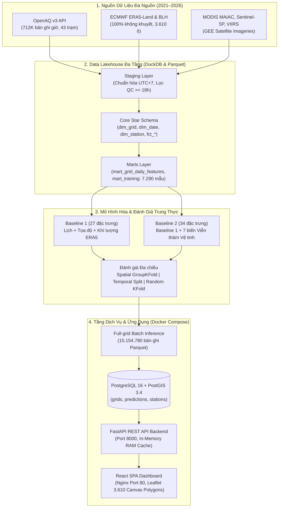

<div align="center">

# 🌫️ HANOI_PM25
### Hệ Thống Ước Tính Hồi Cứu & Trực Quan Hóa Bụi Mịn $\text{PM}_{2.5}$ Lưới 1 km tại Hà Nội (2021–2026)
**A Production-grade Spatial Data Science & Full-stack GIS Lakehouse System**

[](https://github.com/NguyenThinh06/hanoi_pm25/releases)
[](https://www.python.org/)
[](archive/DEPLOYMENT.md)
[](archive/BACKEND.md)
[](docs/schema.md)
[](frontend/README.md)
[](LICENSE)

[🎯 Định Hướng Nghiệp Vụ](docs/business_case.md) • [🗄️ Cấu Trúc Dữ Liệu](docs/schema.md) • [🚀 Triển Khai Docker](archive/DEPLOYMENT.md) • [📚 Thư Viện Tài Liệu](docs/README.md) • [📄 Báo Cáo Kỹ Thuật](archive/report.md) • [📝 Changelog](CHANGELOG.md)

</div>

---

## 📖 Mục Lục

- [🌟 Điểm Nổi Bật Của Hệ Thống](#-điểm-nổi-bật-của-hệ-thống)
- [⚡ Khởi Động Nhanh 1-Chạm (Quick Start)](#-khởi-động-nhanh-1-chạm-quick-start)
- [🗺️ Bài Toán Nghiệp Vụ & Ranh Giới Khoa Học](#️-bài-toán-nghiệp-vụ--ranh-giới-khoa-học)
- [🏗️ Kiến Trúc Hệ Thống (Architecture)](#️-kiến-trúc-hệ-thống-architecture)
- [🔬 Mô Hình Học Máy & Kết Quả Thực Nghiệm](#-mô-hình-học-máy--kết-quả-thực-nghiệm)
- [🌐 Giao Diện Bản Đồ & Trực Quan Hóa](#-giao-diện-bản-đồ--trực-quan-hóa)
- [📁 Cấu Trúc Thư Mục Chuẩn](#-cấu-trúc-thư-mục-chuẩn)
- [📚 Hệ Thống Tài Liệu Kèm Theo](#-hệ-thống-tài-liệu-kèm-theo)
- [🛠️ Công Nghệ Sử Dụng (Tech Stack)](#️-công-nghệ-sử-dụng-tech-stack)

---

## 🌟 Điểm Nổi Bật Của Hệ Thống

- **🛰️ Dữ Liệu Đa Nguồn Toàn Diện:** Tích hợp 3 tầng dữ liệu độc lập: **712.870** bản ghi giờ từ trạm mặt đất (OpenAQ v3), dữ liệu khí tượng tái phân tích ECMWF ERA5 phủ kín $100\%$ không-thời gian, và dữ liệu viễn thám vệ tinh (MODIS MAIAC AOD, Sentinel-5P, Suomi-NPP VIIRS) qua Google Earth Engine.
- **🗺️ Độ Phủ Không Gian Rộng Lớn:** Chia toàn bộ thành phố Hà Nội ($\approx 3.359\text{ km}^2$) thành **3.610 ô lưới $1\text{ km} \times 1\text{ km}$** chuẩn tọa độ `EPSG:3405` / `EPSG:4326`, giải quyết khoảng trống dữ liệu tại $99,17\%$ diện tích không có trạm quan trắc mặt đất.
- **📈 15.15 Triệu Bản Ghi Ước Tính:** Đã sinh trọn vẹn 15.154.780 bản ghi ước tính nồng độ bụi $\text{PM}_{2.5}$ trung bình ngày trong suốt **2.099 ngày** (01/01/2021 – 30/09/2026) cho 2 mô hình cơ sở.
- **🔬 Phương Pháp Luận Khoa Học Đánh Giá Trung Thực:** Áp dụng **`Spatial GroupKFold`** cô lập ô trạm kiểm thử nhằm ngăn chặn hiện tượng rò rỉ dữ liệu không gian (*Spatial Data Leakage*), phản ánh đúng năng lực ngoại suy sang nơi không có trạm.
- **⚡ Triển Khai 1-Chạm (One-Touch Startup):** Khởi động toàn bộ cụm 4 dịch vụ (Database PostGIS, Importer, FastAPI Backend, React Frontend) chỉ bằng **1 lệnh duy nhất** (`.\run.ps1` hoặc `docker compose up -d`).
- **🎯 Đối Soát 3 Điểm Chuẩn Xác:** Kèm script tự động đối soát giá trị nồng độ từ file gốc `Parquet` $\rightarrow$ `PostgreSQL` $\rightarrow$ `REST API`, đảm bảo tính toàn vẹn dữ liệu với sai lệch bằng $0$ tuyệt đối.

---

## ⚡ Khởi Động Nhanh 1-Chạm (Quick Start)

Hệ thống được đóng gói hoàn chỉnh bằng Docker Compose, sẵn sàng chạy ngay trên Windows, Linux và macOS:

### 1. Yêu cầu tiên quyết
- Đã cài đặt [Docker Desktop](https://www.docker.com/products/docker-desktop/) và đã bật ứng dụng.
- Đã cài đặt Git.

### 2. Chạy 1-chạm (Khuyến nghị 👍)
```powershell
# Bước 1: Clone kho mã nguồn
git clone https://github.com/NguyenThinh06/hanoi_pm25.git
cd hanoi_pm25

# Bước 2: Chạy script 1-chạm (Windows)
#   Lần chạy đầu, script tự tải gói dữ liệu (~86MB) từ GitHub Release v1.0.0,
#   kiểm tra SHA256 và giải nén — không cần tải thủ công.
.\run.ps1

# (Nếu dùng Linux / macOS / WSL)
chmod +x run.sh && ./run.sh
```

*Script sẽ tự động tạo file `.env`, khởi động cụm container Docker, nạp dữ liệu mẫu và **tự động mở trình duyệt web** tại `http://localhost`.*

### 3. Các cổng truy cập dịch vụ:

| Dịch vụ | Đường dẫn truy cập | Mô tả chức năng |
| :--- | :--- | :--- |
| **🌐 Web Dashboard** | **[http://localhost](http://localhost)** | Xem bản đồ nhiệt 3.610 ô lưới, đổi ngày/model, xem biểu đồ trạm |
| **📚 Tài liệu API Swagger** | **[http://localhost:8000/docs](http://localhost:8000/docs)** | Trực tiếp kiểm thử 6 REST API endpoints của FastAPI |
| **💚 Kiểm tra sức khỏe** | **[http://localhost/health](http://localhost/health)** | Kiểm tra kết nối cơ sở dữ liệu PostGIS và trạng thái API |

---

## 🗺️ Bài Toán Nghiệp Vụ & Ranh Giới Khoa Học

> 📌 Xem chi tiết tại [docs/business_case.md](docs/business_case.md)

### Vấn đề thực tế
Hà Nội có diện tích lớn nhưng chỉ có **32 trạm đo đạt chuẩn QC** phân bố trên **30 ô lưới**, tập trung ở khu vực nội thành. Hơn **3.580 ô lưới ($\approx 99,17\%$)** ở ngoại thành, vùng đệm sinh thái và khu công nghiệp hoàn toàn không có dữ liệu quan trắc thường xuyên.

```
[Mạng lưới quan trắc mặt đất]        32 trạm / 30 ô lưới (0.83% diện tích)
[Khoảng trống không gian]           3.580 ô lưới không có trạm (99.17% diện tích)
```

### Ranh giới khoa học minh bạch (3 Không)
1. ❌ **Không phải dự báo tương lai (No Forecasting):** Đây là mô hình **ước tính hồi cứu** (retrospective estimation) cho từng ngày trong quá khứ dựa trên dữ liệu khí quyển đã ghi nhận; không dự báo nồng độ ngày mai.
2. ❌ **Không suy diễn nguyên nhân ô nhiễm:** Đồ án không có dữ liệu kiểm kê nguồn thải (emission inventory), không quy trách nhiệm phát thải cho bất kỳ ngành nghề hay khu vực cụ thể nào.
3. ❌ **Không phải chẩn đoán y tế:** Kết quả nhằm phục vụ nghiên cứu khoa học dữ liệu và trực quan hóa không gian, không đưa ra khuyến cáo bệnh lý cá nhân.

---

## 🏗️ Kiến Trúc Hệ Thống (Architecture)

Hệ thống được thiết kế theo mô hình **End-to-End Data Lakehouse & Serving Platform**:



---

## 🔬 Mô Hình Học Máy & Kết Quả Thực Nghiệm

> 📌 Xem báo cáo đầy đủ tại [archive/report.md](archive/report.md) và [archive/model_report.md](archive/model_report.md)

### 1. Hai mô hình cơ sở:
- **Baseline 1 (`XGBoost: Lịch + Tọa độ + Khí tượng` - 27 biến):** Dựa trên tọa độ không gian `EPSG:3405`, ngày trong năm, chu kỳ mùa và các biến khí tượng ERA5 (nhiệt độ, ẩm, mưa, gió, độ cao lớp biên BLH).
- **Baseline 2 (`XGBoost: Lịch + Tọa độ + Khí tượng + Vệ tinh` - 34 biến):** Bổ sung 7 biến viễn thám: Độ dày quang học sol khí AOD $0,47\ \mu\text{m}$ (MODIS), nồng độ cột đối lưu $\text{NO}_2, \text{CO}, \text{O}_3, \text{SO}_2$ (Sentinel-5P) và bức xạ ánh sáng ban đêm (VIIRS).

### 2. Kết quả kiểm nghiệm thực tế đã xác minh:

| Phương pháp đánh giá | Mô hình | MAE ($\mu\text{g/m}^3$) | RMSE ($\mu\text{g/m}^3$) | $R^2$ | Ý nghĩa khoa học |
| :--- | :--- | :---: | :---: | :---: | :--- |
| **Spatial GroupKFold** *(Chính - 5 Fold)* | Baseline 1 (Khí tượng) | 11,60 | 16,79 | 0,5452 | Chuẩn mực đánh giá ngoại suy sang ô không có trạm. |
| | **Baseline 2 (Khí tượng + Vệ tinh)** | **11,05** | **15,95** | **0,5894** | **Vệ tinh giúp giảm $4,7\%$ MAE, tăng $4,42\%$ $R^2$; thắng ở 4/5 fold.** |
| **Temporal Split** *(Bổ sung năm 2026)* | Baseline 1 | 11,14 | 16,14 | 0,5284 | Train 2021–2025 (6.280 mẫu), Test 2026 (1.010 mẫu). |
| | **Baseline 2** | **11,08** | **16,00** | **0,5367** | Thắng vượt trội khi có AOD ($17,16$ vs $19,53\ \mu\text{g/m}^3$). |
| **Random KFold** *(Tham chiếu dòng)* | Baseline 1 / Baseline 2 | 6,62 / 6,77 | 10,37 / 10,65 | 0,838 / 0,829 | Bị rò rỉ không gian; điểm số ảo không phản ánh năng lực ngoại suy. |

---

## 🌐 Giao Diện Bản Đồ & Trực Quan Hóa

Dashboard được xây dựng chuyên biệt để xử lý dữ liệu không gian lớn mà không gây quá tải trình duyệt:

- **Leaflet HTML5 Canvas:** Render mượt mà **3.610 polygon ô lưới** trong một khung hình duy nhất, cho phép lia chuột, zoom và chọn ô với tốc độ 60 FPS.
- **Bộ lọc động:** Lựa chọn linh hoạt ngày bất kỳ trong giai đoạn 2021–2026, chuyển đổi trực tiếp giữa Baseline 1 và Baseline 2 để so sánh độ chênh lệch nồng độ.
- **Lớp trạm quan trắc mặt đất:** Đánh dấu vị trí các trạm quan trắc thực tế, hiển thị số đo thực tế và cờ kiểm soát chất lượng (QC) để đối chiếu trực tiếp với ước tính của mô hình.
- **Biểu đồ chuỗi thời gian:** Click vào bất kỳ ô lưới nào trên bản đồ để xem biểu đồ biến thiên nồng độ trong suốt một năm.

---

## 📁 Cấu Trúc Thư Mục Chuẩn

```text
pm25_hanoi/
├── archive/                # Lưu trữ các bản thảo nháp cũ và script trung gian
├── data/
│   ├── reference/          # Ranh giới hành chính chuẩn Hà Nội (hanoi_boundary.geojson)
│   ├── raw/                # Dữ liệu gốc tải về từ OpenAQ v3 & Google Earth Engine
│   ├── staging/            # Dữ liệu đã chuẩn hóa múi giờ UTC+7 và gắn cờ QC
│   ├── core/               # Bảng chiều (dim_grid, dim_date, dim_station) & sự kiện (fct_*)
│   └── marts/              # Mart đặc trưng 3.610 ô & mart huấn luyện trạm (7.290 mẫu)
├── db/
│   └── migrations/         # DDL SQL tự động khởi tạo bảng không gian trong PostgreSQL/PostGIS
├── docs/                   # Thư viện tài liệu cốt lõi (Xem docs/README.md)
│   ├── business_case.md    # 📄 Định vị bài toán, 4 câu hỏi nghiên cứu & ranh giới khoa học
│   ├── schema.md           # 🗄️ Đặc tả chi tiết lược đồ bảng dữ liệu Lakehouse & Marts
│   └── README.md           # 📖 Hướng dẫn & Chỉ mục tài liệu cốt lõi
├── frontend/               # Mã nguồn React SPA Dashboard (Vite, Leaflet Canvas, Tailwind)
├── outputs/
│   ├── evaluation/         # Metrics JSON và parquet kết quả của 3 phương pháp đánh giá
│   ├── models/             # Model XGBoost JSON đã lưu và metadata của Baseline 1 & 2
│   └── registry/           # Sổ đăng ký thực nghiệm & metadata model cục bộ (JSON)
├── scripts/                # Bộ công cụ vận hành: import, verify_reconciliation, backup_restore
├── src/                    # Mã nguồn cốt lõi: ingest, pipeline, models, api
├── tests/                  # Bộ kiểm thử tự động pytest (unit & integration tests)
├── CHANGELOG.md            # 📜 Lịch sử các phiên bản & tính năng (Keep a Changelog)
├── docker-compose.yml      # Cấu hình cụm 4 dịch vụ Docker
├── run.ps1 / run.sh        # Script khởi động 1-chạm tự động
├── requirements.txt        # Danh sách thư viện Python
├── pyproject.toml          # Cấu hình project, linting (Ruff) và pytest
└── run.py                  # CLI điều phối duy nhất của dự án
```

---

## 📚 Hệ Thống Tài Liệu Kèm Theo

Dự án cung cấp bộ tài liệu được tinh gọn tập trung vào hai trụ cột chính tại [docs/README.md](docs/README.md):

1. **Tài liệu cốt lõi:**
   - [docs/business_case.md](docs/business_case.md): Định vị nghiệp vụ, làm rõ khoảng trống không gian 30 vs 3.580 ô lưới, ranh giới khoa học minh bạch và 4 câu hỏi nghiên cứu thực nghiệm.
   - [docs/schema.md](docs/schema.md): Đặc tả Data Lakehouse, Star Schema (`dim_*`, `fct_*`) và các Data Mart huấn luyện/dự đoán.
2. **Kho lưu trữ tài liệu kỹ thuật chi tiết ([archive/](archive/README.md)):**
   - [archive/HANDOVER.md](archive/HANDOVER.md): Đặc tả 6 REST API endpoints và hợp đồng dữ liệu giao diện.
   - [archive/DEPLOYMENT.md](archive/DEPLOYMENT.md): Sổ tay triển khai Docker Compose chi tiết, đối soát 3 điểm và sao lưu DB.
   - [archive/BACKEND.md](archive/BACKEND.md): Tài liệu kỹ thuật FastAPI backend, kiến trúc RAM caching và kiểm thử.
   - [archive/report.md](archive/report.md): Báo cáo Khoa học Dữ liệu 12 phần đầy đủ theo chu trình chuẩn.
   - [archive/model_report.md](archive/model_report.md): Báo cáo phân tích thực nghiệm chuyên sâu 3 phương pháp kiểm thử chéo.

---

## 🛠️ Công Nghệ Sử Dụng (Tech Stack)

<div align="center">

| Tầng chức năng | Công nghệ / Thư viện chính |
| :--- | :--- |
| **Thu thập & Viễn thám** | `Google Earth Engine (GEE API)`, `OpenAQ v3 REST API`, `Requests` |
| **Xử lý Không gian & Lakehouse** | `DuckDB`, `GeoPandas`, `PyArrow`, `Shapely`, `PyProj (EPSG:3405 / 4326)` |
| **Khoa học Dữ liệu & Học máy** | `XGBoost`, `Scikit-Learn`, `NumPy`, `Pandas`, `SciPy` |
| **Cơ sở dữ liệu Không gian** | `PostgreSQL 16`, `PostGIS 3.4`, `Psycopg 3 (Connection Pool)` |
| **Backend REST API** | `FastAPI`, `Uvicorn`, `Pydantic v2`, `In-Memory Caching` |
| **Frontend Dashboard** | `React 18`, `Vite`, `Leaflet (HTML5 Canvas)`, `Tailwind CSS` |
| **Đóng gói & Vận hành** | `Docker`, `Docker Compose`, `Nginx Reverse Proxy`, `PowerShell`, `Bash` |
| **Chất lượng Mã nguồn & CI/CD** | `Pytest`, `Ruff (Linter & Formatter)`, `GitHub Actions CI` |

</div>

---

## 👤 Bản Quyền (License)

- **Đề tài:** Xây dựng hệ thống ước tính hồi cứu và trực quan hóa nồng độ bụi mịn $\text{PM}_{2.5}$ lưới 1 km tại Hà Nội (2021–2026).
- **Phiên bản:** Release v1.0.0
- **Giấy phép:** Mã nguồn và tài liệu được phát hành theo giấy phép [MIT License](LICENSE).

---

<div align="center">
<b>HANOI_PM25 Project — Personal Data Science & Engineering Portfolio</b>
<br>
<i>Xây dựng với tinh thần Khoa học Dữ liệu Thực chiến, Trung thực và Minh bạch.</i>
</div>
