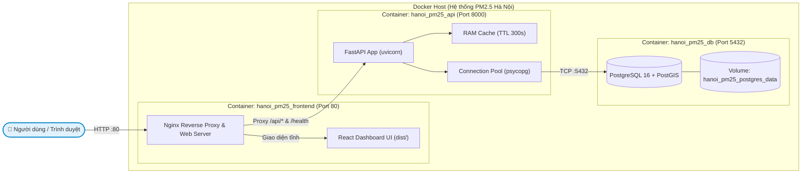

# Hướng dẫn Triển khai & Vận hành Hệ thống PM2.5 Hà Nội (Gói 4)

> Tài liệu hướng dẫn tích hợp, khởi động 1-chạm, kiểm thử end-to-end, đối soát 3 điểm và sao lưu phục hồi toàn bộ hệ thống phục vụ người dùng cuối.

---

## 1. Kiến trúc Hệ thống Tích hợp (Architecture)

Hệ thống được đóng gói hoàn chỉnh bằng **Docker Compose** với 3 dịch vụ chính chạy trên mạng nội bộ cách ly `hanoi_pm25_net`:



### Các dịch vụ trong Docker Compose:

| Dịch vụ | Tên Container | Image / Build | Cổng ngoài | Vai trò |
|---|---|---|---|---|
| **`db`** | `hanoi_pm25_db` | `postgis/postgis:16-3.4` | `5432` | Lưu trữ không gian ô lưới, trạm quan trắc và 15,15 triệu dòng prediction. |
| **`api`** | `hanoi_pm25_api` | Build từ `./Dockerfile` (Python 3.12-slim) | `8000` | Backend FastAPI, phục vụ 7 endpoint REST chuẩn Hợp đồng v1. |
| **`frontend`** | `hanoi_pm25_frontend` | Build từ `./frontend/Dockerfile` (Nginx Alpine) | `80` | Nginx phục vụ web tĩnh React và reverse proxy chuyển tiếp `/api` sang backend. |

---

## 2. Khởi động 1-Chạm (One-Command Startup)

### Bước 1: Chuẩn bị biến môi trường
Sao chép file mẫu `.env.example` thành `.env` (tùy chỉnh mật khẩu nếu cần):

```powershell
cp .env.example .env
```

### Bước 2: Khởi động toàn bộ cụm dịch vụ
Khởi chạy cả 3 dịch vụ ở chế độ chạy ngầm (`-d`):

```powershell
docker compose up -d --build
```

Docker Compose sẽ tự động:
1. Chờ container cơ sở dữ liệu `db` đạt trạng thái `healthy` (`pg_isready`).
2. Khởi động container `api`, kiểm tra sức khỏe tại endpoint `/health`.
3. Khởi động container `frontend` và sẵn sàng đón nhận lưu lượng truy cập.

### Bước 3: Truy cập ứng dụng
* **Giao diện Dashboard người dùng:** 👉 [http://localhost](http://localhost) (cổng 80)
* **Tài liệu API Swagger UI:** 👉 [http://localhost:8000/docs](http://localhost:8000/docs)
* **Kiểm tra trạng thái hệ thống:** 👉 [http://localhost/health](http://localhost/health)

---

## 3. Quy trình Nạp dữ liệu vào Database (Data Ingestion)

Sau khi cơ sở dữ liệu khởi động lần đầu, chạy script import dữ liệu bàn giao:

### Cách 1: Nạp thử nghiệm nhanh (Smoke Test 1 tháng — Khuyến nghị)
Nạp dữ liệu không gian, trạm quan trắc và partition tháng `2024-01` của cả 2 model (~220.000 dòng):

```powershell
python scripts/import.py --bundle-dir outputs/handover_staging --smoke-month 2024-01
```

### Cách 2: Nạp toàn bộ dữ liệu lịch sử 5 năm
Nạp toàn bộ 15.154.780 bản ghi prediction qua 69 partition tháng:

```powershell
python scripts/import.py --bundle-dir outputs/handover_staging
```

> [!NOTE]
> Script `import.py` có tính chất **idempotent** (chạy lại nhiều lần không sinh bản ghi trùng lặp nhờ cơ chế `ON CONFLICT DO NOTHING` trên khóa tự nhiên `(grid_id, date, model_id)`).

---

## 4. Biên bản & Kịch bản Đối soát 3 Điểm Bắt buộc

Theo quy định tại **Mục 6.2 của `docs/HANDOVER.md`**, trước khi nghiệm thu phải chọn ngẫu nhiên 3 cặp ô - ngày và so sánh khớp số liệu tuyệt đối qua chuỗi luân chuyển:

$$\text{File Parquet nguồn} \longrightarrow \text{Database PostgreSQL} \longrightarrow \text{FastAPI Response} \longrightarrow \text{Giao diện React UI}$$

### Chạy kiểm tra tự động:
```powershell
python scripts/verify_reconciliation.py --api-url http://localhost
```

### Kết quả mẫu đạt tiêu chuẩn nghiệm thu:
```text
===================================================================================================
STT  | Mã ô                  | Ngày       | Model      | Parquet    | Postgres   | API        | Kết quả
---------------------------------------------------------------------------------------------------
1    | grid_584000_2324000    | 2024-01-15 | baseline2  | 35.7200    | 35.7200    | 35.7200    | KHỚP 100% (ĐẠT)
2    | grid_585000_2324000    | 2024-01-15 | baseline1  | 29.4100    | 29.4100    | 29.4100    | KHỚP 100% (ĐẠT)
3    | grid_574000_2322000    | 2024-01-20 | baseline2  | 42.1500    | 42.1500    | 42.1500    | KHỚP 100% (ĐẠT)
===================================================================================================

>>> KẾT QUẢ: ĐỐI SOÁT 3 ĐIỂM ĐẠT CHUẨN NGHIỆM THU! (Sai lệch tuyệt đối = 0.000000 µg/m³)
```

*Trên giao diện React Dashboard, khi click vào ô `grid_584000_2324000`, phần **"Giá trị API"** hiển thị chính xác số thực `35.72`, trùng khớp hoàn toàn với số liệu từ Parquet và Database.*

---

## 5. Quy trình Sao lưu & Phục hồi Cơ sở Dữ liệu

Kịch bản sao lưu và phục hồi được tự động hóa hoàn toàn thông qua container Docker:

### 5.1. Sao lưu (Backup - `pg_dump` định dạng nén `-Fc`)
* **Trên Windows PowerShell:**
  ```powershell
  .\scripts\backup_restore.ps1 -Action backup -BackupFile "backups/hanoi_pm25_latest.dump"
  ```
* **Trên Linux / macOS / Bash:**
  ```bash
  ./scripts/backup_restore.sh backup backups/hanoi_pm25_latest.dump
  ```

### 5.2. Phục hồi (Restore - `pg_restore --clean`)
* **Trên Windows PowerShell:**
  ```powershell
  .\scripts\backup_restore.ps1 -Action restore -BackupFile "backups/hanoi_pm25_latest.dump"
  ```
* **Trên Linux / macOS / Bash:**
  ```bash
  ./scripts/backup_restore.sh restore backups/hanoi_pm25_latest.dump
  ```

---

## 6. Xử lý Sự cố & Vận hành Thường nhật (Troubleshooting)

### Kiểm tra log thời gian thực của các dịch vụ:
```powershell
docker compose logs -f api       # Xem log FastAPI
docker compose logs -f frontend  # Xem log Nginx
docker compose logs -f db        # Xem log PostgreSQL
```

### Xung đột cổng:
* Nếu cổng `80` hoặc `8000` trên máy chủ đã bị chiếm bởi ứng dụng khác (ví dụ IIS, Apache):
  Sửa trong file `.env`:
  ```ini
  FRONTEND_PORT=8080
  API_PORT=9000
  ```
  Sau đó khởi động lại: `docker compose up -d`.

### Tắt và dọn dẹp hệ thống:
```powershell
docker compose down             # Dừng containers nhưng bảo toàn dữ liệu volume
docker compose down -v          # Dừng và xóa toàn bộ dữ liệu volume (khi muốn nạp lại từ đầu)
```
