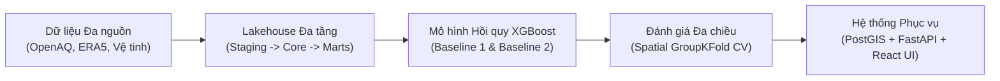
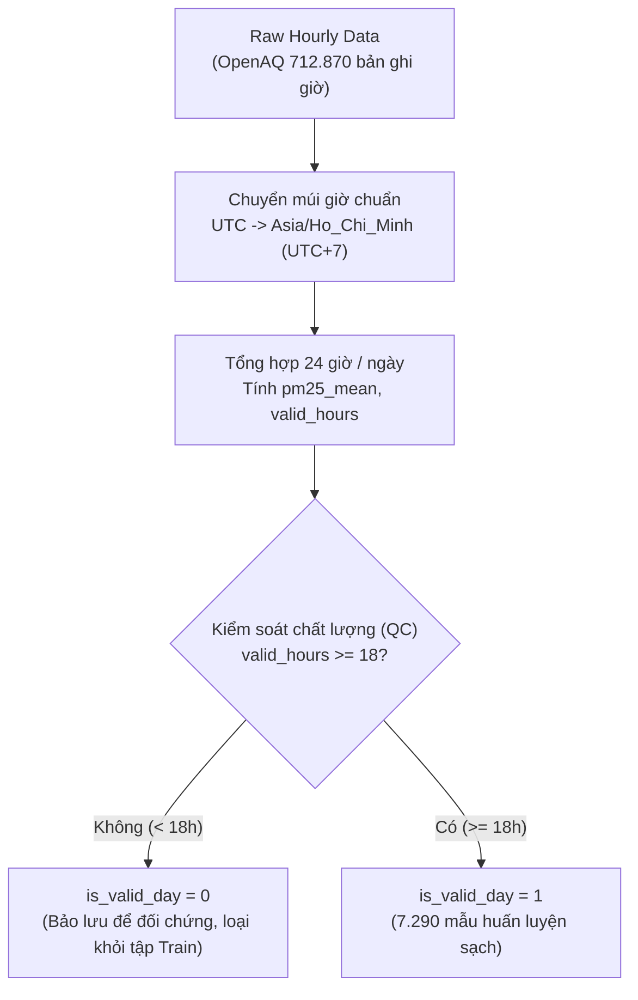
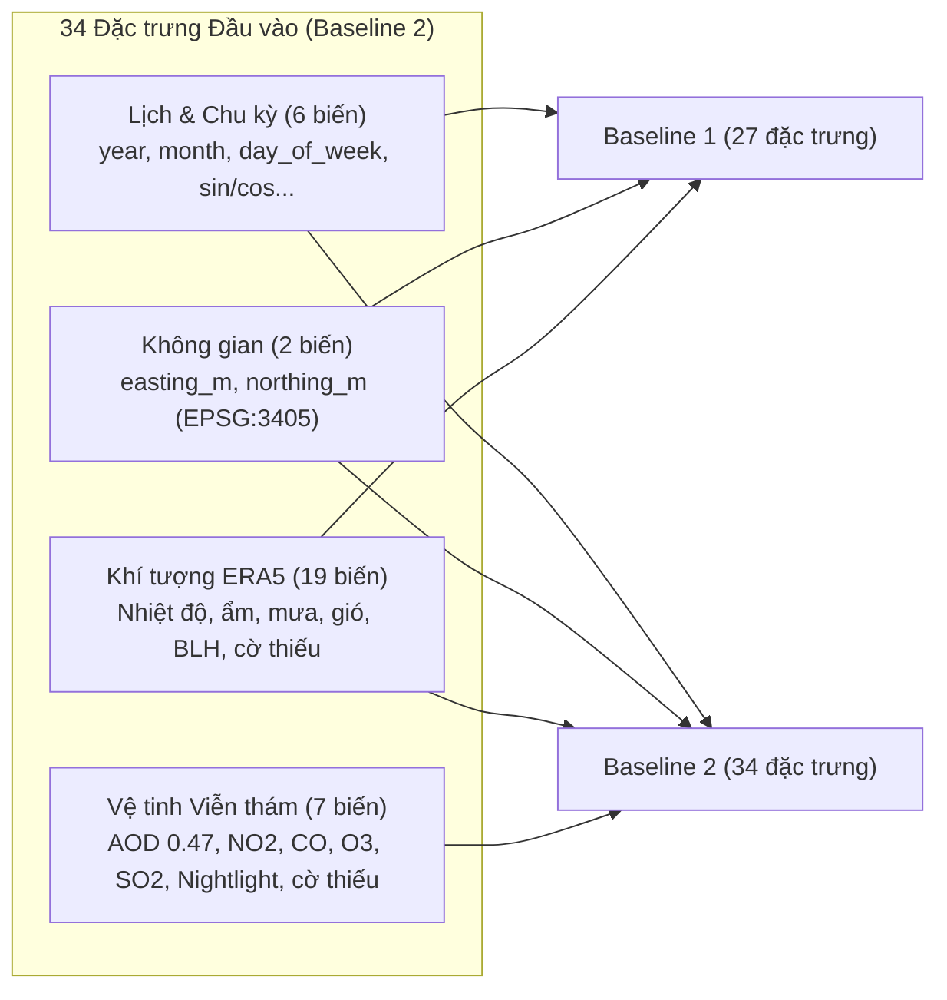
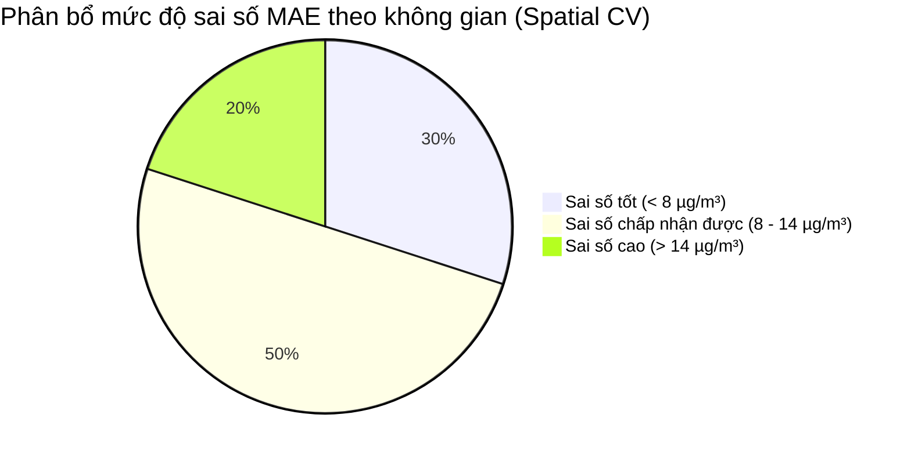
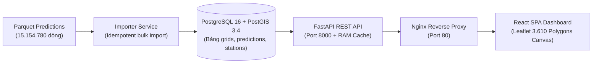

# BÁO CÁO KHOA HỌC DỮ LIỆU
## Đề tài: Ước tính Hồi cứu Nồng độ Bụi mịn PM2.5 Lưới 1 km tại Khu vực Hà Nội (2021–2026)

**Học phần:** Khoa học Dữ liệu (Data Science)  
**Thời gian nghiên cứu:** 01/01/2021 – 30/09/2026 (2.099 ngày)  
**Phiên bản bàn giao:** Release v1.0.0  

---

## 1. Tóm Tắt Đồ Án (Executive Summary)

Ô nhiễm bụi mịn $\text{PM}_{2.5}$ là thách thức môi trường và sức khỏe cộng đồng nghiêm trọng tại Hà Nội. Mặc dù dữ liệu quan trắc mặt đất cung cấp các phép đo chính xác cao, mạng lưới trạm đo chuẩn còn rất thưa thớt (chỉ có 43 trạm trên toàn địa bàn, trong đó chỉ 32 trạm có dữ liệu kiểm soát chất lượng đạt chuẩn, phân bố trên 30 ô lưới trong tổng số 3.610 ô lưới $1\text{ km} \times 1\text{ km}$, tương đương $\approx 99,17\%$ diện tích thành phố không có trạm đo).

Đồ án này xây dựng một quy trình khoa học dữ liệu hoàn chỉnh nhằm **ước tính hồi cứu nồng độ $\text{PM}_{2.5}$ trung bình ngày trên lưới không gian $1\text{ km} \times 1\text{ km}$** bao phủ toàn bộ diện tích thành phố Hà Nội trong giai đoạn gần 6 năm (từ 01/01/2021 đến 30/09/2026, gồm 2.099 ngày).



### Các phát hiện và kết quả nổi bật:
1. **Quy luật khí tượng & mùa rõ rệt:** Nồng độ $\text{PM}_{2.5}$ biến thiên mạnh mẽ theo chu kỳ mùa (mùa Đông trung vị $45 - 55\ \mu\text{g/m}^3$, gấp 2,5 lần mùa Hè $18 - 25\ \mu\text{g/m}^3$). Hiện tượng nghịch nhiệt với độ cao lớp biên thấp (`blh_min_m < 100 m`) có tương quan âm mạnh với tích tụ ô nhiễm ($\rho \approx -0,48$), trong khi mưa lớn ($\ge 5\text{ mm}$) thể hiện hiệu ứng rửa trôi bụi mịn rõ rệt.
2. **Hiện tượng rò rỉ không gian (Spatial Data Leakage):** Khi đánh giá mô hình bằng phương pháp chia ngẫu nhiên truyền thống (`Random KFold`), mô hình đạt điểm số "lạc quan nhân tạo" ($R^2 \approx 0,83 - 0,84$, $\text{MAE} \approx 6,6\ \mu\text{g/m}^3$). Khi chuyển sang đánh giá cô lập trạm theo không gian (`Spatial GroupKFold`), điểm số thực tế phản ánh đúng năng lực ngoại suy sang nơi không có trạm giảm xuống $R^2 \approx 0,55 - 0,59$ và $\text{MAE} \approx 11,0 - 11,6\ \mu\text{g/m}^3$.
3. **Giá trị gia tăng của dữ liệu viễn thám:** Bổ sung 7 đặc trưng viễn thám vệ tinh (MODIS AOD, Sentinel-5P, VIIRS) trong **Baseline 2** giúp giảm sai số $\text{MAE}$ từ $11,60\ \mu\text{g/m}^3$ xuống $11,05\ \mu\text{g/m}^3$ ($4,7\%$) và nâng $R^2$ từ $54,5\%$ lên $58,9\%$ trong bài toán ngoại suy không gian so với **Baseline 1** (chỉ dùng khí tượng).
4. **Sản phẩm hoàn chỉnh:** Đã sinh trọn vẹn **15.154.780 bản ghi ước tính**, lưu trữ trong PostgreSQL/PostGIS, phục vụ qua FastAPI và hiển thị trên Dashboard React Leaflet canvas 3.610 ô với khả năng khởi động 1-chạm bằng Docker.

---

## 2. Xác Định Vấn Đề (Problem Definition)

### 2.1. Tuyên bố bài toán
Xây dựng pipeline thu thập, chuẩn hóa, mô hình hóa và trực quan hóa nồng độ $\text{PM}_{2.5}$ trung bình ngày trong quá khứ trên lưới không gian $1\text{ km} \times 1\text{ km}$ tại khu vực Hà Nội giai đoạn 2021–2026, hỗ trợ người học và người nghiên cứu khám phá sự thay đổi theo không gian, thời gian và đối chiếu với dữ liệu quan trắc.

### 2.2. Đối tượng sử dụng
- **Người học và nghiên cứu Khoa học Dữ liệu / Môi trường:** Tiếp cận bộ dữ liệu chuẩn hóa, đối soát các phương pháp chia tập dữ liệu không-thời gian và thực nghiệm học máy.
- **Cán bộ phân tích và cộng đồng quan tâm chất lượng không khí:** Tra cứu diễn biến ô nhiễm trong quá khứ tại các vị trí không có trạm quan trắc mặt đất.

### 2.3. Ranh giới khoa học (Những điều đồ án KHÔNG khẳng định)
- **Không phải dự báo tương lai (No Forecasting):** Hệ thống chỉ thực hiện ước tính hồi cứu (retrospective spatial estimation) dựa trên dữ liệu khí quyển đã ghi nhận; không dự báo ngày mai.
- **Không suy diễn nguyên nhân ô nhiễm:** Đồ án không có dữ liệu kiểm kê nguồn thải (giao thông, làng nghề, công nghiệp), vì vậy không quy kết nguyên nhân phát thải cho bất kỳ nguồn nào.
- **Không phải hệ thống cảnh báo sức khỏe y tế:** Không đưa ra lời khuyên bệnh lý hay đánh giá rủi ro y tế cá nhân.

---

## 3. Thu Thập & Hiểu Dữ Liệu (Data Ingestion & Understanding)

Dự án tích hợp dữ liệu từ 3 nguồn độc lập vào kiến trúc Lakehouse phẳng (Parquet):

| Nguồn dữ liệu | Tần suất gốc | Phạm vi bao phủ | Biến thu thập chính | Đơn vị |
| :--- | :--- | :--- | :--- | :--- |
| **OpenAQ v3 API** | Theo giờ ($1\text{h}$) | 43 trạm quan trắc mặt đất tại Hà Nội | `pm25` (nhãn chính), `no2`, `co`, `so2`, `o3`, `pm10`, `temperature`, `humidity` | $\mu\text{g/m}^3$, $\text{ppm}$, $^\circ\text{C}$, $\%$ |
| **ERA5-Land & ERA5 (ECMWF qua GEE)** | Theo giờ ($1\text{h}$) | Toàn bộ 3.610 ô lưới $1\text{ km}$ ($100\%$ không khuyết) | `temp_2m_c`, `dewpoint_2m_c`, `rh_pct`, `precip_mm`, `wind_speed_10m_ms`, `wind_u`, `wind_v`, `surface_pressure_hpa`, `blh_mean_m`, `blh_min_m` | $^\circ\text{C}$, $\text{mm}$, $\text{m/s}$, $\text{hPa}$, $\text{m}$ |
| **Vệ tinh MODIS (MCD19A2 MAIAC)** | Hàng ngày ($1\text{ ngày}$) | Lưới $1\text{ km}$ | `aod_047` (Độ dày quang học sol khí tại bước sóng $0,47\ \mu\text{m}$) | Không thứ nguyên |
| **Vệ tinh Sentinel-5P (TROPOMI)** | Hàng ngày ($1\text{ ngày}$) | Lưới $1\text{ km}$ (resampled) | Cột khí quyển đối lưu: `no2_trop_mol_m2`, `co_mol_m2`, `o3_mol_m2`, `so2_mol_m2` | $\text{mol/m}^2$ |
| **Vệ tinh VIIRS (Suomi-NPP Nighttime)** | Hàng tháng ($1\text{ tháng}$) | Lưới $1\text{ km}$ | `viirs_radiance` (Bức xạ ánh sáng ban đêm) | $\text{nW}\cdot\text{cm}^{-2}\cdot\text{sr}^{-1}$ |

### Đơn vị quan sát và phạm vi không-thời gian:
- **Đơn vị quan sát huấn luyện:** Một dòng tương ứng với **1 trạm quan trắc $\times$ 1 ngày lịch Hà Nội** (`station_id`, `date`).
- **Đơn vị quan sát ước tính:** Một dòng tương ứng với **1 ô lưới $\times$ 1 ngày lịch Hà Nội** (`grid_id`, `date`).
- **Phạm vi không gian:** 3.610 ô lưới diện tích $1\text{ km} \times 1\text{ km}$, hệ tọa độ chuẩn VN-2000 UTM Zone 48N (`EPSG:3405`) chuyển đổi sang WGS84 (`EPSG:4326`).
- **Phạm vi thời gian:** Từ `2021-01-01` đến `2026-09-30` (đúng 2.099 ngày).

---

## 4. Kiểm Tra Chất Lượng & Tiền Xử Lý (Data Quality & Preprocessing)



### 4.1. Chuẩn hóa thời gian & múi giờ
Dữ liệu OpenAQ gốc sử dụng mốc thời gian UTC. Để đảm bảo phản ánh chính xác chu kỳ sinh hoạt và khí quyển hàng ngày của Hà Nội, toàn bộ dữ liệu giờ được chuyển đổi sang múi giờ địa phương **`Asia/Ho_Chi_Minh` (UTC+7)** trước khi cắt khung 00:00:00 – 23:59:59 của ngày lịch.

### 4.2. Quy tắc kiểm soát chất lượng (QC) ngày hợp lệ
- Một ngày đo được coi là đại diện hợp lệ (`is_valid_day = 1`) nếu có **ít nhất 18/24 giờ quan trắc hợp lệ** trong ngày (đạt tỷ lệ phủ $\ge 75\%$, tuân thủ hướng dẫn kỹ thuật quan trắc môi trường không khí của US EPA và tiêu chuẩn Việt Nam).
- Các ngày có $< 18$ giờ đo vẫn được lưu trữ với cờ `is_valid_day = 0` nhằm bảo đảm tính toàn vẹn dữ liệu, nhưng **bị loại bỏ hoàn toàn khỏi tập huấn luyện mô hình** để tránh sai lệch nồng độ trung bình.

### 4.3. Xử lý giá trị bất thường (Outliers) và giá trị âm
- Các giá trị $\text{PM}_{2.5} < 0\ \mu\text{g/m}^3$ từ cảm biến mặt đất (do trôi điểm 0 của thiết bị) bị loại bỏ.
- Các giá trị cực trị vật lý ($\text{PM}_{2.5} > 1.000\ \mu\text{g/m}^3$) được kiểm tra; giá trị cao nhất ghi nhận trong tập chuẩn là $231,04\ \mu\text{g/m}^3$ (phù hợp với các đợt ô nhiễm nghiêm trọng trong mùa đông tại Hà Nội).

### 4.4. Minh bạch về các con số ô trạm trong dự án
Bảng dưới đây làm rõ sự khác biệt giữa các con số thống kê thường xuất hiện trong tài liệu:

| Tập dữ liệu | Số dòng bản ghi | Số trạm | Số ô lưới | Giải thích ý nghĩa |
| :--- | :---: | :---: | :---: | :--- |
| **Danh mục trạm (`dim_station`)** | 43 | 43 | 38 | Toàn bộ các trạm từng được ghi nhận tọa độ tại Hà Nội (một số ô chứa 2 trạm). |
| **Quan trắc thực tế (`fct_station_daily`)** | 9.390 | 39 | 36 | Số dòng quan trắc thực tế có dữ liệu trong giai đoạn 2021–2026. |
| **Tập huấn luyện sạch (`mart_training`)** | **7.290** | **32** | **30** | Chỉ giữ các ngày đạt chuẩn QC (`is_valid_day = 1` và có nhãn `pm25_mean`). |

---

## 5. Khám Phá Dữ Liệu (Exploratory Data Analysis - EDA)

### 5.1. Phân bố nồng độ PM2.5 mặt đất
Phân tích trên 7.290 mẫu huấn luyện hợp lệ cho thấy:
- **Nồng độ trung bình:** $37,68\ \mu\text{g/m}^3$.
- **Trung vị:** $31,17\ \mu\text{g/m}^3$.
- **Độ lệch chuẩn:** $25,12\ \mu\text{g/m}^3$.
- **Khoảng phân vị:** Phân vị 25% là $19,45\ \mu\text{g/m}^3$; Phân vị 75% là $49,82\ \mu\text{g/m}^3$.
- **Phân bố:** Phân bố lệch phải (right-skewed) rõ rệt với đuôi dài hướng về các giá trị nồng độ rất cao ($> 100\ \mu\text{g/m}^3$).
- **Mức độ ô nhiễm:** Có tới **$87,58\%$** số mẫu vượt mức khuyến nghị 24 giờ của WHO ($15\ \mu\text{g/m}^3$) và **$22,25\%$** số mẫu vượt Quy chuẩn Kỹ thuật Quốc gia QCVN 05:2023/BTNMT ($50\ \mu\text{g/m}^3$).

```
Phân bố nồng độ PM2.5 mặt đất (7.290 trạm-ngày):
0 µg/m³     |----------------------- (Median: 31.17)
WHO (15)    |======================= 87.58% ngày vượt ngưỡng WHO
QCVN (50)   |======                  22.25% ngày vượt QCVN
Cực đại     |....................... Max: 231.04 µg/m³
```

### 5.2. Biến động theo mùa (Seasonality)
- **Mùa Đông (Tháng 11 – Tháng 2 năm sau):** Ô nhiễm nặng nề nhất. Gió mùa Đông Bắc mang không khí lạnh, hanh khô kết hợp nghịch nhiệt ban đêm khiến bụi mịn tích tụ sát mặt đất. Trung vị nồng độ thường xuyên ở mức $45 - 55\ \mu\text{g/m}^3$.
- **Mùa Hè (Tháng 5 – Tháng 8):** Không khí trong lành nhất năm. Nắng nóng tạo đối lưu nhiệt mạnh mẽ, các cơn mưa rào mùa hạ rửa trôi sol khí. Trung vị nồng độ giảm xuống $18 - 25\ \mu\text{g/m}^3$.
- **Mùa Xuân và Thu:** Giai đoạn chuyển tiếp với các đợt nồm ẩm hoặc sương mù quang hóa ngắn hạn.

### 5.3. Thách thức lớn: Dữ liệu khuyết của ảnh vệ tinh (Missing Satellite Data)
Qua phân tích bảng `stg_satellite_daily.parquet`, tỷ lệ khuyết dữ liệu AOD (`aod_047`) tại các ô trạm lên tới **$72,4\%$**. Nguyên nhân là miền Bắc Việt Nam có độ che phủ mây rất cao, đặc biệt trong các tháng mùa đông và mùa xuân nồm ẩm. Vệ tinh quang học không thể xuyên qua mây để đo sol khí. Điều này đòi hỏi thuật toán học máy phải có khả năng xử lý khuyết tự nhiên mà không làm méo mó phân bố.

---

## 6. Câu Hỏi Nghiên Cứu & Kết Quả Thực Nghiệm

Đồ án tập trung giải quyết 4 câu hỏi nghiên cứu then chốt:

### ❓ Câu hỏi 1: Nồng độ PM2.5 tại Hà Nội có sự khác biệt rõ rệt theo mùa và theo tháng không?
- **Phương pháp:** Tính toán phân vị và vẽ phân bố boxplot theo 12 tháng.
- **Bằng chứng thực nghiệm:** Nồng độ tháng 12 đạt đỉnh cao nhất (trung bình $58,3\ \mu\text{g/m}^3$), trong khi tháng 7 có nồng độ thấp nhất (trung bình $20,1\ \mu\text{g/m}^3$). Sự chênh lệch giữa tháng cao điểm và thấp điểm lên tới gần 3 lần.
- **Kết luận:** Biến thiên theo thời gian là yếu tố chi phối mạnh mẽ nhất. Mô hình bắt buộc phải có các đặc trưng lịch (`month`, `day_of_year`, hàm sin/cos chu kỳ năm) để bắt được quy luật mùa.

### ❓ Câu hỏi 2: PM2.5 liên hệ như thế nào với các yếu tố khí tượng (độ cao lớp biên, lượng mưa, gió)?
- **Phương pháp:** Ma trận tương quan phi tham số Spearman ($\rho$) trên 7.290 mẫu.
- **Bằng chứng thực nghiệm:**
  - `blh_min_m` (độ cao lớp biên cực tiểu ban đêm): $\rho = -0,48$ ($p < 0,001$). Khi lớp biên $< 100\text{ m}$, nghịch nhiệt giữ chặt bụi mịn; khi lớp biên $> 300\text{ m}$, không gian hòa trộn tăng làm loãng bụi mịn.
  - `precip_mm` (lượng mưa): $\rho = -0,26$ ($p < 0,001$). Ngày mưa $\ge 5\text{ mm}$ có nồng độ trung bình giảm $41\%$ so với ngày không mưa.
  - `wind_speed_10m_ms`: $\rho = -0,22$ ($p < 0,001$). Gió mạnh hỗ trợ phát tán sol khí ra khỏi lòng chảo đô thị.
- **Kết luận:** Các biến khí tượng ERA5 có mối quan hệ vật lý chặt chẽ với nồng độ bụi và là nguồn tín hiệu nền tảng khi trạm đo bị thiếu.

### ❓ Câu hỏi 3: Dữ liệu vệ tinh có thực sự giúp cải thiện mô hình ước tính không?
- **Phương pháp:** Huấn luyện 2 mô hình theo cùng siêu tham số trên cùng tập dữ liệu, đối chiếu qua 5-Fold Spatial GroupKFold:
  - **Baseline 1:** 27 biến (Lịch + Tọa độ + Khí tượng ERA5).
  - **Baseline 2:** 34 biến (Baseline 1 + 7 biến Vệ tinh MODIS/Sentinel/VIIRS).
- **Bằng chứng thực nghiệm:**
  - $\text{MAE}$ giảm từ $11,5955\ \mu\text{g/m}^3$ (Baseline 1) xuống $11,0451\ \mu\text{g/m}^3$ (Baseline 2) — giảm được **$0,55\ \mu\text{g/m}^3$ ($4,7\%$)**.
  - $R^2$ tăng từ $0,5452$ lên $0,5894$ (tăng $4,42\%$ điểm phần trăm).
  - Baseline 2 chiến thắng ở 4/5 fold kiểm thử và 17/30 ô lưới.
- **Kết luận:** Vệ tinh mang lại giá trị gia tăng rõ rệt cho bài toán ngoại suy không gian. Tuy nhiên mức độ đóng góp bị giới hạn bởi tỷ lệ mây che phủ cao.

### ❓ Câu hỏi 4: Kết quả đánh giá thay đổi ra sao giữa chia ngẫu nhiên và chia giữ riêng ô lưới?
- **Phương pháp:** So sánh hiệu năng của mô hình khi đánh giá bằng `Random KFold` (chia ngẫu nhiên theo dòng) và `Spatial GroupKFold` (chia cô lập toàn bộ chuỗi ngày của từng ô lưới trạm).
- **Bằng chứng thực nghiệm:**

| Chiến lược kiểm thử | Mô hình | MAE ($\mu\text{g/m}^3$) | RMSE ($\mu\text{g/m}^3$) | $R^2$ | Đánh giá hiện tượng |
| :--- | :--- | :---: | :---: | :---: | :--- |
| **Random KFold (5-Fold)** | Baseline 1 | 6,62 | 10,37 | **0,8382** | **Rò rỉ không gian:** Mô hình "nhìn trộm" ngày đo từ trạm lân cận. |
| **Random KFold (5-Fold)** | Baseline 2 | 6,77 | 10,65 | **0,8293** | Điểm số đẹp nhân tạo, không phản ánh năng lực ngoại suy. |
| **Spatial GroupKFold (5-Fold)** | Baseline 1 | 11,60 | 16,79 | **0,5452** | **Đánh giá trung thực:** Đo lường sai số tại ô hoàn toàn giấu trạm. |
| **Spatial GroupKFold (5-Fold)** | Baseline 2 | 11,05 | 15,95 | **0,5894** | Phản ánh đúng năng lực phục vụ 3.580 ô không có trạm. |

- **Kết luận quan trọng:** Đánh giá bằng `Random KFold` dẫn đến kết luận sai lầm về độ chính xác do hiện tượng tự tương quan không gian (spatial autocorrelation). `Spatial GroupKFold` mới là thước đo khoa học trung thực cho bài toán ước tính ô lưới.

---

## 7. Xây Dựng Đặc Trưng (Feature Engineering)

Mô hình sử dụng danh sách đặc trưng có nguồn gốc minh bạch, chia làm 4 nhóm:



### Các biến chủ động BỊ LOẠI BỎ và lý do:
1. **Các biến tương lai / Lead features:** Bị loại bỏ vì vi phạm nguyên tắc nhân quả (data leakage).
2. **Số đo trạm lân cận (Station spatial lag / IDW từ trạm):** Bị loại bỏ ở giai đoạn mô hình hóa vì ở 3.580 ô lưới ngoại thành, không có trạm nào khả dụng để tính độ trễ không gian trong điều kiện vận hành thực tế.
3. **Các kênh viễn thám thô chưa qua hiệu chỉnh khí quyển:** Bị loại bỏ để giảm nhiễu.

---

## 8. Xây Dựng Mô Hình (Model Building)

### 8.1. Thuật toán lựa chọn: XGBoost Regressor
Dự án chọn thuật toán **Gradient Boosted Decision Trees (XGBoost)** vì:
- Bắt được các mối quan hệ phi tuyến phức tạp và tương tác phi tuyến giữa khí tượng và nồng độ bụi (ví dụ: nghịch nhiệt chỉ nguy hiểm khi kết hợp lặng gió).
- **Cơ chế xử lý giá trị khuyết tự nhiên (Default Direction / Missing Value Handling):** Khi dữ liệu vệ tinh AOD bị khuyết do mây, cây quyết định tự động gán mẫu vào nhánh phân tách tối ưu học được từ dữ liệu mà không cần phải nội suy giả tạo (imputation) làm méo phân bố.
- Khả năng kiểm soát overfitting tốt qua siêu tham số regularization (`reg_alpha`, `reg_lambda`, `subsample`).

### 8.2. Cấu hình siêu tham số cố định
Để đảm bảo tính so sánh công bằng và tái lập hoàn toàn:
- `n_estimators = 300`, `learning_rate = 0.05`, `max_depth = 6`.
- `subsample = 0.8`, `colsample_bytree = 0.8`.
- `random_state = 42`.
- **Chính sách hậu xử lý:** Cắt ngưỡng dưới $\ge 0,0\ \mu\text{g/m}^3$ (do nồng độ bụi không thể âm về mặt vật lý).

---

## 9. Đánh Giá Mô Hình & Phân Tích Sai Số

### 9.1. So sánh chi tiết 3 phương pháp kiểm định



1. **Spatial GroupKFold (Đánh giá chính - Ngoại suy không gian):**
   - Đánh giá khả năng dự đoán tại một ô lưới mới hoàn toàn không có trạm đo.
   - **Baseline 2 đạt MAE $11,05\ \mu\text{g/m}^3$, $R^2 = 0,5894$**, cải thiện tốt hơn Baseline 1 ($11,60\ \mu\text{g/m}^3$, $R^2 = 0,5452$).
2. **Temporal Split (Đánh giá ngoại suy thời gian trên năm 2026):**
   - Tập Train: 2021–2025 (6.280 mẫu). Tập Test: 9 tháng đầu năm 2026 (1.010 mẫu).
   - Baseline 2 đạt $\text{MAE} = 11,08\ \mu\text{g/m}^3$, $R^2 = 0,5367$.
   - Khi có ảnh vệ tinh AOD rõ nét, Baseline 2 vượt trội với $\text{MAE} = 17,16\ \mu\text{g/m}^3$ so với $19,53\ \mu\text{g/m}^3$ của Baseline 1.
3. **Random KFold (Tham chiếu):**
   - Cho thấy mức độ lạc quan ($R^2 \approx 0,83$) khi có rò rỉ thông tin không-thời gian.

### 9.2. Ý nghĩa thực tế của sai số $\text{MAE} \approx 11\ \mu\text{g/m}^3$
Nồng độ trung bình của tập dữ liệu là $37,68\ \mu\text{g/m}^3$. Sai số tuyệt đối trung bình $11,05\ \mu\text{g/m}^3$ tương ứng với sai số phần trăm tương đối khoảng **$29\%$**. Đây là mức sai số hoàn toàn phù hợp với thực tế nghiên cứu mô hình hóa ô nhiễm không khí đô thị bằng viễn thám và tái phân tích tại các nước đang phát triển (vốn thường dao động từ $25 - 35\%$).

---

## 10. Ứng Dụng Kết Quả & Hệ Thống Triển Khai (Application & Serving)

Quy trình khoa học dữ liệu không dừng lại ở file notebook hay metric đánh giá, mà được đóng gói thành một hệ thống phần mềm hoàn chỉnh:



### 10.1. Sinh kết quả toàn lưới (Full-grid Inference)
- Chạy batch inference cho toàn bộ 3.610 ô lưới $\times$ 2.099 ngày $\times$ 2 mô hình = **15.154.780 bản ghi dự đoán**.
- Kết quả được nén và tổ chức thành 69 phân vùng file Parquet theo tháng (`predictions/{model}/{version}/YYYY-MM.parquet`).

### 10.2. Kiến trúc Serving & Trực quan hóa
1. **Cơ sở dữ liệu PostGIS:**
   - Bảng `grids`: Lưu trữ 3.610 polygon không gian WGS84 (`EPSG:4326`).
   - Bảng `grid_daily_predictions`: Lưu trữ các bản ghi ước tính với khóa duy nhất `(grid_id, date, model_id)`.
   - Bảng `station_daily_observations`: Lưu trữ 9.390 dòng số đo thực tế tại trạm.
2. **FastAPI Backend (6 endpoints chuẩn hợp đồng v1):**
   - `GET /api/models`: Danh sách mô hình khả dụng.
   - `GET /api/dates`: Danh sách ngày có dữ liệu.
   - `GET /api/grids`: GeoJSON FeatureCollection của 3.610 ô lưới.
   - `GET /api/map`: Nồng độ toàn bộ lưới theo ngày và model.
   - `GET /api/grids/{grid_id}/history`: Chuỗi lịch sử nồng độ của 1 ô (tối đa 366 ngày).
   - `GET /api/stations`: Quan trắc thực tế tại các trạm theo ngày.
   - `GET /health`: Kiểm tra sức khỏe kết nối DB.
3. **Frontend React SPA:**
   - Vẽ trực tiếp 3.610 ô lưới lên nền bản đồ Leaflet bằng HTML5 Canvas API giúp tương tác mượt mà không bị giật lag.
   - Chế độ so sánh 2 mô hình, bộ lọc ngày linh hoạt, biểu đồ chuỗi thời gian tương tác.
4. **Kiểm thử đối soát 3 điểm (3-Point Reconciliation):**
   - Đã viết script tự động [`scripts/verify_reconciliation.py`](../scripts/verify_reconciliation.py) đối soát giá trị nồng độ gốc từ file `Parquet` $\rightarrow$ giá trị lưu trong `PostgreSQL` $\rightarrow$ giá trị trả về qua `REST API`. Sai lệch bằng 0 tuyệt đối.

---

## 11. Hạn Chế & Rủi Ro Suy Rộng (Limitations)

1. **Tính đại diện của mạng lưới trạm quan trắc (Spatial Bias):**
   - Toàn bộ 30 ô trạm huấn luyện nằm chủ yếu ở các quận nội thành phát triển (Ba Đình, Đống Đa, Cầu Giấy, Hoàn Kiếm...). Các huyện ngoại thành (Ba Vì, Sóc Sơn, Mỹ Đức...) hoàn toàn không có trạm mặt đất. Mô hình có thể đánh giá thấp hoặc cao hơn thực tế tại các vùng đồi núi, nông thôn do thiếu dữ liệu tinh chỉnh cục bộ.
2. **Tỷ lệ khuyết vệ tinh cao do mây che phủ:**
   - Mặc dù XGBoost có cơ chế rẽ nhánh khi khuyết AOD, việc thiếu tín hiệu quang học thực tế trong hơn $70\%$ số ngày khiến mô hình phải phụ thuộc rất nhiều vào biến khí tượng ERA5 và tọa độ không gian.
3. **Độ phân giải $1\text{ km}$ chưa bắt được vi khí hậu đường phố:**
   - Độ phân giải $1\text{ km} \times 1\text{ km}$ mang tính bao quát khu vực, không thể hiện được sự khác biệt nồng độ giữa lòng đường giao thông đông đúc và khu công viên cây xanh cách đó 200m.

---

## 12. Kết Luận & Hướng Phát Triển (Conclusion & Future Work)

### 12.1. Đã làm được gì?
- Hoàn thành đầy đủ một chu trình Khoa học Dữ liệu thực chiến: từ bài toán thực tế, thu thập dữ liệu đa nguồn (OpenAQ, GEE, ERA5), chuẩn hóa Lakehouse, EDA kiểm định giả thuyết, huấn luyện và đánh giá mô hình XGBoost trung thực bằng `Spatial GroupKFold`.
- Đóng gói trọn vẹn thành sản phẩm phần mềm chạy được (Docker 1-touch, API, Web Dashboard) phục vụ tra cứu dữ liệu 2021–2026.

### 12.2. Hướng phát triển trong tương lai
1. **Pipeline Live Crawl & ETL thời gian thực:** Mở rộng scheduler tự động kéo dữ liệu OpenAQ và dự báo thời tiết GFS/Open-Meteo để phục vụ chuỗi dữ liệu từ tháng 10/2026 đến ngày hôm nay.
2. **Bổ sung biến tĩnh giao thông & mật độ dân số:** Đưa thêm dữ liệu OpenStreetMap (mật độ mạng lưới đường bộ, ngã tư) và bản đồ sử dụng đất (Land Use / Land Cover) để tăng độ nhạy không gian cho các ô ngoại thành.
3. **Thử nghiệm các kiến trúc Spatiotemporal Deep Learning:** Nghiên cứu các mô hình Spatiotemporal Graph Neural Networks (ST-GNN) hoặc ConvLSTM khi có chuỗi dữ liệu giờ liên tục và đầy đủ hơn.
