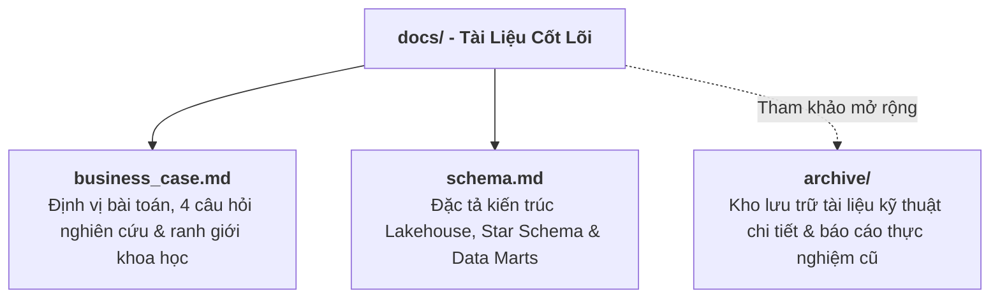

# HỆ THỐNG TÀI LIỆU DỰ ÁN HANOI_PM25
## Hệ Thống Ước Tính Hồi Cứu PM2.5 Lưới 1 km Hà Nội (2021–2026)
**Phiên bản:** Release v1.0.0 · **Tác giả:** Nguyen Thinh

---

Thư mục `docs/` tập trung vào **hai trụ cột cốt lõi** của đồ án Khoa học Dữ liệu: **Nghiệp vụ bài toán (Business Case)** và **Cấu trúc dữ liệu Lakehouse (Schema)**.

---

## 1. Tài Liệu Cốt Lõi (Core Documentation)

| Tài liệu | Trọng tâm nội dung | Đối tượng hướng tới |
| :--- | :--- | :--- |
| 📄 **[docs/business_case.md](business_case.md)** | **Định vị nghiệp vụ & Khung câu hỏi nghiên cứu:** • Trả lời 8 câu hỏi cốt lõi của bài toán ước tính hồi cứu PM2.5. • Phân tích khoảng trống không gian: 32 trạm đo tập trung tại 30 ô lưới ($\approx 0,83\%$) vs 3.580 ô lưới ngoại thành chưa có trạm ($\approx 99,17\%$). • Xác lập ranh giới khoa học minh bạch (Không dự báo tương lai, Không quy kết nguyên nhân, Không chẩn đoán y tế). • 4 câu hỏi nghiên cứu và giả thuyết thực nghiệm. | Giảng viên, Nhà nghiên cứu, Data Scientists |
| 🗄️ **[docs/schema.md](schema.md)** | **Đặc tả Data Lakehouse & Star Schema:** • Mô hình tổ chức dữ liệu đa tầng: Raw Parquet $\to$ Staging $\to$ Core (Star Schema) $\to$ Data Marts $\to$ Serving Database. • Chi tiết các bảng chiều (`dim_grid_1km`, `dim_date`, `dim_station`), bảng sự kiện (`fct_station_daily_observations`, `fct_grid_meteo_daily`, `fct_grid_satellite_daily`). • Lược đồ Data Mart huấn luyện (`mart_station_daily_training`) và đặc trưng toàn lưới (`mart_grid_daily_features`). | Kỹ sư dữ liệu, Developers, Database Administrators |

---

## 2. Tài Liệu Kỹ Thuật Tham Khảo (Archived Technical Documents)

Các tài liệu đặc tả kỹ thuật chi tiết, hợp đồng bàn giao API, hướng dẫn triển khai Docker và báo cáo thực nghiệm chi tiết đã được lưu trữ tại thư mục [`archive/`](../archive/README.md) để giữ cấu trúc tài liệu chính tinh gọn:

- **[archive/HANDOVER.md](../archive/HANDOVER.md):** Hợp đồng dữ liệu & đặc tả 6 REST API endpoints chuẩn hóa.
- **[archive/DEPLOYMENT.md](../archive/DEPLOYMENT.md):** Sổ tay triển khai cụm Docker Compose, đối soát dữ liệu 3 điểm và sao lưu cơ sở dữ liệu.
- **[archive/BACKEND.md](../archive/BACKEND.md):** Tài liệu kỹ thuật FastAPI backend, kiến trúc RAM caching và kiểm thử.
- **[archive/report.md](../archive/report.md):** Báo cáo Khoa học Dữ liệu 12 phần đầy đủ theo chu trình chuẩn.
- **[archive/model_report.md](../archive/model_report.md):** Báo cáo thực nghiệm chuyên sâu 3 phương pháp kiểm thử chéo (`Spatial GroupKFold`, `Random KFold`, `Temporal Split`).
