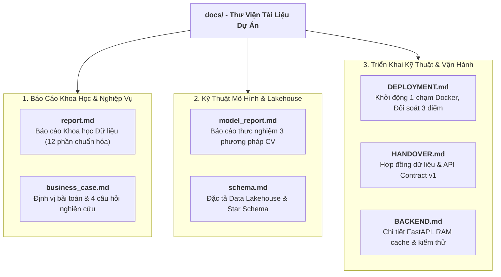

# HỆ THỐNG TÀI LIỆU DỰ ÁN HANOI_PM25
## Hệ Thống Ước Tính Hồi Cứu PM2.5 Lưới 1 km Hà Nội (2021–2026)
**Phiên bản:** Release v1.0.0 · **Tác giả:** Nguyen Thinh

---

Chào mừng bạn đến với trung tâm tài liệu kỹ thuật và báo cáo khoa học của dự án **HANOI_PM25**. Thư mục `docs/` được tổ chức khoa học theo 3 nhóm tài liệu chính phục vụ mục tiêu nghiên cứu học thuật, phân tích dữ liệu thực nghiệm và triển khai vận hành thực tế:

---

## 1. Báo Cáo Khoa Học Dữ Liệu & Nghiên Cứu Nghiệp Vụ

Tài liệu trọng tâm phục vụ đánh giá khoa học dữ liệu, phương pháp luận và kết quả thực nghiệm:

| Tài liệu | Mô tả nội dung | Đối tượng đọc |
| :--- | :--- | :--- |
| 📄 **[docs/report.md](report.md)** | **Báo cáo Khoa học Dữ liệu toàn diện (12 phần):** Trình bày xuyên suốt chu trình Data Science từ xác định vấn đề, thu thập đa nguồn, tiền xử lý QC, EDA, 4 câu hỏi nghiên cứu, huấn luyện XGBoost, đánh giá trung thực `Spatial GroupKFold`, phục vụ ứng dụng đến hạn chế đồ án. | Giảng viên, Nhà nghiên cứu, Data Scientists |
| 📄 **[docs/business_case.md](business_case.md)** | **Định vị nghiệp vụ & Khung câu hỏi nghiên cứu:** Trả lời 8 câu hỏi cốt lõi của bài toán, làm rõ ranh giới khoa học (phân biệt số đo trạm, ước tính mô hình và dự báo tương lai), minh bạch nguồn gốc số liệu trạm và ô lưới. | Nhà phân tích, Kỹ sư dữ liệu, Độc giả quan tâm |

---

## 2. Kỹ Thuật Mô Hình & Kiến Trúc Dữ Liệu (Data & Modeling)

Tài liệu chi tiết về mặt kỹ thuật thuật toán, kỹ thuật đặc trưng và cấu trúc bảng:

| Tài liệu | Mô tả nội dung |
| :--- | :--- |
| 📊 **[docs/model_report.md](model_report.md)** | **Báo cáo chuyên sâu về mô hình học máy:** So sánh chi tiết hiệu năng giữa Baseline 1 (27 biến khí tượng) và Baseline 2 (34 biến khí tượng + vệ tinh) qua 3 phương pháp đánh giá (`Spatial GroupKFold`, `Random KFold`, `Temporal Split`), phân tích ma trận sai số và tầm quan trọng của đặc trưng (Feature Importance). |
| 🗄️ **[docs/schema.md](schema.md)** | **Đặc tả Data Lakehouse & Star Schema:** Mô tả chi tiết kiểu dữ liệu, ràng buộc và ý nghĩa của các bảng `dim_*` (date, grid, station), `fct_*` (observation, meteo, satellite) và `mart_*` trong DuckDB/Parquet. |

---

## 3. Nhóm Triển Khai Kỹ Thuật & Vận Hành (DevOps & Serving)

Tài liệu hướng dẫn cài đặt, khởi động, chạy API và trực quan hóa giao diện:

| Tài liệu | Mô tả nội dung |
| :--- | :--- |
| 🚀 **[docs/DEPLOYMENT.md](DEPLOYMENT.md)** | **Sổ tay vận hành & Triển khai 1-chạm:** Hướng dẫn khởi động toàn bộ cụm dịch vụ bằng `.\run.ps1` hoặc `docker compose up -d`, quy trình đối soát 3 điểm (`verify_reconciliation.py`), cơ chế Smoke Import 5s, và script sao lưu/phục hồi Database (`backup_restore.ps1`). |
| 📜 **[docs/HANDOVER.md](HANDOVER.md)** | **Hợp đồng dữ liệu & Quy ước giao diện (Contract v1):** Đặc tả chi tiết 6 REST API endpoints, định dạng GeoJSON của 3.610 ô lưới, mã lỗi HTTP chuẩn hóa và tiêu chuẩn nghiệm thu end-to-end. |
| ⚡ **[docs/BACKEND.md](BACKEND.md)** | **Tài liệu kỹ thuật Backend FastAPI:** Cấu trúc tầng service, cơ chế in-memory caching RAM, CORS middleware và bộ kiểm thử API tự động. |

---

## 4. Khu Vực Lưu Trữ Lịch Sử (Archive)

Các bản thảo sơ khởi, kết quả thực nghiệm trung gian cũ và tài liệu nháp trước bàn giao được lưu trữ an toàn trong thư mục [`archive/`](../archive/README.md), không làm nhiễu luồng tài liệu chính thức của phiên bản v1.0.
