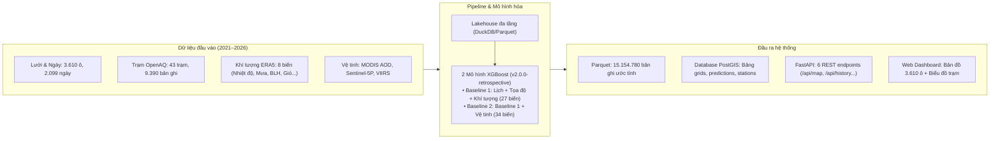
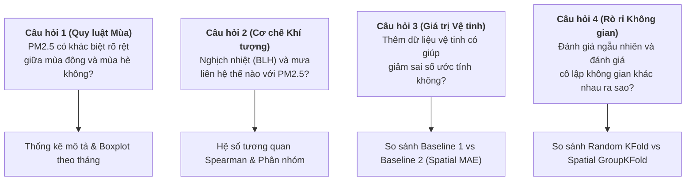

# Định Hướng Nghiệp Vụ & Giả Thuyết Nghiên Cứu (Business Case)
## Đồ án Khoa học Dữ liệu: Ước tính Hồi cứu PM2.5 Lưới 1 km Hà Nội (2021–2026)

---

## 1. Định Vị Bài Toán & Vấn Đề Thực Tế (Problem Statement)

### 1.1. Tuyên bố bài toán (Problem Statement)
> **Xây dựng hệ thống ước tính và trực quan hóa nồng độ bụi mịn $\text{PM}_{2.5}$ trung bình ngày trong quá khứ trên lưới không gian $1\text{ km} \times 1\text{ km}$ tại khu vực Hà Nội giai đoạn 2021–2026, hỗ trợ người học và người nghiên cứu khám phá sự biến động ô nhiễm theo không gian, thời gian và đối chiếu với dữ liệu quan trắc mặt đất.**

### 1.2. Vấn đề thực tế trong giám sát chất lượng không khí
Hà Nội có diện tích tự nhiên khoảng $3.359\text{ km}^2$, được hệ thống chuẩn hóa của dự án chia thành **3.610 ô lưới $1\text{ km} \times 1\text{ km}$** (`EPSG:3405` / `EPSG:4326`). Tuy nhiên, việc theo dõi nồng độ bụi mịn $\text{PM}_{2.5}$ mặt đất đối mặt với rào cản lớn về chi phí đầu tư và bảo trì trạm quan trắc chuẩn (reference grade):
- **Độ bao phủ trạm rất thưa thớt:** Trong giai đoạn 01/01/2021 – 30/09/2026 (2.099 ngày), toàn thành phố chỉ có tổng cộng **43 trạm đo** xuất hiện trong danh mục quan trắc (OpenAQ v3), phân bổ trên **38 ô lưới**.
- **Chất lượng dữ liệu không đồng đều:** Sau khi áp dụng quy chuẩn kiểm soát chất lượng (QC) ngày hợp lệ ($\ge 18/24$ giờ đo hợp lệ mỗi ngày), tập dữ liệu huấn luyện thực tế chỉ có **7.290 dòng trạm–ngày hợp lệ**, thu nhận từ **32 trạm** nằm trên **30 ô lưới**.
- **Khoảng trống không gian khổng lồ:** Có tới **3.580 / 3.610 ô lưới ($\approx 99,17\%$) hoàn toàn không có trạm quan trắc mặt đất**. Phần lớn các khu vực ngoại thành, vùng đệm sinh thái, hành lang giao thông huyết mạch và các khu công nghiệp vệ tinh không có chuỗi số liệu giám sát liên tục.

### 1.3. Phân biệt rõ các khái niệm (Tránh ngộ nhận phạm vi)
Để bảo đảm tính trung thực khoa học, hệ thống phân định rạch ròi 3 khái niệm:
1. **Số đo quan trắc mặt đất (`pm25_observed`):** Là giá trị thực đo từ cảm biến tại các trạm mặt đất có tọa độ xác định. Đây là "nhãn chân lý" (ground truth) dùng để huấn luyện và kiểm chứng mô hình, **không phải giá trị có sẵn trên toàn bộ 3.610 ô lưới**.
2. **Ước tính hồi cứu của mô hình (`pm25_pred`):** Là giá trị do mô hình học máy (XGBoost) nội suy/ước tính dựa trên tọa độ không gian, ngày tháng, khí tượng ERA5 và dữ liệu vệ tinh lịch sử. Giá trị này mang tính chất ước lượng thống kê (retrospective estimation) cho từng ngày trong quá khứ.
3. **Dự báo tương lai (Forecasting):** Đồ án **KHÔNG** làm bài toán dự báo cho ngày mai hay các ngày sắp tới, vì mô hình sử dụng các biến khí tượng và vệ tinh tái phân tích của chính ngày đó để ước tính hồi cứu.
4. **Không phải hệ thống chẩn đoán y tế hay xác định nguyên nhân ô nhiễm:** Đồ án không có dữ liệu kiểm kê nguồn thải chi tiết (emission inventory) hay dữ liệu bệnh học, do đó kết quả chỉ phản ánh tương quan nồng độ trong không khí, không đưa ra kết luận nhân quả y tế hoặc quy trách nhiệm phát thải cho bất kỳ nguồn cụ thể nào.

---

## 2. Đối Tượng Sử Dụng & Trường Hợp Sử Dụng (Target Users & Use Cases)

| Nhóm người dùng | Nhu cầu thực tế | Cách sử dụng sản phẩm của đồ án |
| :--- | :--- | :--- |
| **Học viên, Sinh viên Khoa học Dữ liệu** | Thực hành quy trình Data Science end-to-end trên bài toán không-thời gian (spatiotemporal). | Khám phá cách xử lý dữ liệu đa nguồn (Multi-source Lakehouse), hiểu hiện tượng rò rỉ không gian (Spatial Data Leakage) và cách kiểm thử mô hình bằng `Spatial GroupKFold`. |
| **Người nghiên cứu môi trường / GIS** | Cần chuỗi dữ liệu $\text{PM}_{2.5}$ dạng lưới $1\text{ km}$ liên tục để phân tích không gian trong quá khứ. | Tải dữ liệu ước tính lưới 2021–2026 qua REST API hoặc Parquet, so sánh chuỗi thời gian giữa ô có trạm và ô không có trạm, quan sát diễn biến mùa khô/mùa mưa. |
| **Người xây dựng ứng dụng Web / Bản đồ** | Cần giao diện trực quan hóa dữ liệu ô lưới lớn kèm số liệu trạm. | Trải nghiệm Dashboard bản đồ Leaflet canvas tải 3.610 polygon, tra cứu lịch sử nồng độ của bất kỳ tọa độ ô nào trong 6 năm qua. |

---

## 3. Tại Sao Cần Kết Hợp Đa Nguồn: Trạm, Khí Tượng & Vệ Tinh?

Một điểm trạm mặt đất chỉ phản ánh nồng độ tại điểm đo cục bộ ($0\text{D}$). Để ước tính cho mặt phẳng không gian 2D ($1\text{ km} \times 1\text{ km}$), cần cơ chế bổ trợ:
1. **Dữ liệu trạm mặt đất (Ground Stations - OpenAQ):** Cung cấp nhãn nồng độ $\text{PM}_{2.5}$ ($\mu\text{g/m}^3$) chuẩn xác cao tại điểm đo thực tế.
2. **Khí tượng tái phân tích (ERA5-Land & ERA5 BLH):**
   - Không khí ô nhiễm chịu chi phối trực tiếp bởi các quá trình vật lý khí quyển: *nghịch nhiệt* giữ bụi lại sát mặt đất khi độ cao lớp biên (`blh_min_m`) thấp; *mưa rào* rửa trôi bụi mịn (`precip_mm`); *gió* cuốn bụi phát tán (`wind_speed`).
   - Ưu điểm của ERA5 là **phủ kín 100% không gian và thời gian**, không bị gián đoạn.
3. **Viễn thám Vệ tinh (MODIS MAIAC AOD, Sentinel-5P, VIIRS Nighttime Lights):**
   - Độ dày quang học sol khí (`AOD`) phản ánh trực tiếp mức độ tán xạ/hấp thụ ánh sáng của hạt bụi trong toàn bộ cột khí quyển nhìn từ trên cao xuống.
   - Ánh sáng ban đêm VIIRS (`viirs_radiance`) là đại diện cho mật độ đô thị hóa và hoạt động dân sinh tĩnh tại từng ô $1\text{ km}$.
   - Nhược điểm lớn: Vệ tinh quang học bị che khuất nghiêm ngặt bởi mây (tỷ lệ khuyết AOD tại miền Bắc Việt Nam lên đến 70–80% vào mùa nồm ẩm).

---

## 4. Đầu Vào & Đầu Ra Của Hệ Thống

---

## 5. Phạm Vi Của Phiên Bản v1.0

### Những gì hệ thống ĐÃ LÀM ĐƯỢC trong v1.0:
1. **Pipeline dữ liệu chuẩn hóa:** Hoàn thiện luồng thu thập và chuẩn hóa dữ liệu từ OpenAQ v3 và Google Earth Engine cho 3.610 ô lưới trong suốt 2.099 ngày (từ 01/01/2021 đến 30/09/2026).
2. **Hai mô hình cơ sở kiểm chứng rõ ràng:**
   - **Baseline 1:** 27 đặc trưng (Lịch, Tọa độ, Khí tượng ERA5).
   - **Baseline 2:** 34 đặc trưng (Baseline 1 + 7 biến viễn thám vệ tinh).
3. **Quy trình đánh giá khoa học 3 phương pháp:**
   - Spatial GroupKFold (đánh giá chính, cô lập trạm).
   - Random KFold (đối chứng rò rỉ dữ liệu).
   - Temporal Split (kiểm tra suy rộng theo thời gian năm 2026).
4. **Bộ dữ liệu ước tính hồi cứu đầy đủ:** Đã sinh trọn vẹn 15.154.780 dòng ước tính (7,57 triệu dòng/mô hình) lưu dạng Parquet phân vùng theo tháng.
5. **Đóng gói dịch vụ hoàn chỉnh (Full-stack 1-chạm):**
   - Database PostgreSQL 16 + PostGIS 3.4 tự động tạo bảng và nạp dữ liệu.
   - Backend FastAPI với 6 REST endpoints có in-memory caching.
   - Frontend React SPA + Leaflet canvas kết nối API thật.
   - Khởi động toàn bộ chỉ bằng một lệnh duy nhất: `.\run.ps1` hoặc `docker compose up -d`.

### Những gì đồ án CHƯA GIẢI QUYẾT ĐƯỢC (Giới hạn thực tế):
1. **Chưa có dự báo thời gian thực (Real-time Live Crawl):** Dữ liệu hiện tại kết thúc ở ngày 30/09/2026; chưa có cơ chế crawler tự động kéo dữ liệu của ngày hôm nay.
2. **Không gian trạm quan trắc tập trung ở nội thành:** 32 trạm đo hợp lệ phân bố chủ yếu ở khu vực trung tâm và đô thị phát triển; vùng ngoại thành và nông thôn gần như vắng bóng trạm kiểm chứng.
3. **Tỷ lệ khuyết dữ liệu vệ tinh cao:** Dữ liệu AOD bị mất mát lớn do mây bao phủ, khiến mô hình phải dựa nhiều vào đặc trưng thiếu (missing indicator) và khí tượng.
4. **Độ phân giải $1\text{ km}$ còn thô đối với vi khí hậu đô thị:** Không phản ánh được các hẻm phố hẹp, mặt đường giao thông sát nhà dân hay các hiệu ứng hẻm vực đô thị (urban street canyon).

---

## 6. Đơn Giản Hóa Câu Hỏi Nghiên Cứu & Khung Giả Thuyết

Thay vì duy trì 6 giả thuyết rời rạc, đồ án tập trung vào **4 câu hỏi nghiên cứu cốt lõi**, vừa vặn với phạm vi môn học và có số liệu thực nghiệm chứng minh:

### 🔹 Câu hỏi 1: Nồng độ PM2.5 tại các trạm quan trắc ở Hà Nội có sự khác biệt rõ rệt theo mùa / tháng không?
- **Lý do đặt câu hỏi:** Để xác định xem biến thời gian (tháng, mùa) có phải là đặc trưng phân loại quan trọng cho mô hình hay không.
- **Biến sử dụng:** `pm25_observed`, `month`, `season` từ `fct_station_daily_observations.parquet`.
- **Phương pháp phân tích:** Thống kê mô tả (trung vị, trung bình, phân vị 25–75%), biểu đồ hộp (boxplot) theo tháng.
- **Kết quả thực tế đã xác minh:**
  - Nồng độ $\text{PM}_{2.5}$ phân hóa cực kỳ sâu sắc: Mùa Đông (tháng 11 – tháng 2 năm sau) có trung vị nồng độ lên tới **$45 - 55\ \mu\text{g/m}^3$**, tỷ lệ vượt ngưỡng QCVN ($>50\ \mu\text{g/m}^3$) đạt trên 40%.
  - Ngược lại, mùa Hè (tháng 6 – tháng 8) trung vị nồng độ giảm mạnh xuống **$18 - 25\ \mu\text{g/m}^3$**, tỷ lệ vượt ngưỡng dưới 5%.
- **Ý nghĩa đối với mô hình:** Khẳng định các đặc trưng lịch (`month`, `day_of_year`, các hàm tuần hoàn sin/cos của ngày trong năm) là nhóm đặc trưng bắt buộc phải có trong cả hai mô hình.

### 🔹 Câu hỏi 2: PM2.5 liên hệ như thế nào với các yếu tố khí tượng (độ cao lớp biên, lượng mưa, tốc độ gió)?
- **Lý do đặt câu hỏi:** Xác định xem điều kiện khí quyển có giải thích được sự tích tụ hay phát tán bụi mịn hay không.
- **Biến sử dụng:** `blh_min_m`, `precip_mm`, `wind_speed_10m_ms`, `pm25_observed`.
- **Phương pháp phân tích:** Tính toán ma trận tương quan hạng Spearman (do phân bố lệch phải) và phân tích trung bình có điều kiện.
- **Kết quả thực tế đã xác minh:**
  - **Độ cao lớp biên cực tiểu (`blh_min_m`):** Tương quan âm rõ rệt ($\rho \approx -0,48$). Khi lớp biên ban đêm co hẹp xuống dưới $100\text{ m}$, hiện tượng nghịch nhiệt giữ bụi mịn sát đất, nồng độ trung bình tăng vọt trên $50\ \mu\text{g/m}^3$. Khi lớp biên cao ($>300\text{ m}$), đối lưu tốt giúp bụi khuếch tán, nồng độ trung bình giảm xuống dưới $28\ \mu\text{g/m}^3$.
  - **Lượng mưa (`precip_mm`):** Những ngày có mưa vừa đến mưa to ($\ge 5\text{ mm}$) có nồng độ $\text{PM}_{2.5}$ thấp hơn đáng kể so với ngày khô ráo (hiệu ứng rửa trôi ướt - wet scavenging).
- **Ý nghĩa đối với mô hình:** Chứng minh tính hợp lý vật lý của việc sử dụng các biến khí tượng ERA5 làm khung xương sống cho bài toán ước tính.

### 🔹 Câu hỏi 3: Bổ sung dữ liệu vệ tinh có thực sự cải thiện kết quả ước tính so với chỉ dùng khí tượng không?
- **Lý do đặt câu hỏi:** Thu thập và xử lý ảnh viễn thám từ Google Earth Engine rất tốn tài nguyên tính toán; cần đo lường xem dữ liệu vệ tinh đem lại giá trị gia tăng thực sự bao nhiêu.
- **Biến sử dụng:** So sánh sai số kiểm thử của **Baseline 1** (27 biến khí tượng + lịch) và **Baseline 2** (34 biến = Baseline 1 + 7 biến vệ tinh MODIS/Sentinel/VIIRS).
- **Phương pháp phân tích:** Đánh giá sai số MAE, RMSE, $R^2$ qua 5-Fold Spatial GroupKFold.
- **Kết quả thực tế đã xác minh:**
  - Trên bài toán ước tính ngoại suy không gian (`Spatial GroupKFold`):
    - **Baseline 1:** $\text{MAE} = 11,5955\ \mu\text{g/m}^3$, $\text{RMSE} = 16,7911\ \mu\text{g/m}^3$, $R^2 = 0,5452$.
    - **Baseline 2:** $\text{MAE} = 11,0451\ \mu\text{g/m}^3$, $\text{RMSE} = 15,9541\ \mu\text{g/m}^3$, $R^2 = 0,5894$.
  - Baseline 2 giảm được **$0,55\ \mu\text{g/m}^3$ MAE** ($\approx 4,7\%$) và nâng $R^2$ từ $54,5\%$ lên $58,9\%$. Baseline 2 thắng ở 4/5 fold kiểm thử.
- **Ý nghĩa đối với sản phẩm:** Vệ tinh có mang lại cải thiện thực chất, nhưng mức độ cải thiện bị kìm hãm do tỷ lệ khuyết ảnh vì mây che phủ. Do đó, hệ thống giữ cả hai mô hình trên giao diện để người dùng có thể so sánh trực tiếp.

### 🔹 Câu hỏi 4: Kết quả đánh giá mô hình thay đổi ra sao giữa chia ngẫu nhiên và chia giữ riêng ô lưới?
- **Lý do đặt câu hỏi:** Kiểm chứng hiện tượng rò rỉ dữ liệu không gian (spatial leakage) — một lỗi kinh điển trong các đồ án học máy trên dữ liệu không gian.
- **Biến sử dụng:** Kết quả chạy 5-Fold `Random KFold` so với 5-Fold `Spatial GroupKFold` của cả 2 baseline.
- **Phương pháp phân tích:** So sánh sự sụt giảm hiệu năng giữa 2 chiến lược chia tập.
- **Kết quả thực tế đã xác minh:**
  - Khi chia ngẫu nhiên theo dòng (**Random KFold**): Mô hình đạt chỉ số "đẹp nhân tạo" với $\text{MAE} \approx 6,6 - 6,7\ \mu\text{g/m}^3$ và $R^2 \approx 0,83 - 0,84$.
  - Khi chia cô lập theo ô lưới (**Spatial GroupKFold**): $\text{MAE}$ thực tế tăng lên **$11,0 - 11,6\ \mu\text{g/m}^3$** và $R^2$ sụt giảm về **$0,55 - 0,59$**.
- **Kết luận khoa học quan trọng:** Random KFold làm rò rỉ thông tin vì trong cùng một ngày, trạm A và trạm B cách nhau vài km có nồng độ tương đồng nhau. Nếu trạm A ở tập Train và trạm B ở tập Test, mô hình chỉ đơn thuần "nhớ" ngày hôm đó thay vì học được quy luật không gian. **Spatial GroupKFold mới là thước đo trung thực nhất phản ánh năng lực ước tính tại 3.580 ô không có trạm đo!**

---

## 7. Tiêu Chí Đánh Giá Thành Công Của Đồ Án

1. **Về mặt Khoa học Dữ liệu:**
   - Xây dựng được quy trình xử lý dữ liệu không-thời gian hoàn chỉnh, minh bạch, có kiểm soát chất lượng (QC).
   - Thiết kế phương pháp đánh giá trung thực (`Spatial GroupKFold`), dám công bố và giải thích rõ nguyên nhân sụt giảm chỉ số từ $0,83$ xuống $0,58$.
2. **Về mặt Kỹ thuật Phần mềm & Sản phẩm:**
   - 100% dữ liệu ước tính được đối soát nhất quán (3-point reconciliation: Parquet $\leftrightarrow$ PostgreSQL $\leftrightarrow$ API).
   - Hệ thống có khả năng đóng gói hoàn chỉnh bằng Docker, chạy 1-chạm (`run.ps1`), giao diện phản hồi mượt mà cho 3.610 ô lưới.
3. **Về mặt Trình bày & Thuyết minh:**
   - Trả lời trọn vẹn, thuyết phục các câu hỏi chất vấn của giảng viên về ranh giới bài toán, tính đại diện của mẫu, và nguyên nhân mô hình đạt mức sai số $\approx 11\ \mu\text{g/m}^3$.
