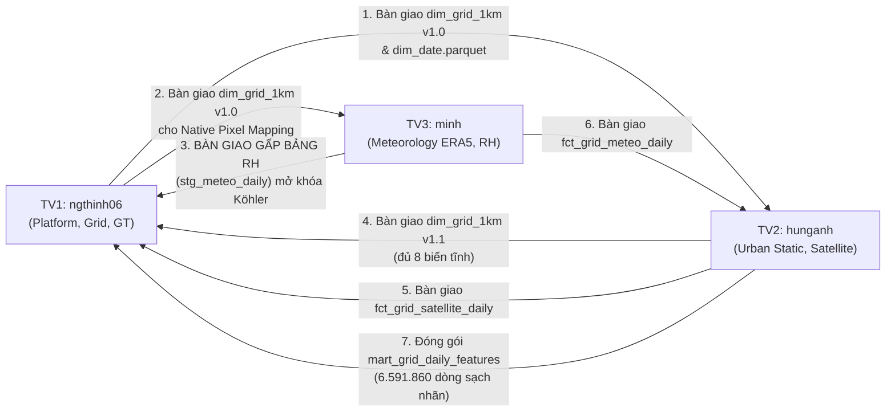

# CẨM NANG THỰC THI & QUY CHUẨN BÀN GIAO DỮ LIỆU TOÀN DIỆN (TEAM EXECUTION & HANDOFF GUIDE)
## DỰ ÁN HANOI_PM25: SPATIO-TEMPORAL DATA LAKEHOUSE (2021–2025)

**Cơ quan ban hành:** Ban Kiến trúc Dữ liệu & Đảm bảo Chất lượng Dự án (Data Architecture & Quality Board)  
**Tác giả:** Data Architect & CI/CD Lead (`ngthinh06` - TV1)  
**Phạm vi áp dụng:** Toàn bộ 3 kỹ sư thành viên:
- **Thành viên 1 (`ngthinh06`):** Data Architect, Spatial Spine & Ground Truth Lead
- **Thành viên 2 (`hunganh`):** Urban Static Features & Satellite Earth Observation Lead
- **Thành viên 3 (`minh`):** Atmospheric Dynamics & Meteorological Reanalysis Engineer  
**Phiên bản tài liệu:** `v3.1.0-master`  
**Ngày hiệu lực:** 2026-10-26  
**Trạng thái phê duyệt:** TÀI LIỆU HƯỚNG DẪN CHUẨN HÓA DÀNH CHO CẢ 3 THÀNH VIÊN  
**Tài liệu liên kết kiến trúc bắt buộc:**
- [Đặc tả Lược đồ Dữ liệu (docs/schema.md)](./docs/schema.md)
- [Hợp đồng Dữ liệu Tổng thể (docs/data_contract.md)](./docs/data_contract.md)

---

## MỤC LỤC TỔNG THỂ

1. [Tổng quan Kiến trúc, Múi giờ và Khung xương Bất biến Toàn dự án](#1-tổng-quan-kiến-trúc-múi-giờ-và-khung-xương-bất-biến-toàn-dự-án)
2. [Ma trận Phân quyền & Điểm Giao thoa Liên thành viên (RACI & Handoff Matrix)](#2-ma-trận-phân-quyền--điểm-giao-thoa-liên-thành-viên-raci--handoff-matrix)
3. [CẨM NANG DÀNH RIÊNG CHO THÀNH VIÊN 1: ngthinh06 (Lưới, Ngày, Trạm & Ground Truth)](#3-cẩm-nang-dành-riêng-cho-thành-viên-1-ngthinh06-lưới-ngày-trạm--ground-truth)
4. [CẨM NANG DÀNH RIÊNG CHO THÀNH VIÊN 2: hunganh (Đặc trưng tĩnh Đô thị & Viễn thám Vệ tinh)](#4-cẩm-nang-dành-riêng-cho-thành-viên-2-hunganh-đặc-trưng-tĩnh-đô-thị--viễn-thám-vệ-tinh)
5. [CẨM NANG DÀNH RIÊNG CHO THÀNH VIÊN 3: minh (Khí quyển ERA5-Land, BLH & Độ ẩm Tương đối)](#5-cẩm-nang-dành-riêng-cho-thành-viên-3-minh-khí-quyển-era5-land-blh--độ-ẩm-tương-đối)
6. [Quy chuẩn Đóng gói Chợ Đặc trưng (Feature Marts) & Rào chắn Chống Rò rỉ Nhãn](#6-quy-chuẩn-đóng-gói-chợ-đặc-trưng-feature-marts--rào-chắn-chống-rò-rỉ-nhãn)
7. [Quy trình Đồng bộ Mã nguồn Git, CI/CD và Cấu trúc Lưu trữ Google Drive](#7-quy-trình-đồng-bộ-mã-nguồn-git-cicd-và-cấu-trúc-lưu-trữ-google-drive)
8. [Nhật ký Xử lý Mâu thuẫn Kiến trúc và Quyết định Cần Đồng thuận](#8-nhật-ký-xử-lý-mâu-thuẫn-kiến-trúc-và-quyết-định-cần-đồng-thuận)

---

## 1. TỔNG QUAN KIẾN TRÚC, MÚI GIỜ VÀ KHUNG XƯƠNG BẤT BIẾN TOÀN DỰ ÁN

### 1.1. Kiến trúc Zero-RDBMS Lakehouse
Dự án HANOI_PM25 tuân thủ nguyên tắc **Zero-RDBMS**:
- Không cài đặt hay chạy dịch vụ ngầm bất kỳ máy chủ cơ sở dữ liệu nào (PostgreSQL/PostGIS, MySQL, SQL Server).
- Toàn bộ dữ liệu được lưu trữ nguyên tử dưới định dạng **Apache Parquet** và **GeoParquet 1.1.0** (chuẩn nén `zstd`), phân tầng Medallion rõ ràng:
  - `data/raw/`: Dữ liệu thô nguyên bản từ các API và vệ tinh, tổ chức phân vùng Hive (`source=.../year=.../month=...`).
  - `data/staging/`: Dữ liệu chuỗi giờ làm sạch, chuẩn hóa múi giờ Hà Nội, gắn cờ QC phân tầng.
  - `data/core/`: Mô hình hình sao Kimball (Star Schema) gồm 3 Dimensions và 3 Facts.
  - `data/marts/`: Bảng thành phẩm đặc trưng không-thời gian phục vụ Machine Learning và trực quan hóa.
- Engine tính toán duy nhất: **DuckDB SQL nhúng** và thư viện **Polars** trong Python.

### 1.2. Khung Không gian và Thời gian Bất biến Đã Đóng Băng
Theo tệp kê khai chuẩn `data/manifests/grid_manifest.json` và provenance `data/reference/hanoi_boundary.provenance.json`:
1. **Hệ quy chiếu Không gian:** Phẳng mét quốc gia **VN-2000 / UTM Zone 48N (`EPSG:3405`)**.
2. **Quy mô Lưới 1km:**
   - Cắt giao ô vuông đều $1.000\text{ m} \times 1.000\text{ m}$ với ranh giới Hà Nội (HDX COD-AB v02, 2025-07-01, SHA-256 `d8194abcc1d89eadd836941a750ae339f398a9b2e5e9d2428d0f96f1f2bd1f77`) bằng toán tử `intersects`.
   - **$N_{\text{GRID}} = 3.610\text{ ô phân tích thực tế}$** (trong đó có 3.363 ô canonical có trọng tâm nằm hoàn toàn trong địa giới).
   - Bảng `dim_grid_1km.parquet` có đúng **$3.611\text{ dòng}$** (gồm 3.610 ô phân tích + 1 dòng ngoại lệ `grid_unknown`).
3. **Trục Thời gian:**
   - 5 năm liên tục: `2021-01-01` đến `2025-12-31` theo giờ địa phương Hà Nội (`Asia/Ho_Chi_Minh`, `UTC+7`).
   - Khóa ngày: `date_id` định dạng số nguyên `YYYYMMDD`, bản ghi ngoại lệ là `-1`.
   - **$N_{\text{DAYS}} = 1.826\text{ ngày lịch thực tế}$** (gồm 366 ngày của năm nhuận 2024). Bảng `dim_date.parquet` có đúng **$1.827\text{ dòng}$** (gồm 1 dòng ngoại lệ `date_id = -1`).
4. **Quy mô Ma trận Khung xương Phân tích (Analysis Spine Matrix):**
   $$|S| = N_{\text{GRID}} \times N_{\text{DAYS}} = 3.610 \times 1.826 = 6.591.860\text{ dòng}$$
   Khung xương này loại trừ cả hai bản ghi ngoại lệ (`grid_id != 'grid_unknown'` và `date_id != -1`). Mọi bảng Marts tổng hợp ô–ngày bắt buộc phải khớp chính xác 100% quy mô $|S|$.

---

## 2. MA TRẬN PHÂN QUYỀN & ĐIỂM GIAO THOA LIÊN THÀNH VIÊN (RACI & HANDOFF MATRIX)

### 2.1. Ma trận Trách nhiệm (RACI Matrix)

| Hạng mục Dữ liệu / Công việc | TV1 (`ngthinh06`) | TV2 (`hunganh`) | TV3 (`minh`) | Ghi chú & Trạng thái |
| :--- | :---: | :---: | :---: | :--- |
| Khung runner `run.py`, CI/CD, Hàm băm & IO Parquet | **R / A** | C | C | Đã hoàn thành (v1.0) |
| Ranh giới Hà Nội & Lưới 1km Spine (`dim_grid_1km` v1.0) | **R / A** | C | C | Đã đóng băng 3.611 dòng |
| Trục ngày 5 năm (`dim_date`) | **R / A** | I | I | Đã đóng băng 1.827 dòng |
| Danh mục trạm mặt đất (`dim_station`) | **R / A** | I | I | Đã hoàn thành (15 dòng) |
| Ingest chuỗi giờ OpenAQ thô & Staging QC trạm | **R / A** | I | I | Đã hoàn thành |
| Bảng Fact mặt đất ngày (`fct_ground_truth_daily`) | **R / A** | I | I | Đã hoàn thành ($\ge 18\text{h}$) |
| 8 biến lưới TV2 (`dim_grid_1km` v1.1 và 5 file theo năm) | C | **R / A** | I | Đã tạo, chờ TV1 review |
| Ingest & Staging Viễn thám (MODIS, S5P, VIIRS) | I | **R / A** | C | Đã tạo 2021–2025, chờ TV1 review |
| Fact Viễn thám ô–ngày (`fct_grid_satellite_daily`) | C | **R / A** | I | Đã tạo, chờ TV1 review |
| Ingest & Staging Khí tượng (ERA5-Land, BLH) | I | C | **R / A** | Đang thực hiện |
| Bảng độ ẩm $RH$ giải phóng nút thắt Köhler cho TV1 | I | I | **R / A** | **Giao điểm khẩn cấp** |
| Fact Khí tượng ô–ngày (`fct_grid_meteo_daily`) | C | I | **R / A** | Chờ TV3 xác nhận bàn giao |
| Đóng gói Chợ Đặc trưng (`mart_grid_daily_features`) | C | **R / A** | C | Quy mô $6.591.860$ dòng |
| Đóng gói Bảng Ghép trạm (`mart_station_matched`) | **R / A** | C | I | Tập nhãn huấn luyện ML |

*(R: Responsible - Thực thi chính; A: Accountable - Chịu trách nhiệm cuối; C: Consulted - Tham vấn; I: Informed - Nhận thông báo).*

### 2.2. Ma trận Bàn giao Cốt lõi Giữa 3 Thành viên (Handoff Points)



---

## 3. CẨM NANG DÀNH RIÊNG CHO THÀNH VIÊN 1: ngthinh06 (LƯỚI, NGÀY, TRẠM & GROUND TRUTH)

### 3.1. Vai trò và Phạm vi của TV1
- **Phụ trách:** 
  - Quản trị toàn bộ hạ tầng thực thi: `run.py`, cấu hình CI/CD GitHub Actions, module băm lũy đẳng `src/common/hashing.py`, bộ ghi Parquet nguyên tử `src/common/io_parquet.py`.
  - Thiết lập và đóng băng chiều không gian `dim_grid_1km.parquet` v1.0 và trục thời gian `dim_date.parquet`.
  - Kiểm toán danh mục trạm OpenAQ (`src/ingest/audit_stations.py`) và tạo bảng `dim_station.parquet`.
  - Thu thập dữ liệu giờ thô OpenAQ (`src/ingest/fetch_ground_truth.py`), làm sạch chuỗi giờ (`src/features/qc_hourly_stations.py`) và tạo bảng Fact trạm ngày `fct_ground_truth_daily.parquet`.
  - Xây dựng bảng ghép nhãn huấn luyện `mart_station_matched.parquet`.
- **Không phụ trách:** Thu thập ảnh vệ tinh MODIS/Sentinel-5P/VIIRS (của TV2); thu thập dữ liệu khí tượng ERA5-Land/BLH (của TV3); tính toán 8 biến tĩnh đô thị đã liệt kê trong schema (của TV2).
- **Phụ thuộc:** Chờ TV3 bàn giao bảng chuỗi giờ độ ẩm tương đối $RH$ (`stg_meteo_daily.parquet`) để kích hoạt công thức hiệu chỉnh ẩm $\kappa$-Köhler toàn diện cho các cảm biến Tier 2.

### 3.2. Danh sách Nguồn Dữ liệu TV1 Thu thập

#### Nguồn 1: Ranh giới Địa giới Hành chính Hà Nội (Bắt buộc)
- **Cơ quan cung cấp:** Tổng cục Thống kê (GSO) & Cục Khảo sát Địa chất/OCHA Field Information Services (FIS).
- **Dataset / Product ID:** `cod-ab-vnm` (Version 02, ngày ban hành 2025-07-01).
- **Tài liệu chính thức:** [HDX COD-AB Vietnam Dataset](https://data.humdata.org/dataset/cod-ab-vnm).
- **Phương thức thu thập:** Tải file nén `vnm_admin_boundaries.geojson.zip`, trích xuất đối tượng `adm1_pcode = 'VN01'`.
- **Độ phân giải & Phạm vi:** Đa giác ranh giới cấp tỉnh/thành phố toàn Hà Nội, không đơn giản hóa cạnh.
- **Giấy phép & Kiểm thực:** Creative Commons Attribution 3.0 IGO (CC BY 3.0 IGO). Mã băm SHA-256 lưu trữ tại `data/reference/hanoi_boundary.provenance.json` là `d8194abcc1d89eadd836941a750ae339f398a9b2e5e9d2428d0f96f1f2bd1f77`.

#### Nguồn 2: Mạng lưới Trạm Quan trắc Mặt đất OpenAQ v3 (Bắt buộc)
- **Cơ quan cung cấp:** OpenAQ Platform (Tổng hợp dữ liệu trạm Đại sứ quán Mỹ, Chi cục BVMT Hà Nội, PAM Air).
- **API Endpoint:** `https://api.openaq.org/v3`
  - Danh mục trạm: `GET /locations?bbox=105.28,20.56,106.02,21.39&limit=100`
  - Chuỗi đo theo trạm: `GET /locations/{location_id}/sensors` và `GET /measurements`
- **Tài liệu chính thức:** [OpenAQ v3 API Documentation](https://docs.openaq.org/).
- **Biến thu thập:** Nồng độ bụi $PM_{2.5}$ (`parameter = 'pm25'`), đơn vị $\mu\text{g}/\text{m}^3$.
- **Thời gian & Cửa sổ mở rộng:** `2020-12-31T16:00:00Z` đến `2026-01-01T08:00:00Z` (đảm bảo phủ trọn vẹn 1.826 ngày Hà Nội).
- **Tài khoản & Hạn mức:** Cần `X-API-Key` đăng ký miễn phí trên OpenAQ Console. Giới hạn 60 requests/phút. Áp dụng Exponential Backoff khi gặp lỗi HTTP 429.
- **Giấy phép:** OpenAQ Open Data License (CC BY 4.0).

### 3.3. Quy trình Thu thập & Chống Trùng lặp của TV1
1. **Kiểm toán trước danh mục trạm:** Chạy `python -m src.ingest.audit_stations` để quét toàn bộ trạm trong bbox, chuyển đổi tọa độ WGS84 sang `EPSG:3405` và xác định ô lưới `grid_id`. Kết quả lưu tại `data/reference/station_registry.json`.
2. **Nạp phân đoạn (Chunking) theo Năm/Tháng:**
   - Chia vòng lặp theo từng năm (`year=2021..2025`) và từng tháng (`month=01..12`).
   - Với mỗi tháng, tải toàn bộ bản ghi giờ của các trạm trong danh mục kiểm toán.
3. **Ghi lũy đẳng (Idempotent Append):**
   - Tạo mã băm nội dung cho từng dòng: `_row_hash = SHA256(station_id | datetime_utc | pm25)`.
   - Lưu vào phân vùng Hive: `data/raw/ground_truth/source=openaq/year=YYYY/month=MM/data.parquet`.
   - Dùng hàm `append_idempotent_raw_parquet()`: Kiểm tra nếu `_row_hash` đã tồn tại trong file đích thì bỏ qua; nếu có revision mới thì ghi nối mà không làm phình file.

### 3.4. Schema ở Từng Tầng do TV1 Phụ trách

#### Tầng Raw: `data/raw/ground_truth/source=openaq/year=YYYY/month=MM/data.parquet`
- **Hạt dữ liệu:** Trạm – Phép đo giờ UTC.
- **Khóa nghiệp vụ:** `(station_id, datetime_utc)`.
- **Cấu trúc cột:**
  - `station_id` (`VARCHAR`, PK): Định danh trạm, ví dụ `'openaq_8422'`.
  - `datetime_utc` (`VARCHAR`, PK): Chuỗi ISO-8601 UTC, ví dụ `'2021-01-01T00:00:00Z'`.
  - `datetime_local` (`VARCHAR`): Giờ Hà Nội, ví dụ `'2021-01-01T07:00:00+07:00'`.
  - `pm25_ug_m3` (`DOUBLE`): Giá trị nồng độ thô ghi nhận từ sensor.
  - `sensor_tier` (`VARCHAR`): `'Tier_1_Reference_FEM'` hoặc `'Tier_2_LowCost_Optical'`.
  - `grid_id` (`VARCHAR`, FK): Ô lưới chứa trạm, ví dụ `'grid_584000_2324000'`.
  - `ingested_at` (`VARCHAR`): Timestamp thời điểm nạp vào hệ thống.
  - `_row_hash` (`VARCHAR`): Mã băm SHA-256 nội dung dòng.

#### Tầng Staging: `data/staging/stg_ground_truth_hourly.parquet`
- **Hạt dữ liệu:** Trạm – Giờ làm sạch và gán cờ QC.
- **Khóa chính:** `(station_id, datetime_utc)`.
- **Cấu trúc cột:** Toàn bộ cột của tầng Raw kèm:
  - `qc_flag` (`INT32`, not null): Cờ phân tầng: `0` (Sạch), `1` (Âm $< 0$), `2` (Vượt ngưỡng $> 1.000\,\mu\text{g}/\text{m}^3$), `3` (Flatline kẹt cảm biến $\ge 6\text{h}$).
  - `is_hampel_outlier` (`INT32`, not null): `1` nếu phát hiện ngoại lai qua bộ lọc Hampel ($window=7\text{h}, 3\sigma$), `0` nếu bình thường.

#### Tầng Core Fact: `data/core/fct_ground_truth_daily.parquet`
- **Hạt dữ liệu:** Trạm – Ngày ($\ge 18\text{h}$ hợp lệ).
- **Khóa chính:** `(station_id, date_id)`.
- **Khóa ngoại:** `station_id` $\rightarrow$ `dim_station`, `date_id` $\rightarrow$ `dim_date`, `grid_id` $\rightarrow$ `dim_grid_1km`.
- **Cột:** `station_id`, `date_id`, `grid_id`, `valid_hours_count`, `pm25_raw_mean`, `pm25_calibrated_mean`, `pm25_daily_std`, `pm25_daily_min`, `pm25_daily_max`. (Chi tiết kiểu dữ liệu xem tại [docs/schema.md](./docs/schema.md#44-bảng-dữ-liệu-sự-kiện-quan-trắc-mặt-đất-hàng-ngày-fct_ground_truth_daily)).

### 3.5. Quy tắc Biến đổi & Nghiệm thu của TV1
- **Múi giờ:** Chuỗi giờ thô UTC phải cộng $7\text{ giờ}$ để xác định chính xác ngày địa phương Hà Nội: `date_id = CAST(STRFTIME(datetime_local, '%Y%m%d') AS INT32)`.
- **Quy tắc $\ge 18\text{h}$ hợp lệ:**
  - Chỉ tính toán trung bình ngày trên các giờ có `qc_flag = 0`.
  - Nếu $\text{valid\_hours\_count} < 18\text{ giờ}$, ngày đo đó chỉ được lưu tại `stg_ground_truth_daily.parquet` với `is_valid_day = 0` và **bị loại bỏ hoàn toàn khỏi `fct_ground_truth_daily.parquet`**.
- **Hiệu chỉnh $\kappa$-Köhler:**
  - Với trạm Tier 1 FEM (Sứ quán Mỹ): `pm25_calibrated_mean = pm25_raw_mean`.
  - Với trạm Tier 2 (PAM Air): Khi nhận được chuỗi $RH$ từ TV3, áp dụng công thức Köhler với $\kappa = 0.35$ khi $RH > 70\%$ để giảm trừ sai số do sol khí hút ẩm.

### 3.6. Bảng Đầu ra Bàn giao của TV1

| Tên bảng / File | Vị trí lưu trữ | Hạt dữ liệu | Quy mô kỳ vọng | Trạng thái hiện tại |
| :--- | :--- | :--- | :--- | :---: |
| `dim_grid_1km.parquet` (v1.0) | `data/core/` | Ô vuông 1km | Đúng 3.611 dòng | **Đã hoàn thành** |
| `dim_date.parquet` | `data/core/` | Ngày lịch | Đúng 1.827 dòng | **Đã hoàn thành** |
| `dim_station.parquet` | `data/core/` | Trạm quan trắc | Đúng 15 dòng | **Đã hoàn thành** |
| `fct_ground_truth_daily.parquet` | `data/core/` | Trạm – Ngày | Phụ thuộc số ngày $\ge 18\text{h}$ | **Đã hoàn thành** |

*Minh họa một số dòng dữ liệu thực tế bàn giao từ `fct_ground_truth_daily.parquet`:*
```
station_id      | date_id  | grid_id              | valid_hours_count | pm25_raw_mean | pm25_calibrated_mean
----------------+----------+----------------------+-------------------+---------------+---------------------
openaq_8422     | 20210101 | grid_584000_2324000  | 24                | 68.42         | 68.42
openaq_8422     | 20210102 | grid_584000_2324000  | 23                | 84.15         | 84.15
openaq_8425     | 20210101 | grid_588000_2327000  | 21                | 55.30         | 42.10
```

---

## 4. CẨM NANG DÀNH RIÊNG CHO THÀNH VIÊN 2: hunganh (ĐẶC TRƯNG TĨNH ĐÔ THỊ & VIỄN THÁM VỆ TINH)

Xem [bản bàn giao TV2](tv2_handoff.md) để review file đầu ra, quy tắc xử lý, lệnh tái tạo và các quyết định còn mở. [Runbook GEE](satellite_gee_runbook.md) ghi chi tiết các đợt xuất và chẩn đoán dữ liệu nguồn.

### 4.1. Vai trò và Phạm vi của TV2
- **Phụ trách:**
  - Trích xuất 8 đặc trưng đô thị đã liệt kê ở §4.4 (2 biến giao thông OpenStreetMap theo năm, 4 biến lớp phủ ESA WorldCover 2021 và 2 biến địa hình NASA SRTM DEM) vào các file `dim_grid_1km`.
  - Kiểm toán, thu thập và tiền xử lý viễn thám vệ tinh trên Google Earth Engine (MODIS MAIAC AOD, Sentinel-5P $NO_2$, VIIRS Nightlight).
  - Giữ dữ liệu AOD thiếu là `NULL`, đánh dấu ngày thiếu để EDA tìm nguyên nhân, và đóng gói `fct_grid_satellite_daily.parquet`.
  - Phối hợp đóng gói Chợ Đặc trưng `mart_grid_daily_features.parquet` quy mô $6.591.860\text{ dòng}$.
- **Không phụ trách:** Thu thập khí tượng ERA5-Land và tính độ ẩm $RH$ (của TV3); quản lý dữ liệu trạm quan trắc OpenAQ (của TV1).
- **Phụ thuộc:**
  - *Làm được ngay:* Kết nối GEE audit nguồn; tính toán 8 biến tĩnh đô thị trên nền `dim_grid_1km.parquet` v1.0 đã có sẵn từ TV1.
  - *Chờ đợi:* Chờ TV3 hoàn tất `fct_grid_meteo_daily` để phối hợp thực hiện `LEFT JOIN` đóng gói `mart_grid_daily_features.parquet`.

### 4.2. Danh sách Nguồn Dữ liệu TV2 Thu thập

#### Nguồn 1: Mạng lưới Giao thông OpenStreetMap (OSM) (Bắt buộc)
- **Cơ quan cung cấp:** Cộng đồng OpenStreetMap / Geofabrik Vietnam Extract.
- **Link chính thức:** [Geofabrik Vietnam Shapefiles](https://download.geofabrik.de/asia/vietnam.html).
- **Phương thức thu thập đã triển khai:** Dùng các bản trích xuất Geofabrik đầu từng năm `vietnam-210101-free.shp.zip` đến `vietnam-250101-free.shp.zip`, lọc lớp `gis_osm_roads_free_1.shp`. `dim_grid_1km.parquet` v1.1 giữ 3.611 dòng và hai cột OSM không hậu tố của mốc 2021 để tương thích TV1. Bảng `fct_grid_osm_yearly.parquet` có 18.050 dòng, khóa `(grid_id, year)` và hai giá trị OSM đúng năm. Mart ghép lưới theo `grid_id`, rồi ghép OSM theo `(grid_id, year)` của ngày. Mốc đầu năm là xấp xỉ theo năm, không tái dựng mạng đường chính xác từng ngày. SHA-256 và thời điểm ảnh chụp được lưu trong các manifest tương ứng.
- **Biến cần lấy:**
  - `osm_primary_road_m`: Chiều dài đường chính (motorway, trunk, primary) cắt qua từng ô lưới 1km (mét).
  - `osm_road_density_km_km2`: Tổng chiều dài toàn bộ các cấp đường trong ô chia cho diện tích ô ($\text{km}/\text{km}^2$).
- **Lưu ý khi phân tích:** Snapshot đầu năm chỉ xấp xỉ mạng đường của cả năm; những ngày trước thời điểm chụp đầu tháng 01 có thể chứa thông tin đến sau vài giờ. Số đường được vẽ trên OSM cũng thay đổi theo mức độ đóng góp bản đồ, không chỉ theo xây dựng thực tế. Giữa các snapshot 2021 và 2022, mật độ đường trung bình của lưới tăng từ khoảng 4,48 lên 7,78 km/km²; cần xem xét hiệu ứng này trong EDA.
- **Giấy phép:** Open Data Commons Open Database License (ODbL).

#### Nguồn 2: Bản đồ Lớp phủ Bề mặt ESA WorldCover 10m (Bắt buộc)
- **Cơ quan cung cấp:** Cơ quan Vũ trụ Châu Âu (ESA).
- **Dataset ID trên GEE:** `ESA/WorldCover/v100` (năm 2020) và `ESA/WorldCover/v200` (năm 2021).
- **Tài liệu chính thức:** [ESA WorldCover Documentation](https://esa-worldcover.org/).
- **Biến cần lấy:**
  - `worldcover_builtup_ratio`: Tỷ lệ diện tích xây dựng đô thị (mã pixel `50`).
  - `worldcover_tree_ratio`: Tỷ lệ tán che cây xanh / rừng (mã pixel `10`).
  - `worldcover_cropland_ratio`: Tỷ lệ đất nông nghiệp trồng trọt (mã pixel `40`).
  - `worldcover_water_ratio`: Tỷ lệ mặt nước thường trực (mã pixel `80`).
- **Độ phân giải:** Không gian $10\text{ m}$. Tính toán theo thuật toán `zonal_stats` trên từng ô vuông $1\text{ km}^2$.

#### Nguồn 3: Mô hình Độ cao Kỹ thuật số NASA SRTM DEM 30m (Bắt buộc)
- **Cơ quan cung cấp:** NASA / USGS.
- **Dataset ID trên GEE:** `USGS/SRTMGL1_003`.
- **Tài liệu chính thức:** [USGS SRTM GL1 Documentation](https://lpdaac.usgs.gov/products/srtmgl1v003/).
- **Biến cần lấy:**
  - `dem_elevation_mean_m`: Độ cao trung bình so với mực nước biển (mét, dải $[-10.0, 1400.0]$).
  - `dem_slope_mean_deg`: Độ dốc sườn địa hình trung bình (degrees, dải $[0^\circ, 90^\circ]$).

#### Nguồn 4: Sol Khí Quang học MODIS MAIAC AOD 1km (Bắt buộc)
- **Cơ quan cung cấp:** NASA LP DAAC.
- **Dataset ID trên GEE:** `MODIS/061/MCD19A2_GRANULES` (MODIS Terra/Aqua MAIAC Daily L2G Global 1km).
- **Tài liệu chính thức:** [MCD19A2 v061 User Guide](https://lpdaac.usgs.gov/products/mcd19a2v061/).
- **Band & Scale Factor:** Band `Optical_Depth_047` (hoặc nội suy bước sóng $550\text{ nm}$); nhân hệ số tỷ lệ `scale_factor = 0.001` để đưa về dải đo thực $[0.0, 3.5]$.
- **Khuyết AOD:** Giữ nguyên `NULL`; cờ `is_aod_missing_mnar = 1` hiện đánh dấu thiếu số đo, chưa chứng minh mây che hay MNAR. Không nội suy trước EDA.

#### Nguồn 5: Mật độ Cột Khí Tầng Đối lưu Sentinel-5P TROPOMI $NO_2$ (Bắt buộc)
- **Cơ quan cung cấp:** Copernicus / ESA.
- **Dataset ID trên GEE:** `COPERNICUS/S5P/OFFL/L3_NO2`.
- **Tài liệu chính thức:** [Sentinel-5P TROPOMI User Guide](https://sentinels.copernicus.eu/web/sentinel/technical-guides/sentinel-5p/products-algorithms).
- **Band thu thập:** `tropospheric_NO2_column_number_density` (đơn vị $\text{mol}/\text{m}^2$).
- **Lọc chất lượng trên GEE:** Khi chuyển NO₂ L2 sang L3, GEE đã loại pixel có `qa_value < 0.75` cho band tầng đối lưu. Collection L3 không cung cấp band `qa_value` để lọc lần nữa; nếu cần tự áp ngưỡng khác, phải dùng dữ liệu L2 gốc.

#### Nguồn 6: Bức xạ Ánh sáng Ban đêm VIIRS DNB (Bắt buộc)
- **Cơ quan cung cấp:** NOAA / Colorado School of Mines.
- **Dataset ID trên GEE:** `NOAA/VIIRS/DNB/MONTHLY_V1/VCMCFG`.
- **Tài liệu chính thức:** [Earth Observation Group VIIRS Nighttime Light](https://eogdata.mines.edu/products/vnl/).
- **Band & Đơn vị:** `avg_rad` (đơn vị $\text{nW}/(\text{cm}^2\cdot\text{sr})$); dùng thêm `cf_cvg` để nhận biết pixel không có quan trắc hợp lệ.
- **Quy tắc thời gian:** Lấy dữ liệu tổng hợp tháng, phát tán (broadcast) đồng nhất cho mọi ngày trong tháng đó.

### 4.3. Quy trình Thu thập Viễn thám trên Google Earth Engine (GEE)
1. **Khởi tạo và Phân quyền:** Đăng ký tài khoản Google Cloud Project kích hoạt GEE API, xác thực qua lệnh `earthengine authenticate`.
2. **Kỹ thuật Chia khoảng (Chunking) Tránh Giới hạn Bộ nhớ:**
   - Chia 5 năm lịch thành các khoảng 3 tháng một lần (Quarterly Chunks, ví dụ: `2021-01-01` đến `2021-03-31`).
   - Sử dụng phương thức `ee.ImageCollection.reduceRegions()` hoặc truy vấn theo danh sách tọa độ tâm của 3.610 ô lưới.
3. **Lưu trữ Tầng Raw Bronze:** CSV v2 được xuất bằng `src/ingest/fetch_satellite_gee.js` trong GEE Code Editor, tải nguyên bản từ Drive vào `data/raw/earth_observation/exports/`, sau đó chạy `python -m src.ingest.ingest_satellite_csv` để kiểm tra khóa và ghi Parquet:
   - Dữ liệu thô tải từ GEE được lưu theo phân vùng:
     `data/raw/earth_observation/source=modis_aod/year=YYYY/quarter=Q/data.parquet`
     `data/raw/earth_observation/source=s5p_no2/year=YYYY/quarter=Q/data.parquet`
     `data/raw/earth_observation/source=viirs_dnb/year=YYYY/month=MM/data.parquet`
   - Mỗi dòng gắn kèm mã băm `_row_hash` chống trùng lặp.

### 4.4. Schema ở Từng Tầng do TV2 Phụ trách

#### Bảng Chiều Lưới Cập nhật: `data/core/dim_grid_1km.parquet` (v1.1)
- **Hạt dữ liệu:** Ô vuông $1\text{ km} \times 1\text{ km}$ (3.611 dòng).
- **Khóa chính:** `grid_id`.
- **Cấu trúc:** Giữ nguyên 6 cột v1.0 từ TV1 và nối thêm 8 cột tĩnh:
  `osm_primary_road_m`, `osm_road_density_km_km2`, `worldcover_builtup_ratio`, `worldcover_tree_ratio`, `worldcover_cropland_ratio`, `worldcover_water_ratio`, `dem_elevation_mean_m`, `dem_slope_mean_deg`.
- **OSM theo năm:** `data/core/fct_grid_osm_yearly.parquet` có 18.050 dòng cho 3.610 ô thật × 5 năm, khóa `(grid_id, year)` và hai cột OSM từ snapshot đầu mỗi năm. `dim_grid_1km.parquet` giữ một dòng mỗi ô, OSM mốc 2021 và WorldCover/DEM cố định.

#### Bảng Fact Viễn thám Hàng ngày: `data/core/fct_grid_satellite_daily.parquet`
- **Hạt dữ liệu đề xuất:** Ô lưới – Ngày (`grid_id`, `date_id`).
- **Khóa chính:** `(grid_id, date_id)`.
- **Khóa ngoại:** `grid_id` $\rightarrow$ `dim_grid_1km`, `date_id` $\rightarrow$ `dim_date`.
- **Hình thức lưu trữ bản v1:** **Dạng dày (Dense)** — đủ 6.591.860 cặp `(grid_id, date_id)` của TV1; số đo thiếu là `NULL`.
- **Bảng cột:**

| Tên cột | Kiểu dữ liệu | Đơn vị | Nullable | Mô tả & Công thức tạo | Ví dụ |
| :--- | :--- | :---: | :---: | :--- | :--- |
| `grid_id` | `VARCHAR` | Mã ô | **NO** | Mã định danh ô lưới $1\text{ km}$ | `'grid_584000_2324000'` |
| `date_id` | `INT32` | Số nguyên | **NO** | Ngày quan trắc `YYYYMMDD` | `20210101` |
| `aod_047_mean` | `FLOAT` | Vô thứ nguyên | YES | MODIS AOD nhân scale `0.001`; `NULL` khi không có số đo hợp lệ sau mask/QA | `0.452` |
| `is_aod_missing_mnar`| `INT32` | Cờ (0/1) | **NO** | Tên cột kế thừa; `1` nếu AOD là `NULL`, `0` nếu có số đo; nguyên nhân sẽ đánh giá sau | `0` |
| `no2_tropospheric_mol_m2`| `FLOAT` | $\text{mol}/\text{m}^2$| YES | S5P $NO_2$ tầng đối lưu lọc $QA \ge 0.75$ | `0.000185` |
| `viirs_nightlight_rad` | `FLOAT` | $\text{nW}/(\text{cm}^2\cdot\text{sr})$| YES | VIIRS DNB ánh sáng ban đêm tổng hợp tháng | `34.82` |

### 4.5. Kế hoạch Thực hiện Từng bước của TV2
- **Bước 1 (Tính biến tĩnh):** Cài `requirements-static-features.txt`, chạy `python -m src.ingest.download_osm_snapshots` để tải và kiểm MD5 năm bản Geofabrik, rồi chạy `python -m src.features.extract_static_features` trên `dim_grid_1km` v1.0 (hoặc v1.1 để tính lại). Module dùng OSM đầu 2021, WorldCover 2021 và DEM để xuất 8 cột nền. Chạy `python -m src.features.build_osm_yearly` để xuất bảng ô–năm `fct_grid_osm_yearly.parquet` mà không nhân bản lưới.
- **Bước 2 (Ingest vệ tinh):** Dùng `src/ingest/fetch_satellite_gee.js` để xuất CSV v2 theo quý từ GEE; chạy `python -m src.ingest.download_satellite_exports`, rồi `python -m src.ingest.ingest_satellite_csv` để lưu Bronze Parquet. Đã thực hiện 2021–2025; kiểm toán tại `data/manifests/satellite_bronze_v2.json`.
- **Bước 3 (Staging & Fact):** Chạy `python -m src.features.build_satellite_daily` để `LEFT JOIN` Bronze vào toàn bộ 3.610 ô × 1.826 ngày. Giữ AOD/NO₂ trống là `NULL`, giữ NO₂ âm nhỏ, phát tán VIIRS trong đúng tháng; không scale hoặc lọc QA thêm vì CSV v2 đã làm trên GEE. Fact v1 lưu dạng dày đủ 6.591.860 dòng. `is_aod_missing_mnar = 1` hiện chỉ có nghĩa AOD trống, chưa xác định nguyên nhân hay cơ chế MNAR; sẽ đánh giá trong EDA. Đã tạo `data/staging/stg_satellite_daily.parquet` và `data/core/fct_grid_satellite_daily.parquet`.
- **Bước 4 (Feature Marts):** Đóng gói `mart_grid_daily_features.parquet` cùng TV1.
- **Kiểm tra gói TV2:** Chạy `python -m src.features.verify_tv2_handoff`; script ghi `data/manifests/tv2_handoff_validation.json` và cập nhật danh sách SHA-256 của file bàn giao. Việc này chỉ xác nhận đầu ra TV2 trên máy, chưa thay thế review hợp đồng toàn dự án.

---

## 5. CẨM NANG DÀNH RIÊNG CHO THÀNH VIÊN 3: minh (KHÍ QUYỂN ERA5-LAND, BLH & ĐỘ ẨM TƯƠNG ĐỐI)

### 5.1. Vai trò và Phạm vi của TV3
- **Phụ trách:**
  - Kết nối Copernicus Climate Data Store (CDS API) và GEE khí quyển.
  - Tải chuỗi giờ tái phân tích khí tượng ERA5-Land (~9km) và Chiều cao lớp biên ERA5 BLH (~31km).
  - Áp dụng thuật toán khử tích lũy lượng mưa giờ, tính vận tốc gió vô hướng $V_{\text{scalar}}$, tỷ số bền vững gió $P$, và độ ẩm tương đối $RH$ (Magnus-Tetens).
  - **Nhiệm vụ bàn giao khẩn cấp:** Xuất bản `stg_meteo_daily.parquet` bàn giao ngay cho TV1 để mở khóa hiệu chỉnh ẩm Köhler cho trạm mặt đất.
  - Nội suy và broadcast khí tượng từ pixel gốc sang 3.610 ô lưới, đóng gói `fct_grid_meteo_daily.parquet`.
- **Không phụ trách:** Viễn thám MODIS/S5P/VIIRS (của TV2); dữ liệu trạm OpenAQ (của TV1); biến tĩnh đô thị (của TV2).
- **Phụ thuộc:**
  - *Làm được ngay:* Cài đặt `cdsapi`, tải dữ liệu mẫu và tải toàn bộ chuỗi giờ 5 năm tại các pixel gốc.
  - *Đầu ra chờ xác nhận:* Chốt thuật toán nội suy (Nearest Neighbor vs Bilinear) với Data Architect trước khi broadcast sang 3.610 ô lưới.

### 5.2. Danh sách Nguồn Dữ liệu TV3 Thu thập

#### Nguồn 1: Tái phân tích Khí tượng ERA5-Land Hourly (Bắt buộc)
- **Cơ quan cung cấp:** Trung tâm Dự báo Thời tiết Hạn vừa Châu Âu (ECMWF) / Copernicus Climate Change Service (C3S).
- **Dataset ID trên CDS:** `reanalysis-era5-land`.
- **Tài liệu chính thức:** [ERA5-Land Documentation (ECMWF)](https://confluence.ecmwf.int/display/CKB/ERA5-Land).
- **Phương thức thu thập:** Gửi API request qua thư viện Python `cdsapi` (cấu hình tệp `~/.cdsapirc`).
- **Độ phân giải & Phạm vi:**
  - Độ phân giải không gian: $0.1^\circ \times 0.1^\circ$ (~9.5km tại Hà Nội).
  - Độ phân giải thời gian: Hàng giờ (Hourly).
  - Phạm vi bao phủ: Bounding box Hà Nội `[21.39, 105.28, 20.56, 106.02]` (North, West, South, East).
- **Danh sách biến và hệ số chuyển đổi:**
  - `2m_temperature` (`t2m`): Đơn vị gốc Kelvin $\rightarrow$ Chuyển sang độ C: $T_{^\circ\text{C}} = T_K - 273.15$.
  - `2m_dewpoint_temperature` (`d2m`): Đơn vị gốc Kelvin $\rightarrow$ Chuyển sang độ C: $T_{d,^\circ\text{C}} = T_{d,K} - 273.15$.
  - `total_precipitation` (`tp`): Đơn vị gốc mét $\rightarrow$ Nhân $1000.0$ ra milimét (mm), áp dụng khử tích lũy.
  - `10m_u_component_of_wind` (`u10`): Gió thành phần Đông-Tây ($\text{m}/\text{s}$).
  - `10m_v_component_of_wind` (`v10`): Gió thành phần Bắc-Nam ($\text{m}/\text{s}$).
  - `surface_pressure` (`sp`): Khí áp bề mặt Pa $\rightarrow$ Chia $100.0$ ra hPa.
- **Tài khoản & Hạn mức:** Đăng ký tài khoản miễn phí trên Copernicus CDS, chấp nhận các điều khoản dịch vụ (Terms of Use). Mỗi request không nên vượt quá 1 năm chuỗi giờ.
- **Giấy phép:** Copernicus Open Access Licence (Sử dụng học thuật và phi thương mại miễn phí).

#### Nguồn 2: Chiều cao Lớp biên Hành tinh ERA5 Single Levels (BLH) (Bắt buộc)
- **Cơ quan cung cấp:** ECMWF / Copernicus C3S.
- **Dataset ID trên CDS:** `reanalysis-era5-single-levels`.
- **Tài liệu chính thức:** [ERA5 Single Levels Documentation](https://confluence.ecmwf.int/display/CKB/ERA5%3A+data+documentation).
- **Biến thu thập:** `boundary_layer_height` (`blh`, đơn vị mét).
- **Độ phân giải:** Không gian $0.25^\circ \times 0.25^\circ$ (~31km tại Hà Nội), thời gian hàng giờ.
- **Kỹ thuật Native Pixels:** Toàn bộ Hà Nội chỉ nằm trong **đúng ~8 điểm pixel gốc BLH**. TV3 chỉ tải đúng 8 điểm pixel này để tránh quá tải hạn ngạch API.

### 5.3. Quy trình Thu thập & Kỹ thuật Native Pixels của TV3
1. **Chiến thuật Trích xuất tại Tâm Pixel Gốc (Native Centroids):**
   - Thay vì truy vấn lặp lại 3.610 lần trên lưới 1km, TV3 xác định danh sách tọa độ tâm của **~45 pixel gốc ERA5-Land** và **~8 pixel gốc BLH**.
   - Tải chuỗi giờ của các pixel này về máy và lưu trữ dạng thô NetCDF/GRIB hoặc Parquet tại `data/raw/atmospheric/`.
2. **Cửa sổ Truy vấn UTC Mở rộng:**
   - Bắt đầu từ `"2020-12-31T16:00:00Z"` đến `"2026-01-01T08:00:00Z"` để bảo toàn trọn vẹn 24 giờ cho ngày địa phương `2021-01-01`.

### 5.4. Quy tắc Biến đổi Vật lý Khí tượng của TV3

#### 1. Khử tích lũy Lượng mưa Giờ ERA5-Land
Biến `total_precipitation` trong ERA5-Land tích lũy từ đầu chu kỳ dự báo (reset lúc 00:00 UTC). Công thức khử tích lũy từng giờ:
$$\text{precip\_h} = \begin{cases} \text{tp}_1 \times 1000 & \text{với } h = 1 \text{ (mốc reset)} \\ \max(0.0, (\text{tp}_h - \text{tp}_{h-1}) \times 1000) & \text{với } h \in [2, 24] \end{cases}$$
Tổng lượng mưa ngày: $\text{precip\_daily\_mm} = \sum_{h=1}^{24} \text{precip\_h}$.

#### 2. Tính Tốc độ Gió Vô hướng & Tỷ số Bền vững Gió
- Tốc độ gió tức thời từng giờ: $w_h = \sqrt{u_{10,h}^2 + v_{10,h}^2}$.
- Tốc độ gió vô hướng trung bình ngày: $V_{\text{scalar}} = \frac{1}{24}\sum_{h=1}^{24} w_h$.
- Tốc độ gió có hướng trung bình ngày: $V_{\text{vector}} = \sqrt{\left(\frac{1}{24}\sum u_{10,h}\right)^2 + \left(\frac{1}{24}\sum v_{10,h}\right)^2}$.
- Tỷ số bền vững hướng gió:
  $$P = \frac{V_{\text{vector}}}{\max(V_{\text{scalar}}, 10^{-4})}, \quad P \in [0.0, 1.0]$$
  *(Ràng buộc tự động: Luôn bảo đảm $V_{\text{vector}} \le V_{\text{scalar}} + 10^{-5}$).*

#### 3. Tính Độ ẩm Tương đối Magnus-Tetens
Áp dụng công thức Magnus-Tetens tính độ ẩm từng giờ:
$$RH_h = \min\left(100.0, \max\left(0.0, 100.0 \times \frac{\exp\left(\frac{17.625 \cdot T_{d,^\circ\text{C}}}{243.04 + T_{d,^\circ\text{C}}}\right)}{\exp\left(\frac{17.625 \cdot T_{^\circ\text{C}}}{243.04 + T_{^\circ\text{C}}}\right)}\right)\right)$$
Sau đó tính trung bình 24 giờ của ngày địa phương Hà Nội để thu được `rh_mean_pct`.

### 5.5. Schema ở Từng Tầng do TV3 Phụ trách

#### Bảng Staging Khí tượng: `data/staging/stg_meteo_daily.parquet`
- **Hạt dữ liệu:** Pixel gốc ERA5 – Ngày địa phương.
- **Khóa chính:** `(pixel_id, date_id)`.
- **Ý nghĩa:** Chứa các trường nhiệt độ, độ ẩm, gió, lượng mưa và BLH trước khi broadcast sang lưới 1km.
- **Yêu cầu then chốt:** Cung cấp cột `rh_mean_pct` để TV1 tra cứu hiệu chỉnh trạm Tier 2.

#### Bảng Fact Khí tượng: `data/core/fct_grid_meteo_daily.parquet`
- **Hạt dữ liệu đề xuất:** Ô lưới – Ngày (`grid_id`, `date_id`).
- **Khóa chính:** `(grid_id, date_id)`.
- **Khóa ngoại:** `grid_id` $\rightarrow$ `dim_grid_1km`, `date_id` $\rightarrow$ `dim_date`.
- **Hình thức:** Đầy đủ (Dense 6.591.860 dòng) sau khi hoàn tất broadcast sang 3.610 ô lưới.
- **Bảng cột:**

| Tên cột | Kiểu dữ liệu | Đơn vị | Nullable | Mô tả & Công thức tạo | Ví dụ |
| :--- | :--- | :---: | :---: | :--- | :--- |
| `grid_id` | `VARCHAR` | Mã ô | **NO** | Mã định danh ô lưới $1\text{ km}$ | `'grid_584000_2324000'` |
| `date_id` | `INT32` | Số nguyên | **NO** | Ngày lịch `YYYYMMDD` | `20210101` |
| `temp_2m_mean_c` | `FLOAT` | $^\circ\text{C}$ | YES | Nhiệt độ 2m trung bình 24h ($T_K - 273.15$) | `18.45` |
| `dewpoint_2m_mean_c` | `FLOAT` | $^\circ\text{C}$ | YES | Điểm sương 2m trung bình 24h | `14.20` |
| `rh_mean_pct` | `FLOAT` | $\%$ | YES | Độ ẩm tương đối Magnus-Tetens trung bình 24h | `76.5` |
| `precip_daily_mm` | `FLOAT` | mm | YES | Tổng lượng mưa ngày đã khử tích lũy | `0.0` |
| `wind_speed_scalar_ms`| `FLOAT` | $\text{m}/\text{s}$ | YES | Tốc độ gió vô hướng 24h $V_{\text{scalar}}$ | `2.85` |
| `wind_persistence` | `FLOAT` | Tỷ số | YES | Độ bền vững hướng gió $P \in [0, 1]$ | `0.82` |
| `surface_pressure_hpa`| `FLOAT` | hPa | YES | Khí áp bề mặt trung bình ngày ($sp / 100.0$) | `1016.5` |
| `blh_mean_m` | `FLOAT` | Mét | YES | Chiều cao lớp biên trung bình ngày | `420.0` |
| `blh_min_m` | `FLOAT` | Mét | YES | Chiều cao lớp biên ban đêm (nghịch nhiệt) | `185.0` |

### 5.6. Kế hoạch Thực hiện Từng bước của TV3
- **Bước 1:** Viết script `src/ingest/fetch_era5_native.py` kết nối CDS API tải chuỗi giờ của ~45 pixel ERA5-Land và ~8 pixel BLH.
- **Bước 2:** Viết script `src/features/process_meteo_daily.py` khử tích lũy mưa, tính gió vô hướng và tính độ ẩm $RH$. Xuất `stg_meteo_daily.parquet`. **Bàn giao ngay cho TV1**.
- **Bước 3:** Thử nghiệm thuật toán nội suy Nearest Neighbor và Bilinear trên 1 ngày mẫu sang 3.610 ô lưới. Báo cáo đối soát cho Data Architect (`ngthinh06`).
- **Bước 4:** Broadcast toàn bộ 5 năm sang 3.610 ô lưới và xuất file `fct_grid_meteo_daily.parquet`.

---

## 6. QUY CHUẨN ĐÓNG GÓI CHỢ ĐẶC TRƯNG (FEATURE MARTS) & RÀO CHẮN CHỐNG RÒ RỈ NHÃN

### 6.1. Nguyên tắc Chống Rò rỉ Nhãn Tuyệt đối (Label Leakage Firewall)
Bảng Chợ Đặc trưng `mart_grid_daily_features.parquet` là đầu vào trực tiếp cho các mô hình Machine Learning dự báo nồng độ bụi mịn.
> [!CAUTION]
> **Rào chắn Chống Rò rỉ Nhãn (Label Leakage Firewall):**  
> Bảng `mart_grid_daily_features.parquet` tuyệt đối tuân thủ cơ chế Whitelist. **NGHIÊM CẤM 100% SỰ HIỆN DIỆN CỦA BẤT KỲ CỘT NÀO LIÊN QUAN ĐẾN NỒNG ĐỘ PM2.5 CÙNG NGÀY HOẶC ĐẶC TRƯNG DẪN XUẤT TỪ TRẠM ĐO MẶT ĐẤT**. Nếu CI/CD phát hiện cột khớp mẫu `*pm25*`, `*station*`, `*ground_truth*`, `*label*` thì toàn bộ pipeline sẽ bị đánh trượt ngay lập tức (Exit Code 1).

### 6.2. Thuật toán Ghép nối Khung xương Không Làm Rơi Dòng (Zero-Drop Left Join)
Quy mô bảng Chợ Đặc trưng bắt buộc phải bằng đúng kích thước khung phân tích:
$$|S| = 3.610\text{ ô} \times 1.826\text{ ngày} = 6.591.860\text{ dòng}$$

Thuật toán ghép nối bằng DuckDB SQL:
```sql
-- Sinh khung xương tích Descartes giữa ô phân tích thực và ngày thực
WITH spine AS (
    SELECT g.grid_id, d.date_id, d.date_actual AS date, d.year
    FROM read_parquet('data/core/dim_grid_1km.parquet') g
    CROSS JOIN read_parquet('data/core/dim_date.parquet') d
    WHERE g.grid_id != 'grid_unknown' AND d.date_id != -1
)
SELECT 
    s.grid_id,
    s.date_id,
    s.date,
    -- Khí tượng từ fct_grid_meteo_daily (TV3)
    m.temp_2m_mean_c,
    m.dewpoint_2m_mean_c,
    m.rh_mean_pct,
    m.precip_daily_mm,
    m.wind_speed_scalar_ms,
    m.wind_persistence,
    m.surface_pressure_hpa,
    m.blh_mean_m,
    m.blh_min_m,
    -- Viễn thám từ fct_grid_satellite_daily (TV2)
    sat.aod_047_mean,
    sat.is_aod_missing_mnar,
    sat.no2_tropospheric_mol_m2,
    sat.viirs_nightlight_rad,
    -- OSM theo năm; WorldCover và DEM theo ô lưới cố định
    osm.osm_primary_road_m,
    osm.osm_road_density_km_km2,
    g.worldcover_builtup_ratio,
    g.worldcover_tree_ratio,
    g.worldcover_cropland_ratio,
    g.worldcover_water_ratio,
    g.dem_elevation_mean_m,
    g.dem_slope_mean_deg
FROM spine s
LEFT JOIN read_parquet('data/core/dim_grid_1km.parquet') g
    ON s.grid_id = g.grid_id
LEFT JOIN read_parquet('data/core/fct_grid_osm_yearly.parquet') osm
    ON s.grid_id = osm.grid_id AND s.year = osm.year
LEFT JOIN read_parquet('data/core/fct_grid_meteo_daily.parquet') m ON s.grid_id = m.grid_id AND s.date_id = m.date_id
LEFT JOIN read_parquet('data/core/fct_grid_satellite_daily.parquet') sat ON s.grid_id = sat.grid_id AND s.date_id = sat.date_id;
```
*Kết quả:* Luôn giữ đủ chính xác 6.591.860 dòng; những ngày hoặc ô thiếu dữ liệu viễn thám/khí tượng sẽ nhận giá trị `NULL` tự nhiên mà không làm biến dạng cấu trúc ma trận.

---

## 7. QUY TRÌNH ĐỒNG BỘ MÃ NGUỒN GIT, CI/CD VÀ CẤU TRÚC LƯU TRỮ GOOGLE DRIVE

### 7.1. Chuẩn mực Nhánh Git và Cam kết Commit
- **Quy tắc nhánh:**
  - `main`: Nhánh sản phẩm chính thức, bảo vệ nghiêm ngặt (chỉ merge qua Pull Request có 2 thành viên duyệt).
  - `develop`: Nhánh tích hợp chung của toàn nhóm.
  - Nhánh tính năng cá nhân:
    - TV1: `feat/tv1-<tên-nhiệm-vụ>` (ví dụ: `feat/tv1-ground-truth-pipeline`)
    - TV2: `feat/tv2-<tên-nhiệm-vụ>` (ví dụ: `feat/tv2-extract-static-grid`, `feat/tv2-satellite-gee`)
    - TV3: `feat/tv3-<tên-nhiệm-vụ>` (ví dụ: `feat/tv3-ingest-era5-native`, `feat/tv3-meteo-rh`)
- **Quy chuẩn Commit:** Tuân thủ chuẩn Conventional Commits:
  - `feat(TASK-ID): mô tả tính năng mới`
  - `fix(TASK-ID): sửa lỗi xử lý logic`
  - `docs(TASK-ID): cập nhật tài liệu kiến trúc`

### 7.2. Cấu trúc Gói Bàn giao Dữ liệu Lên Google Drive
Khi dữ liệu được nghiệm thu trên local, các file Parquet kích thước lớn sẽ được đồng bộ lên thư mục chung Google Drive của nhóm theo cấu trúc chuẩn sau:

```
Google Drive: HANOI_PM25_DATA_LAKEHOUSE/
├── manifests/
│   ├── grid_manifest.json                          (TV1 - Đã có)
│   ├── static_features_v1_1.json                   (TV2: nguồn WorldCover, OSM 2021, DEM)
│   ├── osm_yearly_v1.json                          (TV2: năm snapshot và nguồn OSM)
│   ├── satellite_bronze_v2.json                    (TV2: kiểm toán dữ liệu GEE)
│   ├── satellite_daily_v1.json                     (TV2: số dòng và độ phủ vệ tinh)
│   ├── tv2_handoff_validation.json                  (TV2: kiểm tra khóa, CRS, số đo)
│   └── tv2_checksums_sha256.txt                    (TV2: SHA-256 các file bàn giao)
├── reference/
│   ├── hanoi_boundary.geojson                      (TV1 - Đã có)
│   ├── hanoi_boundary.provenance.json              (TV1 - Đã có)
│   └── station_registry.json                       (TV1 - Đã có)
├── core/
│   ├── dim_grid_1km.parquet                        (TV1 bàn giao v1.0 / TV2 cập nhật v1.1)
│   ├── fct_grid_osm_yearly.parquet                 (TV2: OSM theo ô–năm)
│   ├── dim_date.parquet                            (TV1 - Đã có)
│   ├── dim_station.parquet                         (TV1 - Đã có)
│   ├── fct_ground_truth_daily.parquet              (TV1 - Đã có)
│   ├── fct_grid_satellite_daily.parquet            (TV2 bàn giao)
│   └── fct_grid_meteo_daily.parquet                (TV3 bàn giao)
├── staging/
│   ├── stg_ground_truth_hourly.parquet             (TV1 - Đã có)
│   ├── stg_ground_truth_daily.parquet              (TV1 - Đã có)
│   ├── stg_meteo_daily.parquet                     (TV3 bàn giao sớm)
│   └── stg_satellite_daily.parquet                 (TV2 bàn giao)
└── marts/
    ├── mart_grid_daily_features.parquet            (TV2 & TV1 phối hợp đóng gói)
    └── mart_station_matched.parquet                (TV1 đóng gói)
```

### 7.3. Quy trình Tạo Mã Băm Checksum khi Bàn giao
Mỗi khi upload một tệp dữ liệu lên Google Drive, thành viên bàn giao phải tạo mã băm SHA-256 tương ứng bằng PowerShell hoặc Bash:
Với gói TV2, `python -m src.features.verify_tv2_handoff` đã tạo `data/manifests/tv2_checksums_sha256.txt`; sau khi chuyển file, chạy `sha256sum -c data/manifests/tv2_checksums_sha256.txt` từ thư mục gốc để kiểm tra.
```powershell
# Tạo mã băm SHA-256 trên Windows PowerShell
Get-FileHash -Algorithm SHA256 data/core/fct_grid_satellite_daily.parquet
```
Và ghi nối dòng kết quả vào tệp `checksums_sha256.txt` theo cú pháp:
`<sha256_hash>  core/fct_grid_satellite_daily.parquet`

---

## 8. NHẬT KÝ XỬ LÝ MÂU THUẪN KIẾN TRÚC VÀ QUYẾT ĐỊNH CẦN ĐỒNG THUẬN

Bảng đối chiếu 5 mâu thuẫn then chốt giữa mã nguồn thực tế và các tài liệu lập kế hoạch ban đầu, cùng phương án chốt chính thức của Data Architect:

| Mâu thuẫn phát hiện | Hiện trạng trong Playbook cũ | Hiện trạng thực tế trong Code & Manifest | Phương án chốt của Data Architect |
| :--- | :--- | :--- | :--- |
| **1. Trách nhiệm Ground Truth** | Ghi TV2 chịu trách nhiệm Ground Truth & QC. | Code ingest, QC trạm do TV1 triển khai 100%. | **Chốt TV1 toàn quyền phụ trách Ground Truth.** TV2 tập trung vào vệ tinh và 8 biến tĩnh đô thị đã xác định trong schema. |
| **2. Số ô lưới $N_{\text{GRID}}$** | Ghi ước tính $\approx 3.360\text{ ô}$ (theo diện tích $3.359,77\text{ km}^2$). | `spatial_spine.py` cắt `intersects` ra đúng **3.610 ô phân tích thực tế**. | **Khóa cứng $N_{\text{GRID}} = 3.610\text{ ô}$** trong manifest. Toàn bộ code test và marts phải đọc động từ manifest này. |
| **3. Quy mô Khung Marts $|S|$** | Ghi ước tính $\approx 6,1\text{ triệu dòng}$. | $3.610\text{ ô} \times 1.826\text{ ngày} = \mathbf{6.591.860\text{ dòng}}$. | **Khóa cứng $|S| = 6.591.860\text{ dòng}$**. Đánh trượt mọi bản build Marts nếu thừa hoặc thiếu dù chỉ 1 dòng. |
| **4. Biểu diễn Fact Vệ tinh** | Yêu cầu Fact vệ tinh phải đủ 6,59 triệu dòng. | AOD khuyết nhiều và nguyên nhân chưa được phân loại cho mọi ngày. | **Bản TV2 v1 lưu dạng Dày (Dense)** đủ 6.591.860 ô–ngày; giữ `NULL` để EDA sau khi toàn bộ nguồn hoàn chỉnh. |
| **5. Phê duyệt Hợp đồng** | Tự gắn nhãn "RATIFIED & FORMALLY BINDING". | Hai bảng Fact cốt lõi chưa hoàn thành, các tham số chưa chốt. | **Chuyển hợp đồng về trạng thái DRAFT**. Hợp đồng chỉ được coi là Ratified khi TV2 và TV3 ký duyệt các cam kết bàn giao. |

---
*Cẩm nang này là văn kiện kỹ thuật hướng dẫn hành động chính thức cho toàn bộ 3 thành viên trong dự án HANOI_PM25. Mọi thay đổi về schema hoặc logic nghiệp vụ bắt buộc phải thông qua Ban Kiến trúc Dữ liệu trước khi áp dụng vào mã nguồn.*
