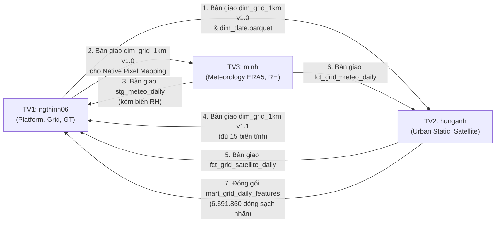

# CẨM NANG THỰC THI & QUY CHUẨN BÀN GIAO DỮ LIỆU TOÀN DIỆN (TEAM EXECUTION & HANDOFF GUIDE)
## DỰ ÁN HANOI_PM25: SPATIO-TEMPORAL DATA LAKEHOUSE (2021–2025)

**Cơ quan ban hành:** Ban Kiến trúc Dữ liệu & Đảm bảo Chất lượng Dự án (Data Architecture & Quality Board)  
**Tác giả:** Data Architect & CI/CD Lead (`ngthinh06` - TV1)  
**Phạm vi áp dụng:** Toàn bộ 3 kỹ sư thành viên:
- **Thành viên 1 (`ngthinh06`):** Data Architect, Spatial Spine & Ground Truth Lead
- **Thành viên 2 (`hunganh`):** Urban Static Features & Satellite Earth Observation Lead
- **Thành viên 3 (`minh`):** Atmospheric Dynamics & Meteorological Reanalysis Engineer  
**Phiên bản tài liệu:** `v3.1.0-master`  
**Ngày hiệu lực:** 2026-10-26  
**Trạng thái phê duyệt:** TÀI LIỆU HƯỚNG DẪN CHUẨN HÓA DÀNH CHO CẢ 3 THÀNH VIÊN  
**Tài liệu liên kết kiến trúc bắt buộc:**
- [Đặc tả Lược đồ Dữ liệu (docs/schema.md)](./schema.md)
- [Hợp đồng Dữ liệu Tổng thể (docs/data_contract.md)](./data_contract.md)

---

## MỤC LỤC TỔNG THỂ

1. [Tổng quan Kiến trúc, Múi giờ và Khung xương Bất biến Toàn dự án](#1-tổng-quan-kiến-trúc-múi-giờ-và-khung-xương-bất-biến-toàn-dự-án)
2. [Ma trận Phân quyền & Điểm Giao thoa Liên thành viên (RACI & Handoff Matrix)](#2-ma-trận-phân-quyền-điểm-giao-thoa-liên-thành-viên-raci-handoff-matrix)
3. [CẨM NANG DÀNH RIÊNG CHO THÀNH VIÊN 1: ngthinh06 (Lưới, Ngày, Trạm & Ground Truth)](#3-cẩm-nang-dành-riêng-cho-thành-viên-1-ngthinh06-lưới-ngày-trạm-ground-truth)
4. [CẨM NANG DÀNH RIÊNG CHO THÀNH VIÊN 2: hunganh (Đặc trưng tĩnh Đô thị & Viễn thám Vệ tinh)](#4-cẩm-nang-dành-riêng-cho-thành-viên-2-hunganh-đặc-trưng-tĩnh-đô-thị-viễn-thám-vệ-tinh)
5. [CẨM NANG DÀNH RIÊNG CHO THÀNH VIÊN 3: minh (Khí quyển ERA5-Land, BLH & Độ ẩm Tương đối)](#5-cẩm-nang-dành-riêng-cho-thành-viên-3-minh-khí-quyển-era5-land-blh-độ-ẩm-tương-đối)
6. [Quy chuẩn Đóng gói Chợ Đặc trưng (Feature Marts) & Rào chắn Chống Rò rỉ Nhãn](#6-quy-chuẩn-đóng-gói-chợ-đặc-trưng-feature-marts-rào-chắn-chống-rò-rỉ-nhãn)
7. [Quy trình Đồng bộ Mã nguồn Git, CI/CD và Cấu trúc Lưu trữ Google Drive](#7-quy-trình-đồng-bộ-mã-nguồn-git-cicd-và-cấu-trúc-lưu-trữ-google-drive)
8. [Nhật ký Xử lý Mâu thuẫn Kiến trúc và Quyết định Cần Đồng thuận](#8-nhật-ký-xử-lý-mâu-thuẫn-kiến-trúc-và-quyết-định-cần-đồng-thuận)

---

## 1. TỔNG QUAN KIẾN TRÚC, MÚI GIỜ VÀ KHUNG XƯƠNG BẤT BIẾN TOÀN DỰ ÁN

### 1.1. Kiến trúc Zero-RDBMS Lakehouse
Dự án HANOI_PM25 tuân thủ nguyên tắc **Zero-RDBMS**:
- Không cài đặt hay chạy dịch vụ ngầm bất kỳ máy chủ cơ sở dữ liệu nào (PostgreSQL/PostGIS, MySQL, SQL Server).
- Toàn bộ dữ liệu được lưu trữ nguyên tử dưới định dạng **Apache Parquet** và **GeoParquet 1.1.0** (chuẩn nén `zstd`), phân tầng Medallion rõ ràng:
  - `data/raw/`: Dữ liệu thô nguyên bản từ các API và vệ tinh, tổ chức phân vùng Hive (`source=.../year=.../month=...`).
  - `data/staging/`: Dữ liệu chuỗi giờ làm sạch, chuẩn hóa múi giờ Hà Nội, gắn cờ QC phân tầng.
  - `data/core/`: Mô hình hình sao Kimball (Star Schema) gồm 3 Dimensions và 3 Facts.
  - `data/marts/`: Bảng thành phẩm đặc trưng không-thời gian phục vụ Machine Learning và trực quan hóa.
- Engine tính toán duy nhất: **DuckDB SQL nhúng** và thư viện **Polars** trong Python.

### 1.2. Khung Không gian và Thời gian Bất biến Đã Đóng Băng
Theo tệp kê khai chuẩn `data/manifests/grid_manifest.json` và provenance `data/reference/hanoi_boundary.provenance.json`:
1. **Hệ quy chiếu Không gian:** Phẳng mét quốc gia **VN-2000 / UTM Zone 48N (`EPSG:3405`)**.
2. **Quy mô Lưới 1km:**
   - Cắt giao ô vuông đều $1.000\text{ m} \times 1.000\text{ m}$ với ranh giới Hà Nội (HDX COD-AB v02, 2025-07-01, SHA-256 `d8194abcc1d89eadd836941a750ae339f398a9b2e5e9d2428d0f96f1f2bd1f77`) bằng toán tử `intersects`.
   - **$N_{\text{GRID}} = 3.610\text{ ô phân tích thực tế}$** (trong đó có 3.363 ô canonical có trọng tâm nằm hoàn toàn trong địa giới).
   - Bảng `dim_grid_1km.parquet` có đúng **$3.611\text{ dòng}$** (gồm 3.610 ô phân tích + 1 dòng ngoại lệ `grid_unknown`).
3. **Trục Thời gian:**
   - 5 năm liên tục: `2021-01-01` đến `2025-12-31` theo giờ địa phương Hà Nội (`Asia/Ho_Chi_Minh`, `UTC+7`).
   - Khóa ngày: `date_id` định dạng số nguyên `YYYYMMDD`, bản ghi ngoại lệ là `-1`.
   - **$N_{\text{DAYS}} = 1.826\text{ ngày lịch thực tế}$** (gồm 366 ngày của năm nhuận 2024). Bảng `dim_date.parquet` có đúng **$1.827\text{ dòng}$** (gồm 1 dòng ngoại lệ `date_id = -1`).
4. **Quy mô Ma trận Khung xương Phân tích (Analysis Spine Matrix):**
   $$|S| = N_{\text{GRID}} \times N_{\text{DAYS}} = 3.610 \times 1.826 = 6.591.860\text{ dòng}$$
   Khung xương này loại trừ cả hai bản ghi ngoại lệ (`grid_id != 'grid_unknown'` và `date_id != -1`). Mọi bảng Marts tổng hợp ô–ngày bắt buộc phải khớp chính xác 100% quy mô $|S|$.

---

## 2. MA TRẬN PHÂN QUYỀN & ĐIỂM GIAO THOA LIÊN THÀNH VIÊN (RACI & HANDOFF MATRIX)

### 2.1. Ma trận Trách nhiệm (RACI Matrix)

| Hạng mục Dữ liệu / Công việc | TV1 (`ngthinh06`) | TV2 (`hunganh`) | TV3 (`minh`) | Ghi chú & Trạng thái |
| :--- | :---: | :---: | :---: | :--- |
| Khung runner `run.py`, CI/CD, Hàm băm & IO Parquet | **R / A** | C | C | Đã hoàn thành (v1.0) |
| Ranh giới Hà Nội & Lưới 1km Spine (`dim_grid_1km` v1.0) | **R / A** | C | C | Đã đóng băng 3.611 dòng |
| Trục ngày 5 năm (`dim_date`) | **R / A** | I | I | Đã đóng băng 1.827 dòng |
| Danh mục trạm mặt đất (`dim_station`) | **R / A** | I | I | Đã hoàn thành (44 dòng: snapshot khảo sát 43 trạm trong bbox + 1 unknown) |
| Ingest chuỗi giờ OpenAQ thô & Staging QC trạm | **R / A** | I | I | Đã hoàn thành |
| Bảng Fact mặt đất ngày (`fct_ground_truth_daily`) | **R / A** | I | I | Giữ mọi ngày có bản ghi; gắn cờ đủ 18 giờ |
| 15 Biến tĩnh đô thị (`dim_grid_1km` v1.1) | C | **R / A** | I | Đang thực hiện |
| Ingest & Staging Viễn thám (MODIS, S5P, VIIRS) | I | **R / A** | C | Đang thực hiện |
| Fact Viễn thám ô–ngày (`fct_grid_satellite_daily`) | C | **R / A** | I | Chờ TV2 xác nhận bàn giao |
| Ingest & Staging Khí tượng (ERA5-Land, BLH) | I | C | **R / A** | Đang thực hiện |
| Bàn giao đặc trưng độ ẩm tương đối $RH$ (phục vụ Marts & nghiên cứu) | I | I | **R / A** | **Giao điểm phối hợp** |
| Fact Khí tượng ô–ngày (`fct_grid_meteo_daily`) | C | I | **R / A** | Chờ TV3 xác nhận bàn giao |
| Đóng gói Chợ Đặc trưng (`mart_grid_daily_features`) | C | **R / A** | C | Quy mô $6.591.860$ dòng |
| Đóng gói Bảng Ghép trạm (`mart_station_matched`) | **R / A** | C | I | Tập nhãn huấn luyện ML |

*(R: Responsible - Thực thi chính; A: Accountable - Chịu trách nhiệm cuối; C: Consulted - Tham vấn; I: Informed - Nhận thông báo).*

### 2.2. Ma trận Bàn giao Cốt lõi Giữa 3 Thành viên (Handoff Points)



---

## 3. CẨM NANG DÀNH RIÊNG CHO THÀNH VIÊN 1: ngthinh06 (LƯỚI, NGÀY, TRẠM & GROUND TRUTH)

### 3.1. Vai trò và Phạm vi của TV1
- **Phụ trách:** 
  - Quản trị toàn bộ hạ tầng thực thi: `run.py`, cấu hình CI/CD GitHub Actions, module băm lũy đẳng `src/common/hashing.py`, bộ ghi Parquet nguyên tử `src/common/io_parquet.py`.
  - Thiết lập và đóng băng chiều không gian `dim_grid_1km.parquet` v1.0 và trục thời gian `dim_date.parquet`.
  - Kiểm toán danh mục trạm OpenAQ (`src/ingest/audit_stations.py`) và tạo bảng `dim_station.parquet`.
  - Thu thập dữ liệu giờ thô OpenAQ (`src/ingest/fetch_ground_truth.py`), làm sạch chuỗi giờ (`src/features/qc_hourly_stations.py`) và tạo bảng Fact trạm ngày `fct_ground_truth_daily.parquet`.
  - Xây dựng bảng ghép nhãn huấn luyện `mart_station_matched.parquet`.
- **Không phụ trách:** Thu thập ảnh vệ tinh MODIS/Sentinel-5P/VIIRS (của TV2); thu thập dữ liệu khí tượng ERA5-Land/BLH (của TV3); tính toán 15 biến tĩnh đô thị (của TV2).
- **Phụ thuộc:** Chưa có mô hình hiệu chỉnh đồng vị trí được nghiệm thu; staging daily và fact chỉ xuất PM2.5 thô sau QC. Nhóm ML sẽ quyết định nhãn huấn luyện; không tự áp dụng κ-Köhler hay giả định chỉ cần RH là đủ.

### 3.2. Danh sách Nguồn Dữ liệu TV1 Thu thập

#### Nguồn 1: Ranh giới Địa giới Hành chính Hà Nội (Bắt buộc)
- **Cơ quan cung cấp:** Tổng cục Thống kê (GSO) & Cục Khảo sát Địa chất/OCHA Field Information Services (FIS).
- **Dataset / Product ID:** `cod-ab-vnm` (Version 02, ngày ban hành 2025-07-01).
- **Tài liệu chính thức:** [HDX COD-AB Vietnam Dataset](https://data.humdata.org/dataset/cod-ab-vnm).
- **Phương thức thu thập:** Tải file nén `vnm_admin_boundaries.geojson.zip`, trích xuất đối tượng `adm1_pcode = 'VN01'`.
- **Độ phân giải & Phạm vi:** Đa giác ranh giới cấp tỉnh/thành phố toàn Hà Nội, không đơn giản hóa cạnh.
- **Giấy phép & Kiểm thực:** Creative Commons Attribution 3.0 IGO (CC BY 3.0 IGO). Mã băm SHA-256 lưu trữ tại `data/reference/hanoi_boundary.provenance.json` là `d8194abcc1d89eadd836941a750ae339f398a9b2e5e9d2428d0f96f1f2bd1f77`.

#### Nguồn 2: Mạng lưới Trạm Quan trắc Mặt đất OpenAQ v3 (Bắt buộc)
- **Cơ quan cung cấp:** OpenAQ Platform (Tổng hợp dữ liệu trạm Đại sứ quán Mỹ, Chi cục BVMT Hà Nội, PAM Air).
- **API Endpoint:** `https://api.openaq.org/v3`
  - Danh mục trạm: `GET /locations?bbox=105.28,20.56,106.02,21.39&limit=100`
  - Chuỗi đo theo trạm: `GET /locations/{location_id}/sensors` và `GET /measurements`
- **Tài liệu chính thức:** [OpenAQ v3 API Documentation](https://docs.openaq.org/).
- **Biến thu thập:** Nồng độ bụi $PM_{2.5}$ (`parameter = 'pm25'`), đơn vị $\mu\text{g}/\text{m}^3$.
- **Thời gian & Cửa sổ mở rộng:** `2020-12-31T16:00:00Z` đến `2026-01-01T08:00:00Z` (đảm bảo phủ trọn vẹn 1.826 ngày Hà Nội).
- **Tài khoản & Hạn mức:** Cần `X-API-Key` đăng ký miễn phí trên OpenAQ Console. Giới hạn 60 requests/phút. Áp dụng Exponential Backoff khi gặp lỗi HTTP 429.
- **Giấy phép:** OpenAQ Open Data License (CC BY 4.0).

### 3.3. Quy trình Thu thập, Khóa Đồng thời & Chống Trùng lặp của TV1
1. **Kiểm toán trước danh mục trạm:** Chạy `python -m src.ingest.audit_stations` để quét toàn bộ trạm trong bbox, chuyển đổi tọa độ WGS84 sang `EPSG:3405` và xác định ô lưới `grid_id`. Kết quả lưu tại `data/reference/station_registry.json`.
2. **Nạp phân đoạn (Chunking) theo Năm/Tháng:**
   - Chia vòng lặp theo từng năm (`year=2021..2025`) và từng tháng (`month=01..12`). Hỗ trợ tham số `--month` hoặc `--start-month` và `--end-month` để cào/chạy lại riêng một khoảng tháng xác định.
   - Tháng tải và phân vùng raw dùng UTC: từ đầu tháng (bao gồm) đến đầu tháng tiếp theo (không bao gồm). Ngày phân tích vẫn theo `Asia/Ho_Chi_Minh`.
   - Để phủ đủ ngày Hà Nội 2021–2025, cần dữ liệu từ `2020-12-31T17:00:00Z` đến trước `2025-12-31T17:00:00Z`, nếu nguồn cung cấp; các năm mặc định 2021–2025 không bao gồm phần đầu kỳ này.
   - Manifest `utc_v1` dùng khóa riêng, không coi trạng thái hoàn tất cũ theo tháng Hà Nội là hoàn tất tháng UTC.
   - Với mỗi tháng, tải toàn bộ bản ghi giờ của các trạm trong danh mục kiểm toán qua phân trang. Chỉ khi mọi trang tải thành công mới kết luận hoàn thành; nếu gặp lỗi mạng, HTTP 404 hoặc response không hợp lệ (thiếu `results`), ném lỗi và đánh dấu `FAILED`.
3. **Thứ tự Ghi An toàn & Mã Thoát Lỗi:**
   - Ghi dữ liệu thành công vào file Parquet đích trước, sau đó mới cập nhật trạng thái `SUCCESS` vào manifest.
   - Nếu có bất kỳ đơn vị sensor-tháng nào thất bại, CLI trả mã thoát khác 0 (`sys.exit(1)`) để CI/Scheduler cảnh báo kịp thời.
4. **Khóa Tệp Đồng thời (Advisory Lock dựa trên PID Liveness):**
   - Áp dụng `file_concurrency_lock` ghi PID vào `.parquet.lock`. Kiểm tra tiến trình sống (`is_process_alive`) trên cả Windows và Linux/macOS. Tuyệt đối không tự ý bẻ khóa nếu tiến trình giữ khóa vẫn đang hoạt động.
   - *Giới hạn kỹ thuật:* Đây là khóa đơn máy, pipeline được thiết kế tối ưu cho quy trình chạy tuần tự (single-process / sequential); nghiêm cấm chạy song song đa tiến trình trên cùng một phân vùng tháng.
5. **Ghi Lũy đẳng & Theo dõi Revision ($A \rightarrow B \rightarrow A$):**
   - Tạo mã băm nội dung cho từng dòng: `_row_hash = SHA256(station_id | sensor_id | datetime_utc | value | parameter)`.
   - Lưu vào phân vùng Hive: `data/raw/ground_truth/source=openaq/year=YYYY/month=MM/data.parquet`.
   - Hàm `append_idempotent_raw_parquet()` nhận diện bộ khóa nghiệp vụ `(station_id, sensor_id, datetime_utc)` và so khớp với phiên bản mới nhất hiện tại. Hỗ trợ đầy đủ các chuỗi revision nguồn cập nhật (kể cả khi giá trị quay về nội dung cũ $A \rightarrow B \rightarrow A$) mà không làm mất lịch sử và không gây trùng lặp khi chạy lại với `--force`.

### 3.4. Schema ở Từng Tầng do TV1 Phụ trách

#### Tầng Raw: `data/raw/ground_truth/source=openaq/year=YYYY/month=MM/data.parquet`
- **Hạt dữ liệu (Grain):** Trạm – Sensor – Phép đo giờ UTC.
- **Khóa nghiệp vụ:** `(station_id, sensor_id, datetime_utc)`.
- **Cấu trúc cột:**
  - `station_id` (`VARCHAR`, PK): Định danh trạm, ví dụ `'openaq_8422'`.
  - `sensor_id` (`INT64` hoặc `VARCHAR`, PK): Định danh cảm biến vật lý.
  - `datetime_utc` (`VARCHAR`, PK): Chuỗi ISO-8601 UTC, ví dụ `'2021-01-01T00:00:00Z'`.
  - `datetime_local` (`VARCHAR`): Giờ Hà Nội, ví dụ `'2021-01-01T07:00:00+07:00'`.
  - `pm25_ug_m3` (`DOUBLE`): Giá trị nồng độ thô ghi nhận từ sensor (giữ nguyên kể cả âm hoặc NULL để staging kiểm toán).
  - `sensor_tier` (`VARCHAR`): `'Tier_1_Reference_FEM'` hoặc `'Tier_2_LowCost_Optical'`.
  - `grid_id` (`VARCHAR`, FK): Ô lưới chứa trạm, ví dụ `'grid_584000_2324000'`.
  - `ingested_at` (`VARCHAR`): Timestamp thời điểm nạp vào hệ thống.
  - `_row_hash` (`VARCHAR`): Mã băm SHA-256 nội dung dòng.

#### Tầng Staging: `data/staging/stg_ground_truth_hourly.parquet`
- **Hạt dữ liệu (Grain):** Trạm – Sensor – Giờ làm sạch và gán cờ QC.
- **Khóa chính:** `(station_id, sensor_id, datetime_utc)`.
- **Cấu trúc cột:** Toàn bộ cột của tầng Raw kèm:
  - `qc_flag` (`INT32`, not null): Cờ phân tầng: `0` (Sạch), `1` (Âm $< 0$, NaN, Inf, -Inf, Null, Timestamp hỏng), `2` (Vượt ngưỡng vật lý $> 1.000\,\mu\text{g}/\text{m}^3$), `3` (Flatline kẹt cảm biến liên tục thực tế $\ge 6\text{h}$).
  - `is_hampel_outlier` (`INT32`, not null): `1` nếu phát hiện ngoại lai qua bộ lọc Hampel ($window=7\text{h}, 3\sigma$), `0` nếu bình thường (chẩn đoán độc lập, không loại giờ).

#### Tầng Core Fact: `data/core/fct_ground_truth_daily.parquet`
- **Hạt dữ liệu (Grain):** **Trạm – Ngày** có bản ghi giờ, kể cả ngày dưới 18 giờ sạch hoặc không có giờ sạch; chưa phải bảng nhãn ô–ngày.
- **Khóa chính:** `(station_id, date_id)`.
- **Khóa ngoại:** `station_id` $\rightarrow$ `dim_station`, `date_id` $\rightarrow$ `dim_date`, `grid_id` $\rightarrow$ `dim_grid_1km` (dùng để nối trạm với ô lưới 1km).
- **Cột:** `station_id`, `date_id`, `grid_id`, `valid_hours_count`, `is_valid_day`, `pm25_raw_mean`, `pm25_daily_std`, `pm25_daily_min`, `pm25_daily_max`.

### 3.5. Quy tắc Biến đổi & Nghiệm thu của TV1
- **Múi giờ:** Chuỗi giờ thô UTC được chuyển đổi chính xác sang ngày địa phương Hà Nội (`Asia/Ho_Chi_Minh`): `date_id = CAST(STRFTIME(datetime_local, '%Y%m%d') AS INT32)`.
- **Tiền hợp nhất cấp giờ (Hourly Consolidation):**
  - Trước khi tính trung bình ngày, các phép đo trong cùng 1 giờ của 1 trạm được gom nhóm lại thành 1 giờ duy nhất. Mỗi giờ hợp lệ đóng góp đúng trọng số $1/N$ vào trung bình ngày.
  - Nếu trạm có nhiều sensor cùng đo trong giờ, giá trị giờ là trung bình các sensor sạch; không tự ý ưu tiên loại bỏ sensor nào khi chưa có nghiên cứu đồng vị trí.
- **Quy tắc Quality Gate $\ge 18\text{h}$ hợp lệ:**
  - Ngưỡng $\ge 18$ tính trên số giờ duy nhất trong ngày có `qc_flag = 0` và giá trị hữu hạn.
  - Staging giữ mọi ngày có bản ghi giờ; fact giữ các ngày trong phạm vi 2021–2025. Ngày dưới 18 giờ có `is_valid_day = 0`; nếu không có giờ sạch thì `pm25_raw_mean = NULL`. Lọc nhãn huấn luyện là quyết định riêng.
- **Ngữ nghĩa hiệu chuẩn PM2.5:**
  - Chưa có phương pháp hiệu chỉnh được nghiệm thu trong repository; không xuất cột PM2.5 hiệu chỉnh trong staging daily hoặc fact.
  - Tuyệt đối không tự ý gán giá trị thô thành "đã hiệu chỉnh", không tự áp dụng công thức $\kappa$-Köhler khi chưa có mô hình được duyệt. Toàn bộ `pm25_raw_mean` được bảo tồn nguyên vẹn làm cơ sở đối chuẩn.
  - Bảng nhãn cấp ô–ngày và ma trận ghép đặc trưng `mart_station_matched.parquet` là các dataset dự kiến ở giai đoạn sau.

### 3.6. Bảng Đầu ra Bàn giao của TV1

| Tên bảng / File | Vị trí lưu trữ | Hạt dữ liệu | Quy mô kỳ vọng | Trạng thái hiện tại |
| :--- | :--- | :--- | :--- | :---: |
| `dim_grid_1km.parquet` (v1.0) | `data/core/` | Ô vuông 1km | Đúng 3.611 dòng | **Đã hoàn thành** |
| `dim_date.parquet` | `data/core/` | Ngày lịch | Đúng 1.827 dòng | **Đã hoàn thành** |
| `dim_station.parquet` | `data/core/` | Trạm quan trắc | 44 dòng (snapshot khảo sát: 43 trạm trong bbox + 1 unknown; không cố định cứng) | **Đã hoàn thành** |
| `fct_ground_truth_daily.parquet` | `data/core/` | Trạm – Ngày | Mọi ngày có bản ghi giờ | **Giữ cờ chất lượng 18 giờ** |

*Ví dụ minh họa cấu trúc fact (không phải dữ liệu thực tế):*
```
station_id      | date_id  | grid_id              | valid_hours_count | pm25_raw_mean
openaq_example  | 20210101 | grid_584000_2324000  | 24                | 68.42
```

---

## 4. CẨM NANG DÀNH RIÊNG CHO THÀNH VIÊN 2: hunganh (ĐẶC TRƯNG TĨNH ĐÔ THỊ & VIỄN THÁM VỆ TINH)

### 4.1. Vai trò và Phạm vi của TV2
- **Phụ trách:**
  - Trích xuất 15 đặc trưng tĩnh đô thị (giao thông OpenStreetMap, lớp phủ ESA WorldCover 10m, địa hình NASA SRTM DEM 30m) vào `dim_grid_1km.parquet` v1.1.
  - Kiểm toán, thu thập và tiền xử lý viễn thám vệ tinh trên Google Earth Engine (MODIS MAIAC AOD, Sentinel-5P $NO_2$, VIIRS Nightlight).
  - Áp dụng chính sách mây che MNAR và đóng gói `fct_grid_satellite_daily.parquet`.
  - Phối hợp đóng gói Chợ Đặc trưng `mart_grid_daily_features.parquet` quy mô $6.591.860\text{ dòng}$.
- **Không phụ trách:** Thu thập khí tượng ERA5-Land và tính độ ẩm $RH$ (của TV3); quản lý dữ liệu trạm quan trắc OpenAQ (của TV1).
- **Phụ thuộc:**
  - *Làm được ngay:* Kết nối GEE audit nguồn; tính toán 15 biến tĩnh đô thị trên nền `dim_grid_1km.parquet` v1.0 đã có sẵn từ TV1.
  - *Chờ đợi:* Chờ TV3 hoàn tất `fct_grid_meteo_daily` để phối hợp thực hiện `LEFT JOIN` đóng gói `mart_grid_daily_features.parquet`.

### 4.2. Danh sách Nguồn Dữ liệu TV2 Thu thập

#### Nguồn 1: Mạng lưới Giao thông OpenStreetMap (OSM) (Bắt buộc)
- **Cơ quan cung cấp:** Cộng đồng OpenStreetMap / Geofabrik Vietnam Extract.
- **Link chính thức:** [Geofabrik Vietnam Shapefiles](https://download.geofabrik.de/asia/vietnam.html).
- **Phương thức thu thập:** Tải file `vietnam-latest-free.shp.zip`, lọc lớp `gis_osm_roads_free_1.shp`.
- **Biến cần lấy:**
  - `osm_primary_road_m`: Chiều dài đường chính (motorway, trunk, primary) cắt qua từng ô lưới 1km (mét).
  - `osm_road_density_km_km2`: Tổng chiều dài toàn bộ các cấp đường trong ô chia cho diện tích ô ($\text{km}/\text{km}^2$).
- **Giấy phép:** Open Data Commons Open Database License (ODbL).

#### Nguồn 2: Bản đồ Lớp phủ Bề mặt ESA WorldCover 10m (Bắt buộc)
- **Cơ quan cung cấp:** Cơ quan Vũ trụ Châu Âu (ESA).
- **Dataset ID trên GEE:** `ESA/WorldCover/v100` (năm 2020) và `ESA/WorldCover/v200` (năm 2021).
- **Tài liệu chính thức:** [ESA WorldCover Documentation](https://esa-worldcover.org/).
- **Biến cần lấy:**
  - `worldcover_builtup_ratio`: Tỷ lệ diện tích xây dựng đô thị (mã pixel `50`).
  - `worldcover_tree_ratio`: Tỷ lệ tán che cây xanh / rừng (mã pixel `10`).
  - `worldcover_cropland_ratio`: Tỷ lệ đất nông nghiệp trồng trọt (mã pixel `40`).
  - `worldcover_water_ratio`: Tỷ lệ mặt nước thường trực (mã pixel `80`).
- **Độ phân giải:** Không gian $10\text{ m}$. Tính toán theo thuật toán `zonal_stats` trên từng ô vuông $1\text{ km}^2$.

#### Nguồn 3: Mô hình Độ cao Kỹ thuật số NASA SRTM DEM 30m (Bắt buộc)
- **Cơ quan cung cấp:** NASA / USGS.
- **Dataset ID trên GEE:** `USGS/SRTMGL1_003`.
- **Tài liệu chính thức:** [USGS SRTM GL1 Documentation](https://lpdaac.usgs.gov/products/srtmgl1v003/).
- **Biến cần lấy:**
  - `dem_elevation_mean_m`: Độ cao trung bình so với mực nước biển (mét, dải $[-10.0, 1400.0]$).
  - `dem_slope_mean_deg`: Độ dốc sườn địa hình trung bình (degrees, dải $[0^\circ, 90^\circ]$).

#### Nguồn 4: Sol Khí Quang học MODIS MAIAC AOD 1km (Bắt buộc)
- **Cơ quan cung cấp:** NASA LP DAAC.
- **Dataset ID trên GEE:** `MODIS/061/MCD19A2_GRANULES` (MODIS Terra/Aqua MAIAC Daily L2G Global 1km).
- **Tài liệu chính thức:** [MCD19A2 v061 User Guide](https://lpdaac.usgs.gov/products/mcd19a2v061/).
- **Band & Scale Factor:** Band `Optical_Depth_047` (hoặc nội suy bước sóng $550\text{ nm}$); nhân hệ số tỷ lệ `scale_factor = 0.001` để đưa về dải đo thực $[0.0, 3.5]$.
- **Lọc mây & MNAR:** Giữ nguyên `NULL` khi bị mây che, bật cờ `is_aod_missing_mnar = 1`. Tuyệt đối không nội suy!

#### Nguồn 5: Mật độ Cột Khí Tầng Đối lưu Sentinel-5P TROPOMI $NO_2$ (Bắt buộc)
- **Cơ quan cung cấp:** Copernicus / ESA.
- **Dataset ID trên GEE:** `COPERNICUS/S5P/OFFL/L3_NO2`.
- **Tài liệu chính thức:** [Sentinel-5P TROPOMI User Guide](https://sentinels.copernicus.eu/web/sentinel/technical-guides/sentinel-5p/products-algorithms).
- **Band thu thập:** `tropospheric_NO2_column_number_density` (đơn vị $\text{mol}/\text{m}^2$).
- **Lọc chất lượng:** Bắt buộc lọc theo cờ `qa_value >= 0.75` (loại bỏ mây, tuyết và góc nghiêng lớn).

#### Nguồn 6: Bức xạ Ánh sáng Ban đêm VIIRS DNB (Bắt buộc)
- **Cơ quan cung cấp:** NOAA / Colorado School of Mines.
- **Dataset ID trên GEE:** `NOAA/VIIRS/DNB/MONTHLY_V1/VCMCFG`.
- **Tài liệu chính thức:** [Earth Observation Group VIIRS Nighttime Light](https://eogdata.mines.edu/products/vnl/).
- **Band & Đơn vị:** `avg_rad` (đơn vị $\text{nW}/(\text{cm}^2\cdot\text{sr})$).
- **Quy tắc thời gian:** Lấy dữ liệu tổng hợp tháng, phát tán (broadcast) đồng nhất cho mọi ngày trong tháng đó.

### 4.3. Quy trình Thu thập Viễn thám trên Google Earth Engine (GEE)
1. **Khởi tạo và Phân quyền:** Đăng ký tài khoản Google Cloud Project kích hoạt GEE API, xác thực qua lệnh `earthengine authenticate`.
2. **Kỹ thuật Chia khoảng (Chunking) Tránh Giới hạn Bộ nhớ:**
   - Chia 5 năm lịch thành các khoảng 3 tháng một lần (Quarterly Chunks, ví dụ: `2021-01-01` đến `2021-03-31`).
   - Sử dụng phương thức `ee.ImageCollection.reduceRegions()` hoặc truy vấn theo danh sách tọa độ tâm của 3.610 ô lưới.
3. **Lưu trữ Tầng Raw Bronze:**
   - Dữ liệu thô tải từ GEE được lưu theo phân vùng:
     `data/raw/earth_observation/source=modis_aod/year=YYYY/quarter=Q/data.parquet`
     `data/raw/earth_observation/source=s5p_no2/year=YYYY/quarter=Q/data.parquet`
     `data/raw/earth_observation/source=viirs_dnb/year=YYYY/month=MM/data.parquet`
   - Mỗi dòng gắn kèm mã băm `_row_hash` chống trùng lặp.

### 4.4. Schema ở Từng Tầng do TV2 Phụ trách

#### Bảng Chiều Lưới Cập nhật: `data/core/dim_grid_1km.parquet` (v1.1)
- **Hạt dữ liệu:** Ô vuông $1\text{ km} \times 1\text{ km}$ (3.611 dòng).
- **Khóa chính:** `grid_id`.
- **Cấu trúc:** Giữ nguyên 6 cột v1.0 từ TV1 và nối thêm 8 cột tĩnh:
  `osm_primary_road_m`, `osm_road_density_km_km2`, `worldcover_builtup_ratio`, `worldcover_tree_ratio`, `worldcover_cropland_ratio`, `worldcover_water_ratio`, `dem_elevation_mean_m`, `dem_slope_mean_deg`.

#### Bảng Fact Viễn thám Hàng ngày: `data/core/fct_grid_satellite_daily.parquet`
- **Hạt dữ liệu đề xuất:** Ô lưới – Ngày (`grid_id`, `date_id`).
- **Khóa chính:** `(grid_id, date_id)`.
- **Khóa ngoại:** `grid_id` $\rightarrow$ `dim_grid_1km`, `date_id` $\rightarrow$ `dim_date`.
- **Hình thức lưu trữ:** **Lưu dạng Thưa (Sparse)** — Chỉ ghi nhận các cặp `(grid_id, date_id)` thực sự có vệ tinh chụp được.
- **Bảng cột:**

| Tên cột | Kiểu dữ liệu | Đơn vị | Nullable | Mô tả & Công thức tạo | Ví dụ |
| :--- | :--- | :---: | :---: | :--- | :--- |
| `grid_id` | `VARCHAR` | Mã ô | **NO** | Mã định danh ô lưới $1\text{ km}$ | `'grid_584000_2324000'` |
| `date_id` | `INT32` | Số nguyên | **NO** | Ngày quan trắc `YYYYMMDD` | `20210101` |
| `aod_047_mean` | `FLOAT` | Vô thứ nguyên | YES | MODIS AOD nhân scale `0.001`; `NULL` khi bị mây che | `0.452` |
| `is_aod_missing_mnar`| `INT32` | Cờ (0/1) | **NO** | `1` nếu AOD bị khuyết do mây; `0` nếu có số đo | `0` |
| `no2_tropospheric_mol_m2`| `FLOAT` | $\text{mol}/\text{m}^2$| YES | S5P $NO_2$ tầng đối lưu lọc $QA \ge 0.75$ | `0.000185` |
| `viirs_nightlight_rad` | `FLOAT` | $\text{nW}/(\text{cm}^2\cdot\text{sr})$| YES | VIIRS DNB ánh sáng ban đêm tổng hợp tháng | `34.82` |

### 4.5. Kế hoạch Thực hiện Từng bước của TV2
- **Bước 1 (Tính biến tĩnh):** Viết module `src/features/extract_static_features.py` đọc `dim_grid_1km` v1.0, cắt lớp đường OSM và zonal stats WorldCover/DEM. Xuất `dim_grid_1km` v1.1. Bàn giao cho TV1 review.
- **Bước 2 (Ingest vệ tinh):** Viết module `src/ingest/fetch_satellite_gee.py` chia chunk 3 tháng, truy vấn GEE, lưu Bronze Parquet.
- **Bước 3 (Staging & Fact):** Lọc QA S5P, scale AOD, gán cờ MNAR, lưu `stg_satellite_daily.parquet` và `fct_grid_satellite_daily.parquet`.
- **Bước 4 (Feature Marts):** Đóng gói `mart_grid_daily_features.parquet` cùng TV1.

---

## 5. CẨM NANG DÀNH RIÊNG CHO THÀNH VIÊN 3: minh (KHÍ QUYỂN ERA5-LAND, BLH & ĐỘ ẨM TƯƠNG ĐỐI)

### 5.1. Vai trò và Phạm vi của TV3
- **Phụ trách:**
  - Kết nối Copernicus Climate Data Store (CDS API) và GEE khí quyển.
  - Tải chuỗi giờ tái phân tích khí tượng ERA5-Land (~9km) và Chiều cao lớp biên ERA5 BLH (~31km).
  - Áp dụng thuật toán khử tích lũy lượng mưa giờ, tính vận tốc gió vô hướng $V_{\text{scalar}}$, tỷ số bền vững gió $P$, và độ ẩm tương đối $RH$ (Magnus-Tetens).
  - **Bàn giao Staging Khí tượng:** Xuất bản `stg_meteo_daily.parquet` (kèm cột `rh_mean_pct`) phục vụ đối soát và tích hợp vào Feature Mart.
  - Nội suy và broadcast khí tượng từ pixel gốc sang 3.610 ô lưới, đóng gói `fct_grid_meteo_daily.parquet`.
- **Không phụ trách:** Viễn thám MODIS/S5P/VIIRS (của TV2); dữ liệu trạm OpenAQ (của TV1); biến tĩnh đô thị (của TV2).
- **Phụ thuộc:**
  - *Làm được ngay:* Cài đặt `cdsapi`, tải dữ liệu mẫu và tải toàn bộ chuỗi giờ 5 năm tại các pixel gốc.
  - *Đầu ra chờ xác nhận:* Chốt thuật toán nội suy (Nearest Neighbor vs Bilinear) với Data Architect trước khi broadcast sang 3.610 ô lưới.

### 5.2. Danh sách Nguồn Dữ liệu TV3 Thu thập

#### Nguồn 1: Tái phân tích Khí tượng ERA5-Land Hourly (Bắt buộc)
- **Cơ quan cung cấp:** Trung tâm Dự báo Thời tiết Hạn vừa Châu Âu (ECMWF) / Copernicus Climate Change Service (C3S).
- **Dataset ID trên CDS:** `reanalysis-era5-land`.
- **Tài liệu chính thức:** [ERA5-Land Documentation (ECMWF)](https://confluence.ecmwf.int/display/CKB/ERA5-Land).
- **Phương thức thu thập:** Gửi API request qua thư viện Python `cdsapi` (cấu hình tệp `~/.cdsapirc`).
- **Độ phân giải & Phạm vi:**
  - Độ phân giải không gian: $0.1^\circ \times 0.1^\circ$ (~9.5km tại Hà Nội).
  - Độ phân giải thời gian: Hàng giờ (Hourly).
  - Phạm vi bao phủ: Bounding box Hà Nội `[21.39, 105.28, 20.56, 106.02]` (North, West, South, East).
- **Danh sách biến và hệ số chuyển đổi:**
  - `2m_temperature` (`t2m`): Đơn vị gốc Kelvin $\rightarrow$ Chuyển sang độ C: $T_{^\circ\text{C}} = T_K - 273.15$.
  - `2m_dewpoint_temperature` (`d2m`): Đơn vị gốc Kelvin $\rightarrow$ Chuyển sang độ C: $T_{d,^\circ\text{C}} = T_{d,K} - 273.15$.
  - `total_precipitation` (`tp`): Đơn vị gốc mét $\rightarrow$ Nhân $1000.0$ ra milimét (mm), áp dụng khử tích lũy.
  - `10m_u_component_of_wind` (`u10`): Gió thành phần Đông-Tây ($\text{m}/\text{s}$).
  - `10m_v_component_of_wind` (`v10`): Gió thành phần Bắc-Nam ($\text{m}/\text{s}$).
  - `surface_pressure` (`sp`): Khí áp bề mặt Pa $\rightarrow$ Chia $100.0$ ra hPa.
- **Tài khoản & Hạn mức:** Đăng ký tài khoản miễn phí trên Copernicus CDS, chấp nhận các điều khoản dịch vụ (Terms of Use). Mỗi request không nên vượt quá 1 năm chuỗi giờ.
- **Giấy phép:** Copernicus Open Access Licence (Sử dụng học thuật và phi thương mại miễn phí).

#### Nguồn 2: Chiều cao Lớp biên Hành tinh ERA5 Single Levels (BLH) (Bắt buộc)
- **Cơ quan cung cấp:** ECMWF / Copernicus C3S.
- **Dataset ID trên CDS:** `reanalysis-era5-single-levels`.
- **Tài liệu chính thức:** [ERA5 Single Levels Documentation](https://confluence.ecmwf.int/display/CKB/ERA5%3A+data+documentation).
- **Biến thu thập:** `boundary_layer_height` (`blh`, đơn vị mét).
- **Độ phân giải:** Không gian $0.25^\circ \times 0.25^\circ$ (~31km tại Hà Nội), thời gian hàng giờ.
- **Kỹ thuật Native Pixels:** Toàn bộ Hà Nội chỉ nằm trong **đúng ~8 điểm pixel gốc BLH**. TV3 chỉ tải đúng 8 điểm pixel này để tránh quá tải hạn ngạch API.

### 5.3. Quy trình Thu thập & Kỹ thuật Native Pixels của TV3
1. **Chiến thuật Trích xuất tại Tâm Pixel Gốc (Native Centroids):**
   - Thay vì truy vấn lặp lại 3.610 lần trên lưới 1km, TV3 xác định danh sách tọa độ tâm của **~45 pixel gốc ERA5-Land** và **~8 pixel gốc BLH**.
   - Tải chuỗi giờ của các pixel này về máy và lưu trữ dạng thô NetCDF/GRIB hoặc Parquet tại `data/raw/atmospheric/`.
2. **Cửa sổ Truy vấn UTC Mở rộng:**
   - Bắt đầu từ `"2020-12-31T16:00:00Z"` đến `"2026-01-01T08:00:00Z"` để bảo toàn trọn vẹn 24 giờ cho ngày địa phương `2021-01-01`.

### 5.4. Quy tắc Biến đổi Vật lý Khí tượng của TV3

#### 1. Khử tích lũy Lượng mưa Giờ ERA5-Land
Biến `total_precipitation` trong ERA5-Land tích lũy từ đầu chu kỳ dự báo (reset lúc 00:00 UTC). Công thức khử tích lũy từng giờ:
$$\text{precip\_h} = \begin{cases} \text{tp}_1 \times 1000 & \text{với } h = 1 \text{ (mốc reset)} \\ \max(0.0, (\text{tp}_h - \text{tp}_{h-1}) \times 1000) & \text{với } h \in [2, 24] \end{cases}$$
Tổng lượng mưa ngày: $\text{precip\_daily\_mm} = \sum_{h=1}^{24} \text{precip\_h}$.

#### 2. Tính Tốc độ Gió Vô hướng & Tỷ số Bền vững Gió
- Tốc độ gió tức thời từng giờ: $w_h = \sqrt{u_{10,h}^2 + v_{10,h}^2}$.
- Tốc độ gió vô hướng trung bình ngày: $V_{\text{scalar}} = \frac{1}{24}\sum_{h=1}^{24} w_h$.
- Tốc độ gió có hướng trung bình ngày: $V_{\text{vector}} = \sqrt{\left(\frac{1}{24}\sum u_{10,h}\right)^2 + \left(\frac{1}{24}\sum v_{10,h}\right)^2}$.
- Tỷ số bền vững hướng gió:
  $$P = \frac{V_{\text{vector}}}{\max(V_{\text{scalar}}, 10^{-4})}, \quad P \in [0.0, 1.0]$$
  *(Ràng buộc tự động: Luôn bảo đảm $V_{\text{vector}} \le V_{\text{scalar}} + 10^{-5}$).*

#### 3. Tính Độ ẩm Tương đối Magnus-Tetens
Áp dụng công thức Magnus-Tetens tính độ ẩm từng giờ:
$$RH_h = \min\left(100.0, \max\left(0.0, 100.0 \times \frac{\exp\left(\frac{17.625 \cdot T_{d,^\circ\text{C}}}{243.04 + T_{d,^\circ\text{C}}}\right)}{\exp\left(\frac{17.625 \cdot T_{^\circ\text{C}}}{243.04 + T_{^\circ\text{C}}}\right)}\right)\right)$$
Sau đó tính trung bình 24 giờ của ngày địa phương Hà Nội để thu được `rh_mean_pct`.

### 5.5. Schema ở Từng Tầng do TV3 Phụ trách

#### Bảng Staging Khí tượng: `data/staging/stg_meteo_daily.parquet`
- **Hạt dữ liệu:** Pixel gốc ERA5 – Ngày địa phương.
- **Khóa chính:** `(pixel_id, date_id)`.
- **Ý nghĩa:** Chứa các trường nhiệt độ, độ ẩm, gió, lượng mưa và BLH trước khi broadcast sang lưới 1km.
- **Yêu cầu then chốt:** Cung cấp cột `rh_mean_pct` phục vụ ma trận đặc trưng `mart_grid_daily_features` và cơ sở nghiên cứu hiệu chuẩn.

#### Bảng Fact Khí tượng: `data/core/fct_grid_meteo_daily.parquet`
- **Hạt dữ liệu đề xuất:** Ô lưới – Ngày (`grid_id`, `date_id`).
- **Khóa chính:** `(grid_id, date_id)`.
- **Khóa ngoại:** `grid_id` $\rightarrow$ `dim_grid_1km`, `date_id` $\rightarrow$ `dim_date`.
- **Hình thức:** Đầy đủ (Dense 6.591.860 dòng) sau khi hoàn tất broadcast sang 3.610 ô lưới.
- **Bảng cột:**

| Tên cột | Kiểu dữ liệu | Đơn vị | Nullable | Mô tả & Công thức tạo | Ví dụ |
| :--- | :--- | :---: | :---: | :--- | :--- |
| `grid_id` | `VARCHAR` | Mã ô | **NO** | Mã định danh ô lưới $1\text{ km}$ | `'grid_584000_2324000'` |
| `date_id` | `INT32` | Số nguyên | **NO** | Ngày lịch `YYYYMMDD` | `20210101` |
| `temp_2m_mean_c` | `FLOAT` | $^\circ\text{C}$ | YES | Nhiệt độ 2m trung bình 24h ($T_K - 273.15$) | `18.45` |
| `dewpoint_2m_mean_c` | `FLOAT` | $^\circ\text{C}$ | YES | Điểm sương 2m trung bình 24h | `14.20` |
| `rh_mean_pct` | `FLOAT` | $\%$ | YES | Độ ẩm tương đối Magnus-Tetens trung bình 24h | `76.5` |
| `precip_daily_mm` | `FLOAT` | mm | YES | Tổng lượng mưa ngày đã khử tích lũy | `0.0` |
| `wind_speed_scalar_ms`| `FLOAT` | $\text{m}/\text{s}$ | YES | Tốc độ gió vô hướng 24h $V_{\text{scalar}}$ | `2.85` |
| `wind_persistence` | `FLOAT` | Tỷ số | YES | Độ bền vững hướng gió $P \in [0, 1]$ | `0.82` |
| `surface_pressure_hpa`| `FLOAT` | hPa | YES | Khí áp bề mặt trung bình ngày ($sp / 100.0$) | `1016.5` |
| `blh_mean_m` | `FLOAT` | Mét | YES | Chiều cao lớp biên trung bình ngày | `420.0` |
| `blh_min_m` | `FLOAT` | Mét | YES | Chiều cao lớp biên ban đêm (nghịch nhiệt) | `185.0` |

### 5.6. Kế hoạch Thực hiện Từng bước của TV3
- **Bước 1:** Viết script `src/ingest/fetch_era5_native.py` kết nối CDS API tải chuỗi giờ của ~45 pixel ERA5-Land và ~8 pixel BLH.
- **Bước 2:** Viết script `src/features/process_meteo_daily.py` khử tích lũy mưa, tính gió vô hướng và tính độ ẩm $RH$. Xuất `stg_meteo_daily.parquet` để đối soát và chuẩn bị cho Feature Mart.
- **Bước 3:** Thử nghiệm thuật toán nội suy Nearest Neighbor và Bilinear trên 1 ngày mẫu sang 3.610 ô lưới. Báo cáo đối soát cho Data Architect (`ngthinh06`).
- **Bước 4:** Broadcast toàn bộ 5 năm sang 3.610 ô lưới và xuất file `fct_grid_meteo_daily.parquet`.

---

## 6. QUY CHUẨN ĐÓNG GÓI CHỢ ĐẶC TRƯNG (FEATURE MARTS) & RÀO CHẮN CHỐNG RÒ RỈ NHÃN

### 6.1. Nguyên tắc Chống Rò rỉ Nhãn Tuyệt đối (Label Leakage Firewall)
Bảng Chợ Đặc trưng `mart_grid_daily_features.parquet` là đầu vào trực tiếp cho các mô hình Machine Learning dự báo nồng độ bụi mịn.
> [!CAUTION]
> **Rào chắn Chống Rò rỉ Nhãn (Label Leakage Firewall):**  
> Bảng `mart_grid_daily_features.parquet` tuyệt đối tuân thủ cơ chế Whitelist. **NGHIÊM CẤM 100% SỰ HIỆN DIỆN CỦA BẤT KỲ CỘT NÀO LIÊN QUAN ĐẾN NỒNG ĐỘ PM2.5 CÙNG NGÀY HOẶC ĐẶC TRƯNG DẪN XUẤT TỪ TRẠM ĐO MẶT ĐẤT**. Nếu CI/CD phát hiện cột khớp mẫu `*pm25*`, `*station*`, `*ground_truth*`, `*label*` thì toàn bộ pipeline sẽ bị đánh trượt ngay lập tức (Exit Code 1).

### 6.2. Thuật toán Ghép nối Khung xương Không Làm Rơi Dòng (Zero-Drop Left Join)
Quy mô bảng Chợ Đặc trưng bắt buộc phải bằng đúng kích thước khung phân tích:
$$|S| = 3.610\text{ ô} \times 1.826\text{ ngày} = 6.591.860\text{ dòng}$$

Thuật toán ghép nối bằng DuckDB SQL:
```sql
-- Sinh khung xương tích Descartes giữa ô phân tích thực và ngày thực
WITH spine AS (
    SELECT g.grid_id, d.date_id, d.date_actual AS date
    FROM read_parquet('data/core/dim_grid_1km.parquet') g
    CROSS JOIN read_parquet('data/core/dim_date.parquet') d
    WHERE g.grid_id != 'grid_unknown' AND d.date_id != -1
)
SELECT 
    s.grid_id,
    s.date_id,
    s.date,
    -- Khí tượng từ fct_grid_meteo_daily (TV3)
    m.temp_2m_mean_c,
    m.dewpoint_2m_mean_c,
    m.rh_mean_pct,
    m.precip_daily_mm,
    m.wind_speed_scalar_ms,
    m.wind_persistence,
    m.surface_pressure_hpa,
    m.blh_mean_m,
    m.blh_min_m,
    -- Viễn thám từ fct_grid_satellite_daily (TV2)
    sat.aod_047_mean,
    sat.is_aod_missing_mnar,
    sat.no2_tropospheric_mol_m2,
    sat.viirs_nightlight_rad,
    -- Đặc trưng tĩnh đô thị & địa hình từ dim_grid_1km (TV2)
    g.osm_primary_road_m,
    g.osm_road_density_km_km2,
    g.worldcover_builtup_ratio,
    g.worldcover_tree_ratio,
    g.dem_elevation_mean_m,
    g.dem_slope_mean_deg
FROM spine s
LEFT JOIN read_parquet('data/core/dim_grid_1km.parquet') g ON s.grid_id = g.grid_id
LEFT JOIN read_parquet('data/core/fct_grid_meteo_daily.parquet') m ON s.grid_id = m.grid_id AND s.date_id = m.date_id
LEFT JOIN read_parquet('data/core/fct_grid_satellite_daily.parquet') sat ON s.grid_id = sat.grid_id AND s.date_id = sat.date_id;
```
*Kết quả:* Luôn giữ đủ chính xác 6.591.860 dòng; những ngày hoặc ô thiếu dữ liệu viễn thám/khí tượng sẽ nhận giá trị `NULL` tự nhiên mà không làm biến dạng cấu trúc ma trận.

---

## 7. QUY TRÌNH ĐỒNG BỘ MÃ NGUỒN GIT, CI/CD VÀ CẤU TRÚC LƯU TRỮ GOOGLE DRIVE

### 7.1. Chuẩn mực Nhánh Git và Cam kết Commit
- **Quy tắc nhánh:**
  - `main`: Nhánh sản phẩm chính thức, bảo vệ nghiêm ngặt (chỉ merge qua Pull Request có 2 thành viên duyệt).
  - `develop`: Nhánh tích hợp chung của toàn nhóm.
  - Nhánh tính năng cá nhân:
    - TV1: `feat/tv1-<tên-nhiệm-vụ>` (ví dụ: `feat/tv1-ground-truth-pipeline`)
    - TV2: `feat/tv2-<tên-nhiệm-vụ>` (ví dụ: `feat/tv2-extract-static-grid`, `feat/tv2-satellite-gee`)
    - TV3: `feat/tv3-<tên-nhiệm-vụ>` (ví dụ: `feat/tv3-ingest-era5-native`, `feat/tv3-meteo-rh`)
- **Quy chuẩn Commit:** Tuân thủ chuẩn Conventional Commits:
  - `feat(TASK-ID): mô tả tính năng mới`
  - `fix(TASK-ID): sửa lỗi xử lý logic`
  - `docs(TASK-ID): cập nhật tài liệu kiến trúc`

### 7.2. Cấu trúc Gói Bàn giao Dữ liệu Lên Google Drive
Khi dữ liệu được nghiệm thu trên local, các file Parquet kích thước lớn sẽ được đồng bộ lên thư mục chung Google Drive của nhóm theo cấu trúc chuẩn sau:

```
Google Drive: HANOI_PM25_DATA_LAKEHOUSE/
├── manifests/
│   ├── grid_manifest.json                          (TV1 - Đã có)
│   └── checksums_sha256.txt                        (Mã băm SHA-256 toàn bộ file)
├── reference/
│   ├── hanoi_boundary.geojson                      (TV1 - Đã có)
│   ├── hanoi_boundary.provenance.json              (TV1 - Đã có)
│   └── station_registry.json                       (TV1 - Đã có)
├── core/
│   ├── dim_grid_1km.parquet                        (TV1 bàn giao v1.0 / TV2 cập nhật v1.1)
│   ├── dim_date.parquet                            (TV1 - Đã có)
│   ├── dim_station.parquet                         (TV1 - Đã có)
│   ├── fct_ground_truth_daily.parquet              (TV1 - Đã có)
│   ├── fct_grid_satellite_daily.parquet            (TV2 bàn giao)
│   └── fct_grid_meteo_daily.parquet                (TV3 bàn giao)
├── staging/
│   ├── stg_ground_truth_hourly.parquet             (TV1 - Đã có)
│   ├── stg_ground_truth_daily.parquet              (TV1 - Đã có)
│   ├── stg_meteo_daily.parquet                     (TV3 bàn giao sớm)
│   └── stg_satellite_daily.parquet                 (TV2 bàn giao)
└── marts/
    ├── mart_grid_daily_features.parquet            (TV2 & TV1 phối hợp đóng gói)
    └── mart_station_matched.parquet                (TV1 đóng gói)
```

### 7.3. Quy trình Tạo Mã Băm Checksum khi Bàn giao
Mỗi khi upload một tệp dữ liệu lên Google Drive, thành viên bàn giao phải tạo mã băm SHA-256 tương ứng bằng PowerShell hoặc Bash:
```powershell
# Tạo mã băm SHA-256 trên Windows PowerShell
Get-FileHash -Algorithm SHA256 data/core/fct_grid_satellite_daily.parquet
```
Và ghi nối dòng kết quả vào tệp `checksums_sha256.txt` theo cú pháp:
`<sha256_hash>  core/fct_grid_satellite_daily.parquet`

---

## 8. NHẬT KÝ XỬ LÝ MÂU THUẪN KIẾN TRÚC VÀ QUYẾT ĐỊNH CẦN ĐỒNG THUẬN

Bảng đối chiếu 5 mâu thuẫn then chốt giữa mã nguồn thực tế và các tài liệu lập kế hoạch ban đầu, cùng phương án chốt chính thức của Data Architect:

| Mâu thuẫn phát hiện | Hiện trạng trong Playbook cũ | Hiện trạng thực tế trong Code & Manifest | Phương án chốt của Data Architect |
| :--- | :--- | :--- | :--- |
| **1. Trách nhiệm Ground Truth** | Ghi TV2 chịu trách nhiệm Ground Truth & QC. | Code ingest, QC trạm do TV1 triển khai 100%. | **Chốt TV1 toàn quyền phụ trách Ground Truth.** TV2 tập trung toàn lực vào vệ tinh và 15 biến tĩnh đô thị. |
| **2. Số ô lưới $N_{\text{GRID}}$** | Ghi ước tính $\approx 3.360\text{ ô}$ (theo diện tích $3.359,77\text{ km}^2$). | `spatial_spine.py` cắt `intersects` ra đúng **3.610 ô phân tích thực tế**. | **Khóa cứng $N_{\text{GRID}} = 3.610\text{ ô}$** trong manifest. Toàn bộ code test và marts phải đọc động từ manifest này. |
| **3. Quy mô Khung Marts $|S|$** | Ghi ước tính $\approx 6,1\text{ triệu dòng}$. | $3.610\text{ ô} \times 1.826\text{ ngày} = \mathbf{6.591.860\text{ dòng}}$. | **Khóa cứng $|S| = 6.591.860\text{ dòng}$**. Đánh trượt mọi bản build Marts nếu thừa hoặc thiếu dù chỉ 1 dòng. |
| **4. Biểu diễn Fact Vệ tinh** | Yêu cầu Fact vệ tinh phải đủ 6,59 triệu dòng. | Dữ liệu AOD khuyết 70–80% vào mùa đông do mây che. | **Fact vệ tinh lưu dạng Thưa (Sparse)** để tối ưu tài nguyên. Việc làm đầy 6.591.860 dòng do tầng Marts đảm nhiệm khi `LEFT JOIN`. |
| **5. Phê duyệt Hợp đồng** | Tự gắn nhãn "RATIFIED & FORMALLY BINDING". | Hai bảng Fact cốt lõi chưa hoàn thành, các tham số chưa chốt. | **Chuyển hợp đồng về trạng thái DRAFT**. Hợp đồng chỉ được coi là Ratified khi TV2 và TV3 ký duyệt các cam kết bàn giao. |

---
*Cẩm nang này là văn kiện kỹ thuật hướng dẫn hành động chính thức cho toàn bộ 3 thành viên trong dự án HANOI_PM25. Mọi thay đổi về schema hoặc logic nghiệp vụ bắt buộc phải thông qua Ban Kiến trúc Dữ liệu trước khi áp dụng vào mã nguồn.*
