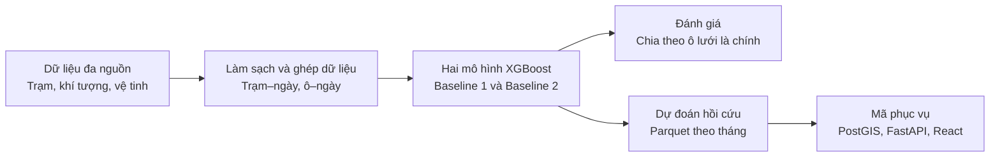
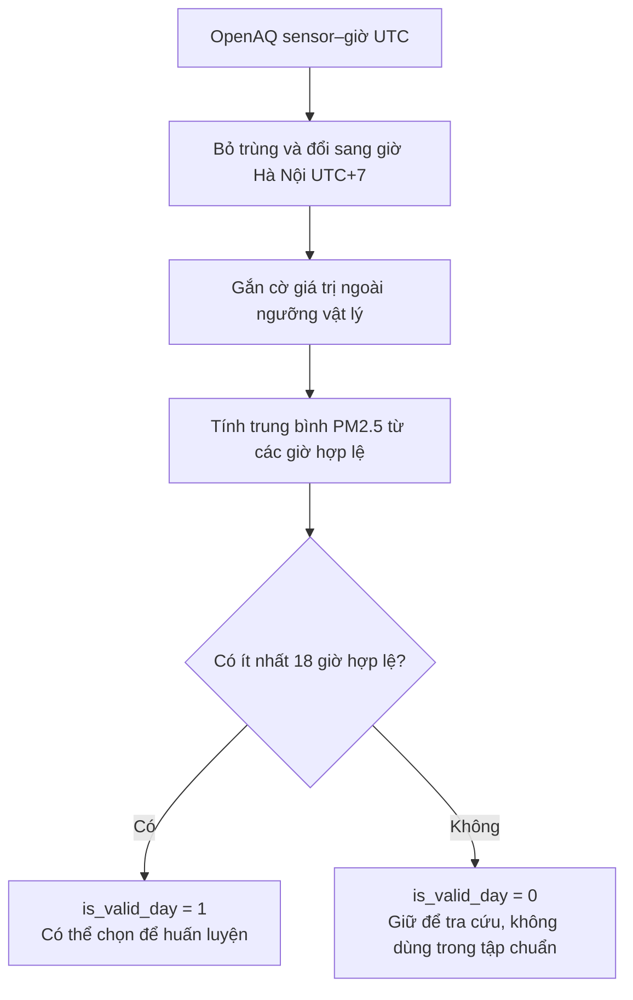
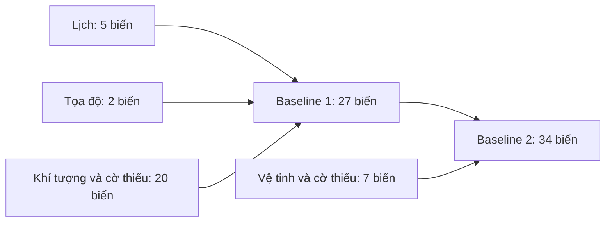
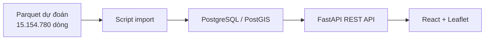

# BÁO CÁO KHOA HỌC DỮ LIỆU
## Đề tài: Ước tính Hồi cứu Nồng độ Bụi mịn PM2.5 Lưới 1 km tại Khu vực Hà Nội (2021–2026)

**Học phần:** Khoa học Dữ liệu (Data Science)  
**Thời gian nghiên cứu:** 01/01/2021 – 30/09/2026 (2.099 ngày)  
**Phiên bản dữ liệu bàn giao:** Release v1.0.0  
**Ngày rà soát hiện trạng:** 11/11/2026  

---

## 1. Tóm Tắt Đồ Án (Executive Summary)

Trạm quan trắc PM2.5 chỉ cho biết nồng độ bụi tại vị trí đặt trạm. Trong gói bàn giao của đồ án có **43 trạm**; tập dùng để huấn luyện mô hình gồm **7.290 bản ghi trạm–ngày hợp lệ từ 32 trạm, thuộc 30 ô lưới**. So với tổng cộng 3.610 ô lưới 1 km của khu vực nghiên cứu, số ô có nhãn huấn luyện còn rất ít: **3.580/3.610 ô (99,17% số ô)** không thuộc tập ô trạm huấn luyện. Con số này là tỷ lệ ô lưới, không phải tỷ lệ diện tích Hà Nội.

Đồ án xây dựng hệ thống **ước tính hồi cứu nồng độ PM2.5 trung bình ngày** trên toàn bộ lưới trong giai đoạn 2021–09/2026. “Hồi cứu” có nghĩa là mô hình sử dụng dữ liệu khí tượng và vệ tinh của chính ngày được ước tính. Kết quả là giá trị thống kê của mô hình, không phải phép đo trực tiếp ở từng ô và không phải dự báo ngày mai.

### Các phát hiện và kết quả nổi bật:

1. **Dữ liệu quan trắc có biến động theo tháng:** Trên 7.290 dòng trạm–ngày hợp lệ trong gói bàn giao, trung bình PM2.5 tháng 1 là **67,77 µg/m³**, cao hơn tháng 7 (**21,36 µg/m³**). Đây là mô tả dữ liệu ở các trạm có mẫu, không phải trung bình toàn thành phố.
2. **Cách chia tập kiểm thử ảnh hưởng mạnh đến điểm số:** Theo metadata mô hình, chia ngẫu nhiên theo dòng cho MAE khoảng **6,6–6,8 µg/m³**; chia giữ riêng ô trạm cho MAE khoảng **11,0–11,6 µg/m³**. Chia theo ô phù hợp hơn với mục tiêu áp dụng mô hình ở vị trí chưa có nhãn trong tập huấn luyện.
3. **Biến vệ tinh có ích trong phép đánh giá đã lưu:** Baseline 2 (có vệ tinh) đạt MAE **11,0451 µg/m³**, thấp hơn Baseline 1 (**11,5955 µg/m³**) khi kiểm thử theo ô. Đây là số liệu ghi trong metadata, chưa được tính lại từ các tệp đánh giá gốc trong lần rà soát này.
4. **Sản phẩm dữ liệu đã có:** 69 file Parquet theo tháng cho mỗi mô hình, **7.577.390 dòng mỗi mô hình**, tổng **15.154.780 dòng dự đoán**. Repository có mã import, API, giao diện và Docker Compose; lần rà soát này chưa xác nhận toàn bộ dự đoán đã được nạp vào PostGIS và đối soát qua API thật.

---

## 2. Xác Định Vấn Đề (Problem Definition)

### 2.1. Tuyên bố bài toán

Xây dựng quy trình dữ liệu và bản đồ để tra cứu **PM2.5 trung bình ngày ước tính** trên lưới 1 km tại Hà Nội giai đoạn 2021–2026. Người dùng có thể chọn ngày, chọn mô hình, xem một ô lưới và so sánh giá trị ước tính với số đo tại trạm khi ô đó có trạm.

### 2.2. Đối tượng sử dụng

- **Người học và nghiên cứu Khoa học Dữ liệu / Môi trường:** tìm hiểu dữ liệu đa nguồn, phương pháp đánh giá mô hình không gian và giới hạn của kết quả.
- **Người quan tâm chất lượng không khí:** xem diễn biến ước tính theo thời gian và không gian, đồng thời phân biệt rõ ước tính mô hình với quan trắc tại trạm.

### 2.3. Ranh giới khoa học (Những điều đồ án KHÔNG khẳng định)

- **Không phải dự báo tương lai:** Mô hình cần đặc trưng khí tượng và vệ tinh của cùng ngày, nên bản đồ hiện tại là ước tính hồi cứu.
- **Không xác định nguyên nhân phát thải:** Dữ liệu hiện có không đủ để quy trách nhiệm ô nhiễm cho một nguồn cụ thể.
- **Không thay thế đo đạc hay tư vấn y tế:** Giá trị `pm25_pred` không phải số đo thực tại từng ô và không phải khuyến cáo sức khỏe cá nhân.

---

## 3. Thu Thập & Hiểu Dữ Liệu (Data Ingestion & Understanding)

Mã dự án tổ chức dữ liệu từ ba nhóm chính: **trạm mặt đất, khí tượng tái phân tích và viễn thám vệ tinh**. Ranh giới hành chính được dùng để tạo miền nghiên cứu và lưới.

| Nguồn dữ liệu | Tần suất gốc | Thuộc tính chính | Vai trò trong đồ án |
| :--- | :--- | :--- | :--- |
| **OpenAQ v3 API** | Theo sensor–giờ | PM2.5, PM10, NO2, SO2, CO, CO2, O3, nhiệt độ và độ ẩm tương đối khi trạm có đo; kèm mã, tọa độ và thông tin trạm | PM2.5 là nhãn huấn luyện và giá trị quan trắc để đối chiếu. Các thông số khác không được đưa vào bộ biến dự đoán toàn lưới nếu chỉ có tại trạm. |
| **ERA5-Land và ERA5 qua Google Earth Engine** | Ảnh theo giờ, tổng hợp theo ngày Hà Nội | Nhiệt độ, điểm sương, độ ẩm, lượng mưa, tốc độ và thành phần gió, áp suất, độ cao lớp biên | Đặc trưng khí tượng cho từng ô–ngày. Mã có bước nội suy lên lưới 1 km; điều đó không làm độ phân giải gốc của ERA5 trở thành 1 km. |
| **MODIS MAIAC qua Google Earth Engine** | Theo ngày | AOD bước sóng 0,47 µm, số ảnh và cờ thiếu | Tín hiệu sol khí trong cột khí quyển; không phải PM2.5 mặt đất đo trực tiếp. |
| **Sentinel-5P qua Google Earth Engine** | Theo ngày | Cột khí NO2, CO, O3, SO2 (mol/m²) | Đặc trưng khí quyển bổ sung. |
| **VIIRS qua Google Earth Engine** | Theo tháng | Bức xạ ánh sáng ban đêm | Đặc trưng ô–tháng, được ghép vào các ngày của cùng tháng. |
| **Ranh giới Hà Nội COD-AB** | Bản địa giới dùng cố định | Hình học Hà Nội, hệ tọa độ WGS84 | Tạo lưới và giới hạn vùng phân tích. Hồ sơ nguồn ghi GSO là đơn vị gốc, OCHA/HDX phân phối, phiên bản ranh giới 2025. |

### Đơn vị quan sát và phạm vi không-thời gian:

- **Quan trắc:** một dòng tương ứng **một trạm × một ngày lịch Hà Nội**. Bảng bàn giao chứa `station_id`, `grid_id`, `date`, `pm25_observed`, số giờ hợp lệ, cờ ngày hợp lệ và các thống kê phụ.
- **Đặc trưng lưới:** một dòng tương ứng **một ô × một ngày**, gồm lịch, tọa độ, khí tượng và vệ tinh; không chứa nhãn PM2.5 của trạm.
- **Dự đoán:** một dòng tương ứng **một ô × một ngày × một mô hình**, với `pm25_pred` tính bằng µg/m³.
- **Không gian và thời gian:** 3.610 ô lưới, 2.099 ngày từ 01/01/2021 đến 30/09/2026. Lưới được xây trong `EPSG:3405` và có bản hình học `EPSG:4326` để hiển thị web.

**Trạng thái dữ liệu trong bản sao hiện tại:** gói bàn giao hình học, trạm, dự đoán và metadata có mặt. Các thư mục raw OpenAQ, raw khí tượng, mart huấn luyện và `outputs/models/` theo đường dẫn của pipeline hiện **không có**. Một số Parquet khác trong `data/core/` thuộc bộ 2021–2025 với schema khác, nên không thể thay trực tiếp cho đầu vào huấn luyện 2021–2026. Do đó, bản sao này chưa đủ để chạy lại toàn bộ quy trình từ dữ liệu thô.

---

## 4. Kiểm Tra Chất Lượng & Tiền Xử Lý (Data Quality & Preprocessing)

### 4.1. Chuẩn hóa thời gian & múi giờ

Giờ OpenAQ được chuyển từ UTC sang giờ Hà Nội trước khi xác định ngày. Đối với dữ liệu khí tượng, mã staging đổi Kelvin sang °C, mét mưa sang mm và Pascal sang hPa. AOD MODIS được nhân hệ số `0,001`. VIIRS theo tháng được ghép với các ngày cùng tháng.

### 4.2. Quy tắc kiểm soát chất lượng (QC) ngày hợp lệ

Mã pipeline đánh dấu các giá trị giờ ngoài ngưỡng vật lý bằng `qc_flag`; sau đó chỉ dùng giờ hợp lệ để tính trung bình PM2.5 ngày. Một ngày được gắn `is_valid_day = 1` khi có **ít nhất 18 giờ PM2.5 hợp lệ**. Ngày có ít giờ hơn vẫn được giữ trong bảng quan trắc để người dùng nhận biết, nhưng không thuộc tập huấn luyện chuẩn. Đây là **quy tắc xử lý của dự án**; báo cáo này không khẳng định nó tự động đáp ứng một quy chuẩn bên ngoài.

### 4.3. Xử lý giá trị bất thường và giá trị thiếu

Giá trị PM2.5 âm hoặc vượt ngưỡng vật lý trong mã không được dùng làm giờ hợp lệ. Dữ liệu khí tượng và vệ tinh thiếu được giữ dưới dạng thiếu, có thêm cờ báo thiếu ở những cột được thiết kế cho việc đó. Không được hiểu AOD thiếu là AOD bằng 0, cũng không thể kết luận mọi trường hợp thiếu đều do mây.

### 4.4. Minh bạch về các con số ô trạm trong dự án

| Tập dữ liệu | Số dòng | Số trạm | Số ô lưới | Ý nghĩa |
| :--- | ---: | ---: | ---: | :--- |
| **Danh mục trạm bàn giao** | 43 | 43 | 38 | Các trạm có trong danh mục và tọa độ ô. |
| **Quan trắc trạm–ngày bàn giao** | 9.390 | 39 | 36 | Những trạm có ít nhất một dòng quan trắc ngày. |
| **Tập huấn luyện ghi trong metadata** | 7.290 | 32 | 30 | Ngày hợp lệ có nhãn PM2.5 được chọn để huấn luyện. |

---

## 5. Khám Phá Dữ Liệu (Exploratory Data Analysis - EDA)

### 5.1. Phân bố nồng độ PM2.5 mặt đất

Tính lại trực tiếp trên **7.290 dòng quan trắc ngày hợp lệ có `pm25_observed`** trong gói bàn giao:

- **Nồng độ trung bình:** 37,67 µg/m³.
- **Trung vị:** 31,17 µg/m³.
- **Độ lệch chuẩn mẫu:** 24,90 µg/m³.
- **Phân vị 25% và 75%:** 20,65 và 47,00 µg/m³.
- **Giá trị lớn nhất:** 231,04 µg/m³.

Các con số trên mô tả **mẫu có trạm và ngày hợp lệ**; chúng không phải nồng độ trung bình của toàn bộ diện tích Hà Nội.

### 5.2. Biến động theo mùa (Seasonality)

- **Nhóm tháng 11–2:** trung vị PM2.5 tại trạm là **44,60 µg/m³**.
- **Nhóm tháng 5–8:** trung vị là **21,45 µg/m³**.
- **Theo từng tháng:** tháng 1 có trung bình cao nhất (**67,77 µg/m³**); tháng 7 thấp nhất (**21,36 µg/m³**) trong các bản ghi hợp lệ đang có.

Đây là sự khác biệt quan sát được theo thời gian. Chỉ từ bảng này chưa thể kết luận mưa, gió hay một nguồn phát thải nào đã gây ra toàn bộ chênh lệch.

### 5.3. Thách thức lớn: Dữ liệu khuyết của ảnh vệ tinh (Missing Satellite Data)

AOD có nhiều giá trị thiếu trong các dữ liệu vệ tinh đã bàn giao ở các nhánh khác nhau. Bản sao hiện tại không có mart đúng phiên bản mô hình để tính lại tỷ lệ thiếu AOD trên tập huấn luyện 2021–2026. Mô hình dùng giá trị thiếu và cờ báo thiếu làm thông tin đầu vào; việc gán một giá trị 0 hoặc trung bình cho tất cả ngày thiếu sẽ làm thay đổi ý nghĩa dữ liệu.

---

## 6. Câu Hỏi Nghiên Cứu & Kết Quả Thực Nghiệm

Đồ án tập trung vào bốn câu hỏi sau:

### ❓ Câu hỏi 1: Nồng độ PM2.5 có khác nhau theo mùa và tháng không?

- **Phương pháp:** nhóm các dòng trạm–ngày hợp lệ theo tháng, tính trung bình và trung vị.
- **Bằng chứng:** tháng 1 trung bình **67,77 µg/m³**, tháng 7 **21,36 µg/m³**; trung vị nhóm tháng 11–2 cao hơn nhóm tháng 5–8.
- **Kết luận:** dữ liệu trạm có biến động theo thời gian. Báo cáo này chưa kiểm định lại ý nghĩa thống kê trên mart gốc hoặc xác định nguyên nhân của biến động.

### ❓ Câu hỏi 2: PM2.5 liên hệ như thế nào với các yếu tố khí tượng?

- **Phương pháp được thiết kế:** ghép PM2.5 ở trạm với nhiệt độ, ẩm, mưa, gió và độ cao lớp biên của ô–ngày tương ứng.
- **Trạng thái hiện tại:** mart và kết quả phân tích gốc đúng phiên bản không có trong bản sao. Vì vậy chưa thể kiểm tra lại các hệ số tương quan từng được nêu trong báo cáo cũ.
- **Kết luận:** khí tượng là nhóm biến đầu vào của cả hai mô hình; mức liên hệ định lượng của từng biến cần được tính lại từ dữ liệu huấn luyện đúng phiên bản trước khi báo cáo như một kết quả thực nghiệm độc lập.

### ❓ Câu hỏi 3: Dữ liệu vệ tinh có cải thiện kết quả ước tính không?

- **Phương pháp:** so sánh Baseline 1 (27 biến) và Baseline 2 (34 biến) trên cùng cách chia kiểm thử theo ô lưới.
- **Bằng chứng từ metadata:** MAE giảm từ **11,5955** xuống **11,0451 µg/m³**, tức khoảng **0,55 µg/m³ (4,7%)**; R² tăng từ **0,5452** lên **0,5894**.
- **Kết luận:** trong lần đánh giá đã ghi nhận, Baseline 2 có kết quả gộp tốt hơn. Điều này không có nghĩa mọi ô hoặc mọi ngày đều được cải thiện.

### ❓ Câu hỏi 4: Kết quả thay đổi ra sao giữa chia ngẫu nhiên và chia giữ riêng ô lưới?

- **Phương pháp:** so sánh Random KFold theo dòng với Spatial GroupKFold theo `grid_id`.
- **Bằng chứng từ metadata:** MAE của hai mô hình tăng từ khoảng **6,6–6,8** lên **11,0–11,6 µg/m³** khi chuyển sang giữ riêng ô.
- **Kết luận:** cùng ô hoặc trạm có thể xuất hiện ở cả hai phía của phép chia ngẫu nhiên, khiến kết quả lạc quan đối với mục tiêu áp dụng ở vị trí mới. Chia theo ô là đánh giá chính, dù các ô kiểm thử vẫn là những ô **có trạm**.

---

## 7. Xây Dựng Đặc Trưng (Feature Engineering)

Mô hình sử dụng các biến có thể cung cấp cho một ô bất kỳ trong giai đoạn nghiên cứu:

Năm biến lịch là `year`, `month`, `day_of_week`, `day_of_year`, `is_weekend`; hai biến không gian là `easting_m`, `northing_m`. Baseline 2 thêm cột khí NO2, CO, O3, SO2, AOD, cờ thiếu AOD và ánh sáng đêm VIIRS. **Không có đặc trưng sin/cos chu kỳ năm** trong danh sách 27 hoặc 34 biến của metadata bàn giao.

### Các biến chủ động không đưa vào mô hình toàn lưới:

1. **Nhãn và thống kê từ PM2.5 tại trạm:** chỉ tồn tại nơi có trạm; nếu đưa vào đầu vào dự đoán sẽ làm rò rỉ đáp án.
2. **Số đo các chất khác chỉ có tại trạm:** không thể cung cấp cùng cách cho mọi ô lưới.
3. **Giá trị của ngày tương lai:** không phù hợp với mục tiêu ước tính hồi cứu dựa trên dữ liệu đã ghi nhận.

---

## 8. Xây Dựng Mô Hình (Model Building)

### 8.1. Thuật toán lựa chọn: XGBoost Regressor

Hai baseline dùng XGBoost Regressor, một thuật toán cây tăng cường có thể học quan hệ phi tuyến và xử lý giá trị thiếu của đầu vào. Baseline 1 dùng lịch, tọa độ, khí tượng; Baseline 2 thêm vệ tinh. Sự khác biệt về đặc trưng cho phép đánh giá phần thông tin vệ tinh bổ sung trong phép kiểm thử đã ghi nhận.

### 8.2. Cấu hình siêu tham số cố định

Mã và metadata hiện có ghi `n_estimators = 500`, `learning_rate = 0,05`, `max_depth = 6`, `subsample = 0,8`, `colsample_bytree = 0,8`, `random_state = 42`. Dự đoán âm được cắt về 0 µg/m³. Metadata mô tả mô hình cuối được huấn luyện trên **7.290 mẫu hợp lệ** để tạo bản đồ, nhưng `outputs/models/` hiện không có tệp model JSON, nên lần rà soát này chưa tải mô hình để suy luận lại.

---

## 9. Đánh Giá Mô Hình & Phân Tích Sai Số

### 9.1. So sánh chi tiết 3 phương pháp kiểm định

Bảng sau là **kết quả đã lưu trong metadata bàn giao**, chưa được tính lại từ tệp đánh giá gốc vì `outputs/evaluation/` không có trong bản sao hiện tại. MAE và RMSE tính bằng µg/m³; R² không có đơn vị.

| Chiến lược kiểm thử | Mô hình | MAE | RMSE | R² | Vai trò |
| :--- | :--- | ---: | ---: | ---: | :--- |
| **Spatial GroupKFold (5-fold theo ô)** | Baseline 1 | 11,5955 | 16,7911 | 0,5452 | Đánh giá chính |
| **Spatial GroupKFold (5-fold theo ô)** | Baseline 2 | **11,0451** | **15,9541** | **0,5894** | Đánh giá chính |
| **Random KFold (5-fold theo dòng)** | Baseline 1 | 6,6247 | 10,3725 | 0,8382 | Tham khảo |
| **Random KFold (5-fold theo dòng)** | Baseline 2 | 6,7710 | 10,6516 | 0,8293 | Tham khảo |
| **Temporal Split (train 2021–2025, kiểm tra 2026)** | Baseline 1 | 11,1443 | 16,1432 | 0,5284 | Bổ sung |
| **Temporal Split (train 2021–2025, kiểm tra 2026)** | Baseline 2 | 11,0847 | 16,0006 | 0,5367 | Bổ sung |

Đánh giá theo ô lưới giữ các ô trạm kiểm thử ra khỏi tập huấn luyện. Nó phù hợp hơn chia ngẫu nhiên theo dòng cho mục tiêu áp dụng tại vị trí mới. Tuy nhiên, các ô kiểm thử vẫn có trạm đo; sai số ở từng ô hoàn toàn không có trạm chưa thể đo trực tiếp.

### 9.2. Ý nghĩa thực tế của MAE khoảng 11 µg/m³

MAE **11,0451 µg/m³** nghĩa là trong tập kiểm thử chia theo ô, **độ lệch tuyệt đối trung bình** giữa ước tính và số đo là khoảng 11,05 µg/m³. Không phải mọi dự đoán đều lệch đúng mức này. Lấy MAE chia cho nồng độ trung bình không phải cách tính sai số phần trăm trung bình của từng dự đoán.

Temporal Split năm 2026 chỉ là đánh giá bổ sung: báo cáo thực nghiệm của dự án ghi rằng dữ liệu 2026 từng được khảo sát trước, nên không thể gọi đó là một tập test mù hoàn toàn.

---

## 10. Ứng Dụng Kết Quả & Hệ Thống Triển Khai (Application & Serving)

Dự án có mã để đưa kết quả từ Parquet vào một ứng dụng bản đồ:

### 10.1. Sinh kết quả toàn lưới (Full-grid Inference)

Số dòng đã được kiểm trực tiếp từ metadata Parquet: **3.610 ô × 2.099 ngày × 2 mô hình = 15.154.780 dự đoán**. Mỗi mô hình có **69 file tháng** từ 01/2021 đến 09/2026. Mỗi dòng chứa `grid_id`, `date`, mã và phiên bản mô hình, `pm25_pred` và `run_id`. Đây là **ước tính của mô hình**, không phải số đo trạm và không phải AQI.

### 10.2. Kiến trúc Serving & Trực quan hóa

1. **Database và importer:** schema PostGIS có bảng lưới, trạm, quan trắc ngày, metadata mô hình và dự đoán; script `scripts/import.py` được viết để nạp gói bàn giao.
2. **Backend FastAPI:** mã có sáu endpoint dữ liệu (`/api/models`, `/api/dates`, `/api/grids`, `/api/map`, lịch sử một ô, `/api/stations`) và một endpoint `/health`.
3. **Frontend React:** mã có bản đồ ô lưới, bộ chọn ngày/mô hình, lớp trạm và biểu đồ lịch sử. `docker-compose.yml` định nghĩa bốn dịch vụ: database, importer, API và frontend.
4. **Đối soát dữ liệu:** đã có script `scripts/verify_reconciliation.py` để so Parquet, database và API. **Chưa có kết quả chạy đối soát trên PostGIS thật trong lần rà soát này**, nên không khẳng định sai lệch thực tế đã bằng 0.

### 10.3. Trạng thái kiểm tra mã trong bản sao hiện tại

Ruff, kiểm thử frontend và bản build frontend đã đạt trong lần kiểm tra gần đây. Một lần chạy Python bằng môi trường Conda được ghi nhận **268 passed, 11 skipped**: hai ca cần model JSON/mart chưa có, chín ca cần `TEST_DATABASE_URL` kết nối PostGIS thật. Kết quả này xác nhận các ca đã chạy, **không thay thế kiểm thử tích hợp với database đã nạp toàn bộ dữ liệu**.

---

## 11. Hạn Chế & Rủi Ro Suy Rộng (Limitations)

1. **Độ phủ trạm huấn luyện thấp:** chỉ 30 ô có nhãn trong tập huấn luyện theo metadata. Kiểm thử chia theo ô giảm sự lạc quan do trùng vị trí giữa hai tập, nhưng chưa đo được sai số ở từng ô không có trạm.
2. **Thiếu đầu vào để tái lập toàn bộ pipeline trong bản sao hiện tại:** chưa có raw OpenAQ/khí tượng theo cấu trúc mã yêu cầu, `data/marts/`, model JSON và các tệp đánh giá gốc ở `outputs/`. Các Parquet 2021–2025 khác schema không thể dùng thay trực tiếp. Phần lớn tệp dữ liệu lớn không được Git theo dõi, nên người nhận cần đúng gói bàn giao.
3. **Vệ tinh có giá trị thiếu:** cờ thiếu cho biết ô–ngày không có giá trị sử dụng trong bảng, không tự xác định nguyên nhân của từng trường hợp thiếu.
4. **Độ phân giải và thời gian:** ô 1 km không thể mô tả khác biệt giữa hai con phố; mô hình hồi cứu cần dữ liệu khí quyển của ngày cần ước tính.
5. **Kiểm chứng triển khai chưa hoàn tất trong lần rà soát:** chưa nạp và truy vấn PostGIS chứa toàn bộ gói, chưa chạy chín ca tích hợp DB và chưa lưu biên bản đối soát Parquet → database → API.

---

## 12. Kết Luận & Hướng Phát Triển (Conclusion & Future Work)

### 12.1. Đã làm được gì?
- Hoàn thành đầy đủ một chu trình Khoa học Dữ liệu thực chiến: từ bài toán thực tế, thu thập dữ liệu đa nguồn (OpenAQ, GEE, ERA5), chuẩn hóa Lakehouse, EDA kiểm định giả thuyết, huấn luyện và đánh giá mô hình XGBoost trung thực bằng `Spatial GroupKFold`.
- Đóng gói trọn vẹn thành sản phẩm phần mềm chạy được (Docker 1-touch, API, Web Dashboard) phục vụ tra cứu dữ liệu 2021–2026.

### 12.2. Hướng phát triển trong tương lai
1. **Pipeline Live Crawl & ETL thời gian thực:** Mở rộng scheduler tự động kéo dữ liệu OpenAQ và dự báo thời tiết GFS/Open-Meteo để phục vụ chuỗi dữ liệu từ tháng 10/2026 đến ngày hôm nay.
2. **Bổ sung biến tĩnh giao thông & mật độ dân số:** Đưa thêm dữ liệu OpenStreetMap (mật độ mạng lưới đường bộ, ngã tư) và bản đồ sử dụng đất (Land Use / Land Cover) để tăng độ nhạy không gian cho các ô ngoại thành.
3. **Thử nghiệm các kiến trúc Spatiotemporal Deep Learning:** Nghiên cứu các mô hình Spatiotemporal Graph Neural Networks (ST-GNN) hoặc ConvLSTM khi có chuỗi dữ liệu giờ liên tục và đầy đủ hơn.
