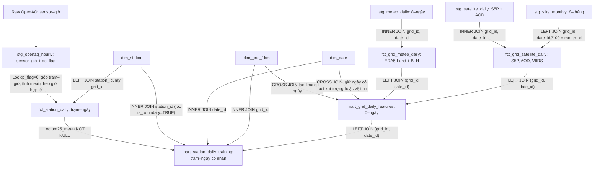

# Schema dữ liệu — HANOI_PM25

## 1. Mục tiêu và quy ước

- Bản đồ PM2.5 lịch sử có grain ô lưới–ngày; phạm vi cấu hình `2021-01-01` → `2026-09-30` gồm 2.099 ngày. Với 3.610 ô và đủ ngày có dữ liệu đầu vào, tối đa có `3.610 × 2.099 = 7.577.390` dòng. Mart lưới chỉ tạo các ngày có trong ít nhất một fact khí tượng hoặc vệ tinh, nên số dòng thực tế có thể ít hơn. Ngày theo giờ Hà Nội `Asia/Ho_Chi_Minh` (`UTC+7`), `date_id = YYYYMMDD`.
- Dữ liệu nhãn cấp trạm–ngày: `pm25_mean` được tính bằng **trung bình cộng trên đúng số giờ hợp lệ (`pm25_valid_hours`) trong ngày**, giữ cả ngày có $< 18$ giờ sạch kèm cờ `is_valid_day = 1` khi $\ge 18$ giờ.
- Quy ước đặt tên:
  - Khí/bụi khác đo tại trạm OpenAQ mang hậu tố **`_aq`**: `pm10_aq`, `no2_aq`, `so2_aq`, `co_aq`, `co2_aq`, `o3_aq`.
  - Khí tượng đo tại trạm OpenAQ mang tiền tố **`openaq_`**: `openaq_temperature`, `openaq_relativehumidity`.
  - Mọi cờ báo thiếu mang hậu tố **`_missing`**: `openaq_temperature_missing`, `openaq_relativehumidity_missing`, `temp_2m_c_missing`, `dewpoint_2m_c_missing`, `rh_pct_missing`, `precip_mm_missing`, `wind_speed_10m_ms_missing`, `surface_pressure_hpa_missing`, `blh_mean_m_missing`, `blh_min_m_missing`, `aod_047_missing`.

## 2. Luồng và quan hệ dữ liệu

**Thứ tự tạo bảng và quy tắc ghép:**
- **Dimensions (`build_dims.py`):**
  - `dim_grid_1km`: cắt lưới 1 km (`EPSG:3405`) giao với `hanoi_boundary.geojson` (`area_in_hanoi_km2 > 0`).
  - `dim_date`: sinh chuỗi ngày `2021-01-01` → `2026-09-30` (`date_id = YYYYMMDD`).
  - `dim_station`: chiếu tọa độ trạm sang `EPSG:3405`, kiểm tra điểm tọa độ nằm trong đa giác địa giới Hà Nội (`is_boundary = boundary.covers(Point)`), chỉ gán `grid_id` khi `is_boundary = TRUE`.
- **Staging (`build_staging.py`):**
  - `stg_openaq_hourly`: `INNER JOIN` danh mục `sensors` theo `sensor_id`, khử trùng lặp theo `(sensor_id, datetime_from_utc)`, đổi sang giờ Hà Nội (`+07`) và gắn `qc_flag` nhị phân (`0`: hợp lệ trong ngưỡng vật lý, `1`: không hợp lệ / ngoài ngưỡng vật lý).
  - `stg_meteo_daily`, `stg_satellite_daily`, `stg_viirs_monthly`: khử trùng lặp theo khóa `(grid_id, date)` / `(grid_id, month)` và chuẩn hóa đơn vị (`°C`, `mm`, `hPa`, `aod047 * 0.001`).
- **Core Facts (`build_facts.py`):**
  - `fct_station_daily`: lọc `qc_flag = 0`, gom `GROUP BY (station_id, parameter, date_id, hour_local)` để hợp nhất cấp giờ, rồi gom `GROUP BY (station_id, date_id)` tính `pm25_mean = sum(hourly_val) / pm25_valid_hours`, các cột `*_aq` và `openaq_*`; sau đó `LEFT JOIN dim_station USING (station_id)` để lấy `grid_id`.
  - `fct_grid_meteo_daily`: `stg_meteo_daily` `INNER JOIN dim_grid_1km USING (grid_id)` và `INNER JOIN dim_date USING (date_id)`, bổ sung các cờ `*_missing`.
  - `fct_grid_satellite_daily`: `stg_satellite_daily` `INNER JOIN` `dim_grid_1km` và `dim_date`, rồi `LEFT JOIN stg_viirs_monthly ON s.grid_id = v.grid_id AND (s.date_id // 100) = v.month_id`, bổ sung cờ `aod_047_missing`.
- **Feature Marts (`build_marts.py`):**
  - `mart_grid_daily_features`: tạo khung bằng `dim_grid_1km CROSS JOIN dim_date`, chỉ giữ ngày xuất hiện trong ít nhất một fact khí tượng hoặc vệ tinh, sau đó `LEFT JOIN fct_grid_meteo_daily USING (grid_id, date_id)` và `LEFT JOIN fct_grid_satellite_daily USING (grid_id, date_id)`. Không chứa bất kỳ cột `pm25_*` nào.
  - `mart_station_daily_training`: lấy `fct_station_daily` (`pm25_mean IS NOT NULL AND grid_id IS NOT NULL`), `INNER JOIN dim_station ON station_id` (lọc `st.is_boundary = TRUE`), `INNER JOIN dim_date ON date_id` và `INNER JOIN dim_grid_1km ON grid_id` (giữ lịch và tọa độ không bao giờ bị `NULL`), rồi `LEFT JOIN mart_grid_daily_features ON (grid_id, date_id)`.

## 3. Danh mục file và khóa chính

Số dòng dưới đây là số được ghi nhận trong một lần chạy, không phải cam kết cho mọi lần chạy hoặc tập dữ liệu hiện có.

| Tầng | Tên file trong `data/` | Grain / khóa chính | Số dòng |
| :--- | :--- | :--- | ---: |
| Core Dim | `core/dim_grid_1km.parquet` | `grid_id` | 3.610 |
| Core Dim | `core/dim_date.parquet` | `date_id` | 2.099 |
| Core Dim | `core/dim_station.parquet` | `station_id` | 43 |
| Staging | `staging/stg_openaq_hourly.parquet` | `(sensor_id, datetime_utc)` | 712.870 |
| Staging | `staging/stg_meteo_daily.parquet` | `(grid_id, date_id)` | 7.577.390 |
| Staging | `staging/stg_satellite_daily.parquet` | `(grid_id, date_id)` | 7.577.390 |
| Staging | `staging/stg_viirs_monthly.parquet` | `(grid_id, month_id)` | 245.480 |
| Core Fact | `core/fct_station_daily.parquet` | `(station_id, date_id)` | 9.390 |
| Core Fact | `core/fct_grid_meteo_daily.parquet` | `(grid_id, date_id)` | 7.577.390 |
| Core Fact | `core/fct_grid_satellite_daily.parquet` | `(grid_id, date_id)` | 7.577.390 |
| Mart | `marts/mart_grid_daily_features.parquet` | `(grid_id, date_id)` | 7.577.390 |
| Mart | `marts/mart_station_daily_training.parquet` | `(station_id, date_id)` | 9.207 |

## 4. Schema các bảng Core & Mart

### 4.1 `dim_grid_1km`
| Cột | Kiểu | Ý nghĩa |
| :--- | :--- | :--- |
| `grid_id` | VARCHAR | Khóa ô (`grid_{easting_ll}_{northing_ll}`). |
| `easting_m`, `northing_m` | BIGINT | Tọa độ tâm ô theo mét (`EPSG:3405`). |
| `lon`, `lat` | DOUBLE | Kinh độ, vĩ độ tâm ô (`WGS84`). |
| `area_in_hanoi_km2` | DOUBLE | Diện tích phần ô nằm trong địa giới Hà Nội ($\text{km}^2$). |
| `centroid_in_hanoi` | BOOLEAN | Tâm ô nằm trong địa giới Hà Nội. |
| `geometry` | GEOMETRY | Hình học ô vuông 1 km (`EPSG:3405`). |

### 4.2 `dim_date`
| Cột | Kiểu | Ý nghĩa |
| :--- | :--- | :--- |
| `date_id` | INTEGER | Khóa ngày `YYYYMMDD`. |
| `date` | DATE | Ngày lịch Hà Nội. |
| `year`, `month`, `day` | SMALLINT / TINYINT | Thành phần ngày. |
| `day_of_week`, `day_of_year` | TINYINT / SMALLINT | Thứ trong tuần (`1` = Thứ Hai), ngày trong năm. |
| `is_weekend` | BOOLEAN | Cờ cuối tuần (Thứ Bảy, Chủ Nhật). |
| `season` | VARCHAR | Mùa Hà Nội (`winter`, `spring`, `summer`, `autumn`). |

### 4.3 `dim_station`
| Cột | Kiểu | Ý nghĩa |
| :--- | :--- | :--- |
| `station_id`, `openaq_location_id` | VARCHAR, BIGINT | Mã trạm (`openaq_{id}`) và ID gốc OpenAQ. |
| `station_name`, `provider`, `owner` | VARCHAR | Tên trạm, nhà cung cấp, đơn vị sở hữu. |
| `sensor_tier` | VARCHAR | `reference` hoặc `low_cost`. |
| `lon`, `lat`, `easting_m`, `northing_m` | DOUBLE | Tọa độ `WGS84` và `EPSG:3405`. |
| `is_boundary` | BOOLEAN | `TRUE` nếu tọa độ thực của trạm nằm trong đa giác địa giới Hà Nội. |
| `grid_id` | VARCHAR | FK đến `dim_grid_1km` (`NULL` nếu `is_boundary = FALSE`). |
| `parameters` | VARCHAR | Danh sách thông số đo tại trạm. |
| `datetime_first_utc`, `datetime_last_utc` | VARCHAR | Thời gian hoạt động đầu/cuối trên OpenAQ. |

### 4.4 `fct_station_daily`
| Cột | Kiểu | Ý nghĩa |
| :--- | :--- | :--- |
| `station_id`, `grid_id`, `date_id` | VARCHAR, VARCHAR, INTEGER | Khóa trạm, ô lưới và ngày. |
| `pm25_valid_hours`, `is_valid_day` | SMALLINT, TINYINT | Số giờ PM2.5 hợp lệ (`0..24`) và cờ $\ge 18$ giờ. |
| `pm25_mean`, `pm25_std`, `pm25_min`, `pm25_max` | DOUBLE | Trung bình ngày (trên số giờ hợp lệ) và thống kê phụ PM2.5 ($\mu\text{g/m}^3$). |
| `pm10_aq`, `no2_aq`, `so2_aq`, `co_aq`, `co2_aq`, `o3_aq` | DOUBLE | Trung bình ngày các khí khác tại trạm OpenAQ (hậu tố `_aq`). |
| `openaq_temperature`, `openaq_relativehumidity` | DOUBLE | Nhiệt độ ($^\circ\text{C}$) và độ ẩm (%) đo tại trạm OpenAQ. |
| `openaq_temperature_missing`, `openaq_relativehumidity_missing` | TINYINT | Cờ báo thiếu khí tượng trạm (`1` = thiếu, `0` = có). |

### 4.5 `fct_grid_meteo_daily` & `fct_grid_satellite_daily`
- **`fct_grid_meteo_daily` (`grid_id`, `date_id`):** `temp_2m_c`, `dewpoint_2m_c`, `rh_pct`, `precip_mm`, `wind_speed_10m_ms`, `wind_u_10m_ms`, `wind_v_10m_ms`, `wind_persistence`, `wind_dir_10m_deg`, `surface_pressure_hpa`, `blh_mean_m`, `blh_min_m`, `era5_land_hours` cùng 8 cột cờ thiếu `*_missing`.
- **`fct_grid_satellite_daily` (`grid_id`, `date_id`):** `no2_trop_mol_m2`, `co_mol_m2`, `o3_mol_m2`, `so2_mol_m2`, `aod_047`, `aod_047_missing`, `viirs_radiance`, `viirs_cloud_free_nights` và các cột số ảnh `*_n`.

### 4.6 Hai bảng Mart (`mart_grid_daily_features` & `mart_station_daily_training`)
- **`mart_grid_daily_features` (`grid_id`, `date_id`):** Gồm lịch (`date`, `year`, `month`, `day_of_week`, `day_of_year`, `is_weekend`, `season`), tọa độ (`easting_m`, `northing_m`), toàn bộ biến khí tượng + `*_missing`, toàn bộ biến vệ tinh + `aod_047_missing`. Không chứa cột `pm25_*`.
- **`mart_station_daily_training` (`station_id`, `date_id`):** Gồm định danh trạm (`station_id`, `station_name`, `sensor_tier`, `is_boundary`, `grid_id`, `date_id`), nhãn `pm25_mean`, `pm25_valid_hours`, `is_valid_day`, các cột trạm (`*_aq`, `openaq_*`, `openaq_*_missing`) và toàn bộ cột đặc trưng lịch, tọa độ, khí tượng, vệ tinh của ô lưới.
