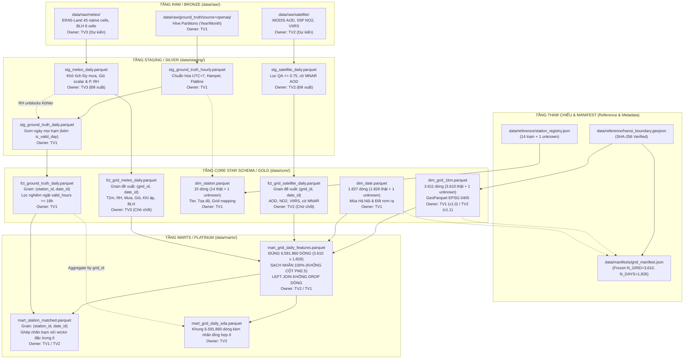

# KIẾN TRÚC VÀ ĐẶC TẢ LƯỢC ĐỒ DỮ LIỆU (DATA SCHEMA SPECIFICATION)
## DỰ ÁN HANOI_PM25: SPATIO-TEMPORAL DATA LAKEHOUSE (2021–2025)

**Cơ quan ban hành:** Ban Kiến trúc Dữ liệu & Quản trị Hồ chứa (Data Architecture Board)  
**Vai trò:** Data Architect & CI/CD Lead (`ngthinh06` - TV1)  
**Phiên bản tài liệu:** `v3.1.0-draft`  
**Ngày cập nhật:** 2026-10-26  
**Trạng thái kiến trúc:** ĐỀ XUẤT CHUẨN HÓA & CHỜ ĐỒNG THUẬN BÀN GIAO (DRAFT FOR TEAM HANDOFF)  
**Tài liệu ràng buộc chất lượng đi kèm:** [Hợp đồng Dữ liệu Tổng thể (Data Contract Specification)](./data_contract.md)

---

## 1. NGUYÊN TẮC KIẾN TRÚC & CÔNG NGHỆ CỐT LÕI (ARCHITECTURE PRINCIPLES)

Dự án HANOI_PM25 xây dựng hồ chứa dữ liệu không-thời gian phục vụ nghiên cứu và mô hình hóa ô nhiễm bụi mịn $PM_{2.5}$ tại Hà Nội giai đoạn 2021–2025. Toàn bộ hệ thống tuân thủ nghiêm ngặt các nguyên tắc kiến trúc sau:

1. **Kiến trúc Zero-RDBMS (Pure Parquet / GeoParquet + In-process DuckDB / Polars):**
   - Tuyệt đối không vận hành cơ sở dữ liệu quan hệ truyền thống (PostgreSQL/PostGIS, MySQL, SQL Server) hay các công cụ điều phối ngoài luồng (như dbt).
   - Mọi bảng dữ liệu từ Bronze (Raw), Silver (Staging), Gold (Core Star Schema) đến Platinum (Marts) được lưu trữ dưới định dạng chuẩn công nghiệp **Apache Parquet** và **GeoParquet 1.1.0** (nén bằng thuật toán `zstd`).
   - Query engine duy nhất là **DuckDB** nhúng và dataframe engine là **Polars**.
2. **Khung Không gian Bất biến (Spatial Grid Spine):**
   - Hệ quy chiếu quốc gia: **VN-2000 / UTM Zone 48N (`EPSG:3405`)**, đơn vị mét thực.
   - Ranh giới địa giới chuẩn: Lấy từ `data/reference/hanoi_boundary.geojson` (nguồn HDX COD-AB v02, GSO Vietnam, đóng băng mã băm SHA-256 `d8194abcc1d89eadd836941a750ae339f398a9b2e5e9d2428d0f96f1f2bd1f77`).
   - Quy tắc tạo lưới: Ô vuông đều kích thước $1.000\text{ m} \times 1.000\text{ m}$. Lựa chọn toàn bộ các ô giao cắt với ranh giới Hà Nội bằng toán tử hình học `intersects`.
   - Quy mô lưới phân tích: **$N_{\text{GRID}} = 3.610\text{ ô}$**. Bảng chiều `dim_grid_1km` có đúng **$3.611\text{ dòng}$** (bao gồm 3.610 ô phân tích thực và 1 dòng ngoại lệ `grid_unknown`).
3. **Khung Thời gian Bất biến (Temporal Spine):**
   - Trục ngày lịch liên tục 5 năm: Từ `2021-01-01` đến `2025-12-31` theo giờ địa phương Hà Nội (`Asia/Ho_Chi_Minh`, `UTC+7`).
   - Khóa ngày: `date_id` định dạng số nguyên `YYYYMMDD`, bản ghi ngoại lệ là `-1`.
   - Số ngày phân tích thực: **$N_{\text{DAYS}} = 1.826\text{ ngày}$** (gồm 366 ngày của năm nhuận 2024). Bảng chiều `dim_date` có đúng **$1.827\text{ dòng}$** (1.826 ngày thật + 1 dòng ngoại lệ `date_id = -1`).
4. **Quy mô Khung xương Phân tích (Analysis Spine):**
   - Tích Descartes thuần túy giữa ô phân tích và ngày phân tích:
     $$|S| = N_{\text{GRID}} \times N_{\text{DAYS}} = 3.610 \times 1.826 = 6.591.860\text{ dòng}$$
   - Khung này **loại trừ cả hai dòng ngoại lệ** (`grid_unknown` và `date_id = -1`).
5. **Phân công Trách nhiệm Rõ ràng (RACI Ownership):**
   - **Thành viên 1 (`ngthinh06` - TV1):** Lưới không gian (`dim_grid_1km` v1.0), Trục ngày (`dim_date`), Danh mục trạm (`dim_station`), Ingestion/QC chuỗi giờ trạm và Dữ liệu quan trắc mặt đất (`fct_ground_truth_daily`).
   - **Thành viên 2 (`hunganh` - TV2):** Trích xuất 15 đặc trưng tĩnh đô thị (`dim_grid_1km` v1.1), Viễn thám vệ tinh MODIS/Sentinel-5P/VIIRS (`fct_grid_satellite_daily`), Đóng gói Star Schema & Feature Marts (`mart_grid_daily_features`).
   - **Thành viên 3 (`minh` - TV3):** Tái phân tích khí tượng ERA5-Land & BLH (`fct_grid_meteo_daily`), Khử tích lũy lượng mưa, Tính gió vô hướng và độ ẩm tương đối ($RH$).

---

## 2. SƠ ĐỒ LUỒNG DỮ LIỆU ĐỒNG BỘ (END-TO-END DATA FLOW)

Dữ liệu luân chuyển qua 4 tầng kiến trúc (Medallion Architecture):



---

## 3. DANH MỤC TỔNG THỂ BẢNG VÀ ARTIFACT DỮ LIỆU

| Tên bảng / File Artifact | Tầng dữ liệu | Định dạng lưu trữ | Hạt dữ liệu (Grain) | Khóa chính (PK) | Khóa ngoại (FK) | Đường dẫn vật lý | Trách nhiệm (Owner) | Trạng thái kỹ thuật |
| :--- | :--- | :--- | :--- | :--- | :--- | :--- | :---: | :---: |
| `grid_manifest.json` | Metadata | JSON | Toàn dự án | N/A | N/A | `data/manifests/grid_manifest.json` | TV1 | **Đã triển khai** |
| `dim_grid_1km` (v1.0) | Core Dim | GeoParquet 1.1.0 | 1 ô lưới 1km | `grid_id` | N/A | `data/core/dim_grid_1km.parquet` | TV1 | **Đã triển khai** |
| `dim_grid_1km` (v1.1) | Core Dim | GeoParquet 1.1.0 | 1 ô lưới 1km | `grid_id` | N/A | `data/core/dim_grid_1km.parquet` | TV2 | **Đang thực hiện** |
| `dim_date` | Core Dim | Parquet | 1 ngày lịch | `date_id` | N/A | `data/core/dim_date.parquet` | TV1 | **Đã triển khai** |
| `dim_station` | Core Dim | Parquet | 1 trạm quan trắc | `station_id` | `grid_id` | `data/core/dim_station.parquet` | TV1 | **Đã triển khai** |
| `stg_ground_truth_hourly` | Staging | Parquet | Trạm – Giờ UTC | `(station_id, datetime_utc)` | `grid_id` | `data/staging/stg_ground_truth_hourly.parquet` | TV1 | **Đã triển khai** |
| `stg_ground_truth_daily` | Staging | Parquet | Trạm – Ngày | `(station_id, date_id)` | `station_id`, `date_id`, `grid_id` | `data/staging/stg_ground_truth_daily.parquet` | TV1 | **Đã triển khai** |
| `fct_ground_truth_daily` | Core Fact | Parquet | Trạm – Ngày ($\ge 18\text{h}$) | `(station_id, date_id)` | `station_id`, `date_id`, `grid_id` | `data/core/fct_ground_truth_daily.parquet` | TV1 | **Đã triển khai** |
| `stg_satellite_daily` | Staging | Parquet | Pixel/Ô – Ngày | Chờ TV2 xác nhận | `date_id` | `data/staging/stg_satellite_daily.parquet` | TV2 | *Đề xuất / Chưa có* |
| `fct_grid_satellite_daily`| Core Fact | Parquet | Ô – Ngày (Đề xuất) | `(grid_id, date_id)` | `grid_id`, `date_id` | `data/core/fct_grid_satellite_daily.parquet` | TV2 | *Đề xuất / Chờ TV2 chốt* |
| `stg_meteo_daily` | Staging | Parquet | Pixel/Ô – Ngày | Chờ TV3 xác nhận | `date_id` | `data/staging/stg_meteo_daily.parquet` | TV3 | *Đề xuất / Chưa có* |
| `fct_grid_meteo_daily` | Core Fact | Parquet | Ô – Ngày (Đề xuất) | `(grid_id, date_id)` | `grid_id`, `date_id` | `data/core/fct_grid_meteo_daily.parquet` | TV3 | *Đề xuất / Chờ TV3 chốt* |
| `mart_grid_daily_features`| Platinum Mart | Parquet | Ô – Ngày phân tích | `(grid_id, date_id)` | `grid_id`, `date_id` | `data/marts/mart_grid_daily_features.parquet` | TV2 / TV1 | *Thiết kế chuẩn / Chờ upstream* |
| `mart_station_matched` | Platinum Mart | Parquet | Trạm – Ngày ($\ge 18\text{h}$) | `(station_id, date_id)` | `station_id`, `date_id`, `grid_id` | `data/marts/mart_station_matched.parquet` | TV1 / TV2 | *Đề xuất* |
| `mart_grid_daily_eda` | Platinum Mart | Parquet | Ô – Ngày phân tích | `(grid_id, date_id)` | `grid_id`, `date_id` | `data/marts/mart_grid_daily_eda.parquet` | TV2 | *Đề xuất* |

---

## 4. CHI TIẾT LƯỢC ĐỒ CÁC MÔ HÌNH DỮ LIỆU CỐT LÕI (MODELS SPECIFICATION)

### 4.1. Bảng Chiều Không Gian Lưới 1km: `dim_grid_1km`
- **Đường dẫn:** `data/core/dim_grid_1km.parquet`
- **Định dạng:** GeoParquet 1.1.0 (`EPSG:3405`)
- **Hạt dữ liệu (Grain):** Từng ô lưới vuông $1\text{ km} \times 1\text{ km}$.
- **Khóa chính:** `grid_id` (Không được Null, duy nhất 100%).
- **Số dòng thực tế:** **3.611 dòng** (3.610 ô phân tích thực tế + 1 ô ngoại lệ `grid_unknown`).

| Tên cột | Kiểu dữ liệu | Đơn vị | Nullable | Giai đoạn (Stage) | Ý nghĩa nghiệp vụ |
| :--- | :--- | :--- | :---: | :---: | :--- |
| `grid_id` | `VARCHAR` | Chuỗi mã | **NO** | v1.0 (TV1) | Mã định danh ô lưới: `grid_{lower_left_easting}_{lower_left_northing}`. Dòng ngoại lệ có giá trị `grid_unknown`. |
| `easting_m` | `DOUBLE` | Mét (m) | YES | v1.0 (TV1) | Tọa độ tâm ô lưới theo trục Đông VN-2000 UTM Zone 48N. Ngoại lệ = `-1.0`. |
| `northing_m` | `DOUBLE` | Mét (m) | YES | v1.0 (TV1) | Tọa độ tâm ô lưới theo trục Bắc VN-2000 UTM Zone 48N. Ngoại lệ = `-1.0`. |
| `is_canonical` | `INT64` | Cờ (0/1) | **NO** | v1.0 (TV1) | `1` nếu trọng tâm ô nằm hoàn toàn trong ranh giới Hà Nội (`centroid.within`); `0` nếu là ô biên cắt ranh giới hoặc ô ngoại lệ. Tổng số ô canonical là 3.363 ô. |
| `area_in_boundary_km2` | `DOUBLE` | $\text{km}^2$ | **NO** | v1.0 (TV1) | Diện tích phần giao giữa ô lưới và đa giác địa giới Hà Nội ($0.0 \le \text{area} \le 1.0$). Ô ngoại lệ = `0.0`. |
| `geometry` | `GEOMETRY` | Polygon | YES | v1.0 (TV1) | Đa giác ô vuông $1.000\text{ m} \times 1.000\text{ m}$ theo `EPSG:3405`. Dòng ngoại lệ là `NULL`. |
| `osm_primary_road_m` | `FLOAT` | Mét (m) | YES | v1.1 (TV2) | *(Đề xuất TV2)* Chiều dài đường quốc lộ / đường chính OpenStreetMap cắt qua ô lưới. |
| `osm_road_density_km_km2`| `FLOAT` | $\text{km}/\text{km}^2$ | YES | v1.1 (TV2) | *(Đề xuất TV2)* Mật độ mạng lưới giao thông đường bộ toàn bộ các cấp trong ô lưới. |
| `worldcover_builtup_ratio`| `FLOAT` | Tỷ lệ [0..1] | YES | v1.1 (TV2) | *(Đề xuất TV2)* Tỷ lệ diện tích bề mặt không thấm / công trình xây dựng (ESA WorldCover mã 50). |
| `worldcover_tree_ratio` | `FLOAT` | Tỷ lệ [0..1] | YES | v1.1 (TV2) | *(Đề xuất TV2)* Tỷ lệ tán che cây xanh / rừng (ESA WorldCover mã 10). |
| `worldcover_cropland_ratio`| `FLOAT` | Tỷ lệ [0..1] | YES | v1.1 (TV2) | *(Đề xuất TV2)* Tỷ lệ đất canh tác nông nghiệp / trồng trọt (ESA WorldCover mã 40). |
| `worldcover_water_ratio` | `FLOAT` | Tỷ lệ [0..1] | YES | v1.1 (TV2) | *(Đề xuất TV2)* Tỷ lệ mặt nước thường trực sông hồ (ESA WorldCover mã 80). |
| `dem_elevation_mean_m` | `FLOAT` | Mét (m) | YES | v1.1 (TV2) | *(Đề xuất TV2)* Độ cao địa hình trung bình so với mực nước biển (NASA SRTM DEM 30m). |
| `dem_slope_mean_deg` | `FLOAT` | Độ (degrees) | YES | v1.1 (TV2) | *(Đề xuất TV2)* Độ dốc sườn địa hình trung bình trong ô lưới ($0^\circ \le \text{slope} \le 90^\circ$). |

---

### 4.2. Bảng Chiều Thời Gian: `dim_date`
- **Đường dẫn:** `data/core/dim_date.parquet`
- **Định dạng:** Apache Parquet
- **Hạt dữ liệu (Grain):** Từng ngày lịch (Daily).
- **Khóa chính:** `date_id` (Không được Null, duy nhất 100%).
- **Số dòng thực tế:** **1.827 dòng** (1.826 ngày lịch thực tế từ 2021-01-01 đến 2025-12-31 + 1 dòng ngoại lệ `date_id = -1`).

| Tên cột | Kiểu dữ liệu | Đơn vị | Nullable | Giai đoạn | Ý nghĩa nghiệp vụ |
| :--- | :--- | :--- | :---: | :---: | :--- |
| `date_id` | `INT32` | Số nguyên | **NO** | v1.0 (TV1) | Khóa thay thế dạng số nguyên `YYYYMMDD` (ví dụ: `20210101`). Dòng ngoại lệ có giá trị `-1`. |
| `date_actual` | `DATE` | Ngày lịch | **NO** | v1.0 (TV1) | Ngày lịch theo chuẩn ISO-8601 (`YYYY-MM-DD`). Ngoại lệ = `1970-01-01`. |
| `year` | `INT64` | Năm | **NO** | v1.0 (TV1) | Năm dương lịch ($2021 \le \text{year} \le 2025$). Dòng ngoại lệ = `-1`. |
| `month` | `INT64` | Tháng | **NO** | v1.0 (TV1) | Tháng trong năm ($1 \le \text{month} \le 12$). Dòng ngoại lệ = `-1`. |
| `day` | `INT64` | Ngày | **NO** | v1.0 (TV1) | Ngày trong tháng ($1 \le \text{day} \le 31$). Dòng ngoại lệ = `-1`. |
| `day_of_week` | `INT64` | Thứ | **NO** | v1.0 (TV1) | Thứ trong tuần theo chuẩn ISO ($1$: Thứ Hai, ..., $7$: Chủ Nhật). Ngoại lệ = `-1`. |
| `is_weekend` | `INT64` | Cờ (0/1) | **NO** | v1.0 (TV1) | `1` nếu là Thứ Bảy hoặc Chủ Nhật; `0` nếu là ngày làm việc. Ngoại lệ = `0`. |
| `hanoi_season` | `VARCHAR` | Tên mùa | **NO** | v1.0 (TV1) | Mùa khí hậu Hà Nội: `Winter` (T11–T2), `Spring` (T3–T4), `Summer` (T5–T8), `Autumn` (T9–T10). Dòng ngoại lệ = `Unknown`. |
| `is_crop_burning_window`| `INT64` | Cờ (0/1) | **NO** | v1.0 (TV1) | Cửa sổ đốt rơm rạ ngoại thành Hà Nội: Đợt 1 (15/5–15/6), Đợt 2 (15/9–31/10). `1` nếu thuộc cửa sổ, `0` nếu không. |

---

### 4.3. Bảng Chiều Trạm Quan Trắc Mặt Đất: `dim_station`
- **Đường dẫn:** `data/core/dim_station.parquet`
- **Định dạng:** Apache Parquet
- **Hạt dữ liệu (Grain):** Từng trạm đo mặt đất vật lý.
- **Khóa chính:** `station_id` (Không được Null, duy nhất 100%).
- **Khóa ngoại:** `grid_id` $\rightarrow$ `dim_grid_1km(grid_id)`.
- **Số dòng thực tế:** **15 dòng** (14 trạm quan trắc thực tế nằm trong địa giới Hà Nội + 1 trạm ngoại lệ `station_unknown`).

| Tên cột | Kiểu dữ liệu | Đơn vị | Nullable | Giai đoạn | Ý nghĩa nghiệp vụ |
| :--- | :--- | :--- | :---: | :---: | :--- |
| `station_id` | `VARCHAR` | Mã trạm | **NO** | v1.0 (TV1) | Định danh duy nhất trạm: `openaq_{loc_id}`. Dòng ngoại lệ = `station_unknown`. |
| `station_name` | `VARCHAR` | Chuỗi ký tự | **NO** | v1.0 (TV1) | Tên vị trí trạm quan trắc (ví dụ: *United States Embassy Hanoi*, *Chi cục BVMT Hà Nội*). Ngoại lệ = `Unknown Station`. |
| `provider` | `VARCHAR` | Tên cơ quan | **NO** | v1.0 (TV1) | Đơn vị vận hành và cung cấp dữ liệu trạm (ví dụ: *US Department of State*, *Chi cục BVMT*). |
| `sensor_tier` | `VARCHAR` | Phân tầng Tier| **NO** | v1.0 (TV1) | Phân tầng cấp độ thiết bị: `Tier_1_Reference_FEM` (máy chuẩn tham chiếu sấy mẫu), `Tier_2_LowCost_Optical` (cảm biến tán xạ quang học), hoặc `Unknown`. |
| `station_microenv_type`| `VARCHAR`| Phân loại MT | **NO** | v1.0 (TV1) | Vi môi trường xung quanh trạm: `Urban_Background`, `Roadside`, `Rural_Background`, `Unknown`. |
| `grid_id` | `VARCHAR` | Mã ô lưới | **NO** | v1.0 (TV1) | Khóa ngoại trỏ sang ô vuông $1\text{ km} \times 1\text{ km}$ chứa trạm trong `dim_grid_1km`. Dòng ngoại lệ trỏ sang `grid_unknown`. |
| `lon_wgs84` | `DOUBLE` | Độ kinh | YES | v1.0 (TV1) | Tọa độ kinh độ địa lý theo WGS84 (`EPSG:4326`). Dòng ngoại lệ là `NULL`. |
| `lat_wgs84` | `DOUBLE` | Độ vĩ | YES | v1.0 (TV1) | Tọa độ vĩ độ địa lý theo WGS84 (`EPSG:4326`). Dòng ngoại lệ là `NULL`. |
| `easting_m` | `DOUBLE` | Mét (m) | YES | v1.0 (TV1) | Tọa độ Easting theo VN-2000 UTM Zone 48N (`EPSG:3405`). Dòng ngoại lệ là `NULL`. |
| `northing_m` | `DOUBLE` | Mét (m) | YES | v1.0 (TV1) | Tọa độ Northing theo VN-2000 UTM Zone 48N (`EPSG:3405`). Dòng ngoại lệ là `NULL`. |
| `is_active` | `BOOLEAN` | Đúng/Sai | **NO** | v1.0 (TV1) | Trạng thái trạm còn hoạt động hay không dựa trên lần gửi dữ liệu gần nhất. Ngoại lệ = `false`. |

---

### 4.4. Bảng Dữ Liệu Sự Kiện Quan Trắc Mặt Đất Hàng Ngày: `fct_ground_truth_daily`
- **Đường dẫn:** `data/core/fct_ground_truth_daily.parquet`
- **Định dạng:** Apache Parquet
- **Hạt dữ liệu (Grain):** **Trạm – Ngày** (`station_id`, `date_id`). Mỗi dòng là một ngày đo hợp lệ tại một trạm cụ thể.
- **Khóa chính:** `(station_id, date_id)` (Không được Null, duy nhất 100%).
- **Khóa ngoại:**
  - `station_id` $\rightarrow$ `dim_station(station_id)`
  - `date_id` $\rightarrow$ `dim_date(date_id)`
  - `grid_id` $\rightarrow$ `dim_grid_1km(grid_id)`
- **Quy tắc nghiệm thu chất lượng:** Chỉ lưu các ngày đo có **$\text{valid\_hours\_count} \ge 18\text{ giờ}$** (đáp ứng tiêu chuẩn kiểm định môi trường quốc tế). Các ngày $< 18\text{h}$ được lưu ở `stg_ground_truth_daily` với `is_valid_day = 0` nhưng **bị loại hoàn toàn khỏi bảng Fact Core**.

| Tên cột | Kiểu dữ liệu | Đơn vị | Nullable | Giai đoạn | Ý nghĩa nghiệp vụ |
| :--- | :--- | :--- | :---: | :---: | :--- |
| `station_id` | `VARCHAR` | Mã trạm | **NO** | v1.0 (TV1) | Khóa ngoại xác định trạm quan trắc mặt đất. |
| `date_id` | `INT32` | Số nguyên | **NO** | v1.0 (TV1) | Khóa ngoại xác định ngày đo theo định dạng `YYYYMMDD`. |
| `grid_id` | `VARCHAR` | Mã ô lưới | **NO** | v1.0 (TV1) | Khóa ngoại ô lưới 1km chứa trạm (được denormalize để tăng tốc truy vấn phân tích). |
| `valid_hours_count` | `INT64` | Giờ | **NO** | v1.0 (TV1) | Số lượng giờ đo hợp lệ trong ngày địa phương ($18 \le \text{valid\_hours\_count} \le 24$). |
| `pm25_raw_mean` | `DOUBLE` | $\mu\text{g}/\text{m}^3$ | **NO** | v1.0 (TV1) | Nồng độ $PM_{2.5}$ trung bình ngày từ dữ liệu thô chưa hiệu chỉnh (chỉ tính trên các giờ có `qc_flag = 0`). |
| `pm25_calibrated_mean`| `DOUBLE` | $\mu\text{g}/\text{m}^3$ | **NO** | v1.0 (TV1) | Nồng độ $PM_{2.5}$ trung bình ngày sau khi áp dụng hiệu chỉnh $\kappa$-Köhler (với Tier 1 FEM: bằng `pm25_raw_mean`). **Đây là biến nhãn chính cho bài toán ML.** |
| `pm25_daily_std` | `DOUBLE` | $\mu\text{g}/\text{m}^3$ | YES | v1.0 (TV1) | Độ lệch chuẩn nồng độ $PM_{2.5}$ trong ngày (thể hiện biến động giờ). |
| `pm25_daily_min` | `DOUBLE` | $\mu\text{g}/\text{m}^3$ | **NO** | v1.0 (TV1) | Nồng độ $PM_{2.5}$ thấp nhất ghi nhận trong ngày. |
| `pm25_daily_max` | `DOUBLE` | $\mu\text{g}/\text{m}^3$ | **NO** | v1.0 (TV1) | Nồng độ $PM_{2.5}$ cao nhất ghi nhận trong ngày. |

---

### 4.5. Bảng Dữ Liệu Sự Kiện Viễn Thám Vệ Tinh Hàng Ngày: `fct_grid_satellite_daily` *(Đề xuất TV2)*
- **Đường dẫn:** `data/core/fct_grid_satellite_daily.parquet`
- **Định dạng:** Apache Parquet
- **Hạt dữ liệu đề xuất (Proposed Grain):** **Ô lưới – Ngày** (`grid_id`, `date_id`).
- **Khóa chính đề xuất:** `(grid_id, date_id)`.
- **Khóa ngoại:**
  - `grid_id` $\rightarrow$ `dim_grid_1km(grid_id)`
  - `date_id` $\rightarrow$ `dim_date(date_id)`
- **Trạng thái:** **ĐỀ XUẤT THIẾT KẾ (PROPOSED - CHỜ TV2 XÁC NHẬN CHÍNH THỨC)**. TV2 có quyền xác nhận hình thức biểu diễn (dạng thưa chỉ chứa ngày có ảnh hay dạng ma trận đầy đủ kèm NULL).

| Tên cột | Kiểu dữ liệu | Đơn vị | Nullable | Giai đoạn | Ý nghĩa nghiệp vụ dự kiến |
| :--- | :--- | :--- | :---: | :---: | :--- |
| `grid_id` | `VARCHAR` | Mã ô lưới | **NO** | v1.0 (TV2) | Mã ô lưới 1km phân tích. |
| `date_id` | `INT32` | Số nguyên | **NO** | v1.0 (TV2) | Ngày quan trắc vệ tinh (`YYYYMMDD`). |
| `aod_047_mean` *(hoặc `aod_550nm_mean`)* | `FLOAT` | Không thứ nguyên | YES | v1.0 (TV2) | Độ dày quang học sol khí AOD từ MODIS MAIAC (đã nhân scale factor `0.001`, dải $[0.0, 3.5]$). `NULL` khi bị mây che. |
| `is_aod_missing_mnar` | `INT32` | Cờ (0/1) | **NO** | v1.0 (TV2) | Cờ chẩn đoán khuyết thiếu phi ngẫu nhiên do mây che (MNAR): `1` nếu AOD bị khuyết do mây/sương mù; `0` nếu quan trắc được bình thường. |
| `no2_tropospheric_mol_m2` | `FLOAT` | $\text{mol}/\text{m}^2$ | YES | v1.0 (TV2) | Mật độ cột khí tầng đối lưu $NO_2$ từ Sentinel-5P (chỉ lấy pixel có $QA \ge 0.75$, dải $[0.0, 0.001]$). |
| `viirs_nightlight_rad` | `FLOAT` | $\text{nW}/\text{cm}^2/\text{sr}$ | YES | v1.0 (TV2) | Bức xạ ánh sáng ban đêm VIIRS DNB (phản ánh hoạt động kinh tế/đô thị ban đêm, dải $[0.0, 300.0]$). |

---

### 4.6. Bảng Dữ Liệu Sự Kiện Khí Tượng Hàng Ngày: `fct_grid_meteo_daily` *(Đề xuất TV3)*
- **Đường dẫn:** `data/core/fct_grid_meteo_daily.parquet`
- **Định dạng:** Apache Parquet
- **Hạt dữ liệu đề xuất (Proposed Grain):** **Ô lưới – Ngày** (`grid_id`, `date_id`).
- **Khóa chính đề xuất:** `(grid_id, date_id)`.
- **Khóa ngoại:**
  - `grid_id` $\rightarrow$ `dim_grid_1km(grid_id)`
  - `date_id` $\rightarrow$ `dim_date(date_id)`
- **Trạng thái:** **ĐỀ XUẤT THIẾT KẾ (PROPOSED - CHỜ TV3 XÁC NHẬN CHÍNH THỨC)**. Dữ liệu gốc từ ~45 điểm pixel ERA5-Land và ~8 điểm pixel BLH, được TV3 nội suy/broadcast sang 3.610 ô lưới.

| Tên cột | Kiểu dữ liệu | Đơn vị | Nullable | Giai đoạn | Ý nghĩa nghiệp vụ dự kiến |
| :--- | :--- | :--- | :---: | :---: | :--- |
| `grid_id` | `VARCHAR` | Mã ô lưới | **NO** | v1.0 (TV3) | Mã ô lưới 1km phân tích. |
| `date_id` | `INT32` | Số nguyên | **NO** | v1.0 (TV3) | Ngày tổng hợp khí tượng địa phương (`YYYYMMDD`). |
| `temp_2m_mean_c` | `FLOAT` | $^\circ\text{C}$ | YES | v1.0 (TV3) | Nhiệt độ không khí trung bình ngày ở độ cao 2m (đổi từ Kelvin: $T_K - 273.15$, dải $[-5.0, 50.0]$). |
| `dewpoint_2m_mean_c` | `FLOAT` | $^\circ\text{C}$ | YES | v1.0 (TV3) | Nhiệt độ điểm sương trung bình ngày ở độ cao 2m (dải $[-10.0, 40.0]$). |
| `rh_mean_pct` | `FLOAT` | $\%$ | YES | v1.0 (TV3) | Độ ẩm tương đối trung bình ngày tính theo công thức Magnus-Tetens từ chuỗi giờ (dải $[0.0, 100.0]$). |
| `precip_daily_mm` | `FLOAT` | mm | YES | v1.0 (TV3) | Tổng lượng mưa ngày đã khử tích lũy (hourly de-accumulated, dải $[0.0, 500.0]$). |
| `wind_speed_scalar_ms` | `FLOAT` | $\text{m}/\text{s}$ | YES | v1.0 (TV3) | Tốc độ gió vô hướng trung bình 24h: $V_{\text{scalar}} = \frac{1}{24}\sum \sqrt{u_{10}^2 + v_{10}^2}$ (dải $[0.0, 35.0]$). |
| `wind_persistence` | `FLOAT` | Tỷ số [0..1] | YES | v1.0 (TV3) | Tỷ số bền vững hướng gió: $P = V_{\text{vector}} / \max(V_{\text{scalar}}, 10^{-4})$ ($0.0 \le P \le 1.0$). |
| `surface_pressure_hpa` | `FLOAT` | hPa | YES | v1.0 (TV3) | Khí áp bề mặt trung bình ngày (đổi từ Pa sang hPa, dải $[900.0, 1050.0]$). |
| `blh_mean_m` | `FLOAT` | Mét (m) | YES | v1.0 (TV3) | Chiều cao lớp biên hành tinh PBLH trung bình ngày từ ERA5 (dải $[10.0, 4000.0]$). |
| `blh_min_m` | `FLOAT` | Mét (m) | YES | v1.0 (TV3) | Chiều cao lớp biên thấp nhất trong ngày (thường vào ban đêm/nghịch nhiệt bức xạ, dải $[10.0, 2000.0]$). |

---

### 4.7. Bảng Chợ Đặc Trưng Không-Thời Gian: `mart_grid_daily_features`
- **Đường dẫn:** `data/marts/mart_grid_daily_features.parquet`
- **Định dạng:** Apache Parquet
- **Hạt dữ liệu (Grain):** **Ô lưới phân tích – Ngày lịch** (`grid_id`, `date_id`).
- **Khóa chính:** `(grid_id, date_id)` (Không được Null, duy nhất 100%).
- **Quy mô ma trận bắt buộc:** **ĐÚNG 6.591.860 DÒNG** ($3.610\text{ ô} \times 1.826\text{ ngày}$).
- **Nguyên tắc Chống Rò rỉ Nhãn (Label Leakage Firewall):**
  > [!IMPORTANT]
  > Bảng này TUYỆT ĐỐI KHÔNG CHỨA bất kỳ cột nào liên quan đến nồng độ bụi $PM_{2.5}$ cùng ngày, số lượng trạm quan trắc mặt đất hay cờ trạm. Cơ chế Whitelist áp dụng nghiêm ngặt trên toàn bộ danh mục cột. Nhãn Ground Truth chỉ được ghép nối riêng rẽ khi huấn luyện mô hình Machine Learning.
- **Quy tắc Ghép nối Không làm rơi dòng (Zero-Drop Left Join):**
  Khung xương được sinh ra từ tích Descartes của các ô thực và các ngày thực:
  $$\text{Spine} = \pi_{\text{grid\_id}}(\sigma_{\text{grid\_id} \neq \text{'grid\_unknown'}}(\text{dim\_grid\_1km})) \times \pi_{\text{date\_id}}(\sigma_{\text{date\_id} \neq -1}(\text{dim\_date}))$$
  Sau đó thực hiện `LEFT JOIN` với bảng đặc trưng tĩnh, `fct_grid_meteo_daily` và `fct_grid_satellite_daily`. Mọi trường thiếu dữ liệu tự động nhận giá trị `NULL`. **Nghiêm cấm mọi thao tác `INNER JOIN` hay lọc `DROP` dòng trên bảng này.**

Danh mục cột chuẩn hóa Whitelist của `mart_grid_daily_features`:
1. **Khóa liên kết:** `grid_id` (`VARCHAR`), `date_id` (`INT32`), `date` (`DATE`).
2. **Khí tượng (từ TV3):** `temp_2m_mean_c`, `dewpoint_2m_mean_c`, `rh_mean_pct`, `precip_daily_mm`, `wind_speed_scalar_ms`, `wind_persistence`, `surface_pressure_hpa`, `blh_mean_m`, `blh_min_m`.
3. **Viễn thám (từ TV2):** `aod_047_mean`, `is_aod_missing_mnar`, `no2_tropospheric_mol_m2`, `viirs_nightlight_rad`.
4. **Đặc trưng tĩnh đô thị & Địa hình (từ TV2):** `osm_primary_road_m`, `osm_road_density_km_km2`, `worldcover_builtup_ratio`, `worldcover_tree_ratio`, `dem_elevation_mean_m`, `dem_slope_mean_deg`.

---

## 5. PHÂN BIỆT HẠT DỮ LIỆU & QUY TẮC GHÉP NỐI CHỐNG NHÂN DÒNG (ANTI-FANOUT)

Trong mô hình hóa không-thời gian, có sự khác biệt căn bản giữa dữ liệu trạm quan trắc mặt đất và dữ liệu ô lưới viễn thám/khí quyển:

```
+---------------------------------------------------------------------------------------+
|  HẠT TRẠM - NGÀY (STATION-DAILY GRAIN)                                                |
|  - Đại diện cho quan trắc điểm (Point measurement) tại một tọa độ vật lý cụ thể.       |
|  - Khóa: (station_id, date_id).                                                       |
|  - Quan hệ Không gian: Nhiều trạm CÓ THỂ cùng nằm trong 1 ô lưới 1km! (1:N)            |
|    Ví dụ: Khu vực nội thành Hoàn Kiếm/Hai Bà Trưng có thể có 2-3 trạm cùng 1 ô lưới.  |
+---------------------------------------------------------------------------------------+
                                         VS
+---------------------------------------------------------------------------------------+
|  HẠT Ô - NGÀY (GRID-DAILY GRAIN)                                                      |
|  - Đại diện cho giá trị trung bình diện tích (Area-averaged surface) trên ô vuông 1km2.|
|  - Khóa: (grid_id, date_id).                                                          |
|  - Quy mô: Đúng 3.610 ô x 1.826 ngày = 6.591.860 bản ghi ma trận toàn cảnh.           |
+---------------------------------------------------------------------------------------+
```

### 5.1. Rủi ro Nhân dòng (Join Fan-out Catastrophe)
Nếu một kỹ sư thiếu cẩn trọng thực hiện phép ghép:
```sql
-- CẢNH BÁO: ĐÂY LÀ PHÉP GHÉP SAI GÂY NHÂN BÙNG NỔ SỐ DÒNG
SELECT m.*, f.pm25_calibrated_mean
FROM mart_grid_daily_features m
LEFT JOIN fct_ground_truth_daily f 
  ON m.grid_id = f.grid_id AND m.date_id = f.date_id;
```
**Hậu quả:** Đối với các ô lưới có nhiều trạm quan trắc mặt đất cùng hoạt động trong một ngày, phép ghép trên sẽ **nhân đôi hoặc nhân ba số dòng của ô đó**, phá vỡ cấu trúc ma trận 6.591.860 dòng và làm sập toàn bộ các câu lệnh kiểm định toàn vẹn khóa chính.

### 5.2. Hai Kịch bản Ghép nối Chuẩn hóa (Standardized Safe Patterns)

#### Kịch bản A: Tạo Tập Dữ liệu Huấn luyện Máy học (Machine Learning Training View)
Áp dụng cho bảng `mart_station_matched.parquet`: Lấy bảng Fact trạm làm hạt chính, ghép sang bảng đặc trưng ô lưới:
```sql
-- CHUẨN A: Hạt kết quả bảo toàn đúng theo (station_id, date_id) của trạm
SELECT 
    f.station_id,
    f.date_id,
    f.grid_id,
    f.pm25_calibrated_mean AS label_pm25,  -- Nhãn học giám sát
    f.valid_hours_count,
    m.temp_2m_mean_c,
    m.rh_mean_pct,
    m.wind_speed_scalar_ms,
    m.aod_047_mean,
    m.worldcover_builtup_ratio,
    m.dem_elevation_mean_m
FROM read_parquet('data/core/fct_ground_truth_daily.parquet') f
LEFT JOIN read_parquet('data/marts/mart_grid_daily_features.parquet') m
    ON f.grid_id = m.grid_id AND f.date_id = m.date_id;
```
*Số dòng đầu ra chính xác bằng số dòng của `fct_ground_truth_daily` (100% không bị nhân dòng).*

#### Kịch bản B: Tạo Bảng Bản Đồ Phân Tích Khám Phá (EDA Surface Grid View)
Áp dụng cho bảng `mart_grid_daily_eda.parquet`: Cần biểu diễn giá trị nồng độ ô lưới trên nền toàn bộ 6.591.860 dòng. Bắt buộc phải **tổng hợp (aggregate) các trạm trong cùng ô trước khi join**:
```sql
-- CHUẨN B: Gom nhóm các trạm cùng ô trước khi LEFT JOIN vào khung xương
WITH station_daily_aggregated AS (
    SELECT 
        grid_id,
        date_id,
        COUNT(DISTINCT station_id) AS active_stations_in_cell,
        ROUND(AVG(pm25_calibrated_mean), 2) AS grid_cell_pm25_mean
    FROM read_parquet('data/core/fct_ground_truth_daily.parquet')
    GROUP BY grid_id, date_id
)
SELECT 
    m.*,
    COALESCE(s.active_stations_in_cell, 0) AS station_count,
    s.grid_cell_pm25_mean
FROM read_parquet('data/marts/mart_grid_daily_features.parquet') m
LEFT JOIN station_daily_aggregated s
    ON m.grid_id = s.grid_id AND m.date_id = s.date_id;
```
*Số dòng đầu ra luôn được bảo toàn tuyệt đối bằng đúng $|S| = 6.591.860\text{ dòng}$.*

---

## 6. PHÂN TÁCH PHẦN ĐÃ TRIỂN KHAI VÀ THIẾT KẾ ĐỀ XUẤT MỞ RỘNG

Để đảm bảo tính trung thực kỹ thuật cao nhất trong tài liệu kiến trúc, phần này phân định rõ ranh giới giữa những gì **đã chạy thực tế trong mã nguồn** và những gì **đang ở mức đề xuất kiến trúc (Proposed Specifications)**:

### 6.1. Các Thành phần Đã Triển Khai Thực Tế (Implemented Baseline)
1. **Khung xương Lưới 1km:** `dim_grid_1km.parquet` v1.0 (3.611 dòng, 6 cột, thuật toán `intersects` với ranh giới HDX COD-AB 2025, đóng băng SHA-256).
2. **Trục Ngày 5 Năm:** `dim_date.parquet` (1.827 dòng, 9 cột, phân loại mùa Hà Nội và cửa sổ đốt rơm rạ, khóa `-1`).
3. **Danh mục Trạm:** `dim_station.parquet` (15 dòng, phân loại Tier 1/Tier 2, ánh xạ tọa độ sang `grid_id`).
4. **Chuỗi Giờ Staging:** `stg_ground_truth_hourly.parquet` (Deduplicate qua `_row_hash`, gắn cờ QC phân tầng: âm, cực đại, flatline 6h, Hampel filter).
5. **Gom Ngày Mặt Đất:** `stg_ground_truth_daily.parquet` (Tính trung bình và gắn cờ `is_valid_day = (valid_hours_count >= 18)`).
6. **Fact Mặt Đất:** `fct_ground_truth_daily.parquet` (Chỉ lọc các dòng $\ge 18\text{h}$, tích hợp khóa ngoại chuẩn).
7. **Hạ tầng Ghi/Đọc:** `src/common/io_parquet.py` (ghi nguyên tử `atomic_write_parquet`) và `src/common/hashing.py` (băm SHA-256 `compute_row_hash`).

### 6.2. Các Thiết Kế Đề Xuất Mở Rộng Cần Bổ Sung (Proposed Architectural Enhancements)
Các cơ chế sau đã được thiết kế trong tài liệu kiến trúc nhưng **chưa được mã hóa đầy đủ trong code hiện tại**:

1. **Quản trị Lô Nạp (Ingestion Batch Management):**
   - *Đề xuất:* Thiết lập bảng/file manifest ghi nhận từng đợt nạp: `data/manifests/ingestion_batches.json` (chứa `batch_id`, `source_name`, `started_at_utc`, `completed_at_utc`, `status = SUCCESS | PARTIAL | FAILED`, `records_ingested`).
2. **Truy vết Phả hệ Cấp Dòng (Batch-Row Lineage):**
   - *Đề xuất:* Bổ sung vào các bảng Raw và Staging 3 trường siêu dữ liệu chuẩn doanh nghiệp:
     - `_batch_id`: Mã UUID của lần nạp dữ liệu.
     - `_ingested_at_utc`: Thời điểm ghi nhận bản ghi (chuẩn ISO-8601 UTC).
     - `_source_file`: Đường dẫn file gốc hoặc tên phân vùng API.
3. **Lưu trữ Kết Quả Kiểm Định Chất Lượng (Quality Results Logging):**
   - *Đề xuất:* Thay vì chỉ in báo cáo ra màn hình terminal từ `contract_verifier.py`, cần tự động kết xuất kết quả kiểm tra từng lần chạy vào artifact `data/manifests/quality_audit_log.parquet` (hoặc JSON) để lưu trữ lịch sử kiểm định phục vụ đối soát CI/CD.
4. **Bảng Ánh Xạ Khử Trùng & Bản Ghi Bị Thay Thế (Duplicate & Replacement Audit Mapping):**
   - *Đề xuất:* Khi API OpenAQ hoặc Copernicus cập nhật dữ liệu hồi tố (re-analysis revision), hệ thống cần một bảng ghi nhận lịch sử thay thế: `data/staging/stg_revision_audit.parquet` lưu vết cặp `(business_key, old_row_hash, new_row_hash, replaced_at_utc)`.

---

## 7. ĐIỀU HƯỚNG TÀI LIỆU LIÊN QUAN

- Để tra cứu các ràng buộc kiểm định, tiêu chuẩn nghiệm thu từng trường dữ liệu, quy định xử lý bất thường và các quyết định kỹ thuật đang chờ TV2/TV3 chốt, vui lòng đọc:  
  👉 **[Hợp đồng Dữ liệu Tổng thể: docs/data_contract.md](./data_contract.md)**
- Để tra cứu danh mục mã lệnh thực thi của dự án: Xem [run.py](../run.py).
- Để tra cứu phân công công việc chi tiết của từng thành viên: Xem [Playbook TV1](../deliverables/HANOI_PM25_Playbook_TV1_ngthinh06.md), [Playbook TV2](../deliverables/HANOI_PM25_Playbook_TV2_hunganh.md) và [Playbook TV3](../deliverables/HANOI_PM25_Playbook_TV3_minh.md).
