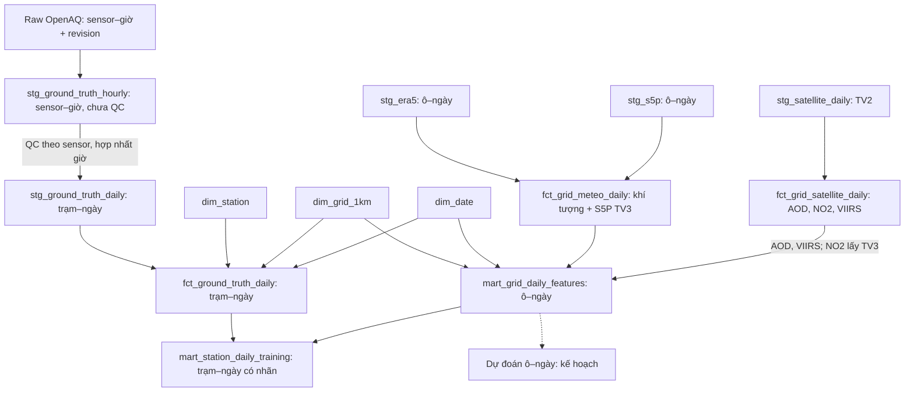

# Schema dữ liệu hiện trạng — HANOI_PM25

**Ảnh chụp:** workspace ngày 2026-10-28; các file Parquet có thể thay đổi khi các thành viên bàn giao. Đây là tài liệu kỹ thuật để review, **không thay thế data contract hoặc xác nhận nghiệm thu dữ liệu**. Tài liệu kiến trúc cũ: [schema.md](./schema.md).

## 1. Mục tiêu và quy ước

- Bản đồ PM2.5 lịch sử 2021–2025 có grain ô lưới–ngày; ngày phân tích là ngày Hà Nội `Asia/Ho_Chi_Minh`, `date_id = YYYYMMDD`.
- Dữ liệu nhãn có grain trạm–ngày. `pm25_raw_mean` là trung bình các giờ sạch quan sát được, không phải giá trị đã hiệu chuẩn; nó `NULL` khi không có giờ sạch. Fact giữ cả ngày có dưới 18 giờ, `is_valid_day = 1` nếu có ít nhất 18 giờ sạch.
- Mỗi trạm có thể cùng ô với trạm khác; chưa chốt quy tắc gộp nhãn trạm thành nhãn ô–ngày. Các khóa trong tài liệu là **khóa logic**, không được Parquet tự thực thi.
- Không tự động đưa `valid_hours_count`, `is_valid_day`, `is_crop_burning_window` hoặc nhãn vào đặc trưng model. Mart lưới không chứa PM2.5. OSM hiện có fact nhưng tạm không ghép vào mart.

## 2. Luồng và quan hệ dữ liệu

`dim_station` → `fct_ground_truth_daily` là một–nhiều theo `station_id`; `dim_grid_1km` và `dim_date` là một–nhiều tới các fact theo khóa tương ứng. `mart_station_daily_training` là phép ghép nhiều–một từ trạm–ngày sang mart ô–ngày; nhiều trạm có thể dùng cùng vector đặc trưng. `fct_grid_osm_yearly` dùng `(grid_id, year)` nhưng chưa tham gia mart.

## 3. Danh mục file và khóa logic

Số dòng là ảnh chụp, không mặc định là ràng buộc bất biến. Kiểm tra thực tế ngày 2026-10-28 cho các khóa dưới đây: không có null hoặc trùng khóa. Kiểm tra này **không tự chứng minh nguồn, tính đại diện hoặc chất lượng khoa học**.

| Tầng | Tên file trong `data/` | Grain / khóa logic | Số dòng |
|---|---|---|---:|
| Core | `core/dim_grid_1km.parquet` | `grid_id` | 3.611 |
| Core | `core/dim_date.parquet` | `date_id` | 1.827 |
| Core | `core/dim_station.parquet` | `station_id` | 44 |
| Core | `core/fct_ground_truth_daily.parquet` | `(station_id, date_id)` | 7.909 |
| Core | `core/fct_grid_meteo_daily.parquet` | `(grid_id, date_id)` | 6.591.860 |
| Core | `core/fct_grid_satellite_daily.parquet` | `(grid_id, date_id)` | 6.591.860 |
| Core | `core/fct_grid_osm_yearly.parquet` | `(grid_id, year)` | 18.050 |
| Staging | `staging/stg_ground_truth_hourly.parquet` | `(station_id, sensor_id, datetime_utc)` | 163.239 |
| Staging | `staging/stg_ground_truth_daily.parquet` | `(station_id, date_id)` | 7.913 |
| Staging | `staging/stg_era5.parquet` | `(grid_id, date)` | 6.591.860 |
| Staging | `staging/stg_s5p.parquet` | `(grid_id, date)` | 6.591.860 |
| Staging | `staging/stg_satellite_daily.parquet` | `(grid_id, date_id)` | 6.591.860 |
| Mart | `marts/mart_grid_daily_features.parquet` | `(grid_id, date_id)` | 6.591.860 |
| Mart | `marts/mart_station_daily_training.parquet` | `(station_id, date_id)` | 7.878 |

Spine phân tích trong ảnh chụp có 3.610 ô × 1.826 ngày = 6.591.860 ô–ngày. Dimension có thêm `grid_unknown` và `date_id = -1`; mart không đưa các dòng ngoại lệ này vào khung dự đoán.

## 4. Schema các bảng core

Kiểu bên dưới là kiểu DuckDB đọc từ file, không đồng nghĩa mọi cột đã có ràng buộc `NOT NULL` vật lý.

### 4.1 `dim_grid_1km`

| Cột | Kiểu | Ý nghĩa |
|---|---|---|
| `grid_id` | VARCHAR | Khóa ô; có `grid_unknown`. |
| `easting_m`, `northing_m` | BIGINT | Tọa độ theo hệ mét của lưới. |
| `is_canonical` | BIGINT | Cờ ô chuẩn. |
| `area_in_boundary_km2` | DOUBLE | Diện tích phần ô nằm trong địa giới. |
| `geometry` | GEOMETRY | Hình học ô, CRS VN-2000 / UTM zone 48N, EPSG:3405. |

File lưới đang có trên máy **chưa chứa WorldCover, DEM hoặc OSM**. Không suy ra biến tĩnh tồn tại chỉ từ schema đề xuất.

### 4.2 `dim_date`

| Cột | Kiểu | Ý nghĩa |
|---|---|---|
| `date_id` | INTEGER | Khóa ngày; `-1` là unknown. |
| `date_actual` | DATE | Ngày lịch Hà Nội. |
| `year`, `month`, `day` | BIGINT | Thành phần ngày. |
| `day_of_week` | BIGINT | Thứ trong tuần. |
| `is_weekend` | BIGINT | Cờ cuối tuần. |
| `hanoi_season` | VARCHAR | Nhãn mùa theo quy ước dự án. |
| `is_crop_burning_window` | BIGINT | Cờ cửa sổ theo quy ước; không chọn cho model hiện tại. |

### 4.3 `dim_station`

| Cột | Kiểu | Ý nghĩa |
|---|---|---|
| `station_id`, `station_name`, `provider` | VARCHAR | Định danh, tên và đơn vị cung cấp trạm. |
| `sensor_tier`, `station_microenv_type` | VARCHAR | Phân loại trong metadata; không tự chứng minh thiết bị hoặc chất lượng. |
| `grid_id` | VARCHAR | Ô được ánh xạ cho trạm; FK logic đến `dim_grid_1km`. |
| `lon_wgs84`, `lat_wgs84` | DOUBLE | Kinh độ/vĩ độ WGS84. |
| `easting_m`, `northing_m` | DOUBLE | Tọa độ chiếu của trạm. |
| `is_active` | BOOLEAN | Trạng thái trong ảnh chụp danh mục, không khẳng định hoạt động mọi ngày lịch sử. |

### 4.4 `fct_ground_truth_daily`

| Cột | Kiểu | Ý nghĩa |
|---|---|---|
| `station_id`, `grid_id` | VARCHAR | FK logic đến station và grid. |
| `date_id` | INTEGER | FK logic đến ngày. |
| `valid_hours_count` | BIGINT | Số giờ sạch duy nhất từ 0–24. |
| `is_valid_day` | INTEGER | `1` khi ít nhất 18 giờ sạch; là cờ, không lọc fact. |
| `pm25_raw_mean` | DOUBLE | Trung bình các giờ sạch, µg/m³; NULL khi không có giờ sạch. |
| `pm25_daily_std`, `pm25_daily_min`, `pm25_daily_max` | DOUBLE | Thống kê giờ sạch; NULL tùy số giờ/phép tính. |

### 4.5 `fct_grid_meteo_daily`

Fact thử nghiệm ghép từ `stg_era5` và `stg_s5p`; grain `(grid_id, date_id)`. Tên fact hiện bao gồm cả khí vệ tinh TV3, cần nhóm xác nhận lại khi chốt kiến trúc. Khóa là FK logic đến lưới và ngày.

| Cột | Kiểu | Ý nghĩa |
|---|---|---|
| `grid_id`, `date_id` | VARCHAR, INTEGER | Khóa ô–ngày. |
| `temp_2m_mean_c`, `dewpoint_2m_mean_c` | DOUBLE | Nhiệt độ và điểm sương 2 m, °C. |
| `rh_mean_pct`, `precip_daily_mm` | DOUBLE | RH (%), lượng mưa ngày (mm). |
| `wind_speed_scalar_ms`, `wind_persistence` | DOUBLE | Tốc độ gió vô hướng (m/s), chỉ số độ bền hướng gió. |
| `surface_pressure_hpa` | DOUBLE | Áp suất bề mặt, hPa. |
| `blh_mean_m`, `blh_min_m` | DOUBLE | BLH trung bình/nhỏ nhất (m); hiện NULL toàn bộ. |
| `no2_tropospheric_mol_m2` | DOUBLE | Cột NO₂ tầng đối lưu từ S5P TV3. |
| `co_column_mol_m2`, `o3_column_mol_m2`, `so2_column_mol_m2` | DOUBLE | Cột khí S5P TV3, mol/m². |
| `era5_image_count`, `precip_hour_count` | BIGINT | Số ảnh/giờ nguồn theo đầu ra TV3; cần xác nhận ngữ nghĩa. |
| `s5p_no2_image_count`, `s5p_co_image_count`, `s5p_o3_image_count`, `s5p_so2_image_count` | BIGINT | Số ảnh nguồn từng sản phẩm, không mặc định là số pixel hợp lệ. |

Người dùng đã xác nhận `date` nguồn TV3 là ngày Hà Nội. Cách tính mưa/RH, QA S5P, ánh xạ lưới và nguồn BLH vẫn cần TV3 bàn giao/xác nhận.

### 4.6 `fct_grid_satellite_daily`

| Cột | Kiểu | Ý nghĩa |
|---|---|---|
| `grid_id`, `date_id` | VARCHAR, INTEGER | Khóa ô–ngày. |
| `aod_047_mean` | FLOAT | AOD MODIS 0,47 µm, không thứ nguyên. |
| `is_aod_missing_mnar` | INTEGER | Cờ AOD thiếu; tên không chứng minh cơ chế MNAR. |
| `no2_tropospheric_mol_m2` | FLOAT | NO₂ TV2; hiện mart chọn NO₂ TV3. |
| `viirs_nightlight_rad` | FLOAT | Ánh sáng đêm VIIRS; nguồn tháng được lặp theo ngày theo báo cáo TV2. |

### 4.7 `fct_grid_osm_yearly`

`grid_id` VARCHAR + `year` INTEGER là khóa ô–năm. `osm_primary_road_m` FLOAT là tổng chiều dài nhóm đường lớn (m); `osm_road_density_km_km2` FLOAT là chiều dài đường / diện tích ô đầy đủ (km/km²). Dữ liệu hiện chưa được dùng trong mart theo quyết định của nhóm.

## 5. Staging và raw

| Bảng | Cột hiện có và ý nghĩa |
|---|---|
| `stg_ground_truth_hourly` | `station_id` VARCHAR, `sensor_id` BIGINT, `grid_id` VARCHAR, `datetime_utc`/`datetime_local` VARCHAR, `pm25` DOUBLE, `sensor_tier`/`station_microenv`/`_row_hash` VARCHAR. Chuẩn hóa và hòa giải revision; **chưa lưu cờ QC**. QC được thực hiện khi build ngày. |
| `stg_ground_truth_daily` | `station_id`, `grid_id`, `sensor_tier` VARCHAR; `date_actual` DATE; `date_id`, `is_valid_day` INTEGER; `total_hours_count`, `valid_hours_count` BIGINT; `pm25_raw_mean`, `pm25_daily_std`, `pm25_daily_min`, `pm25_daily_max` DOUBLE. Lưu cả ngày có 0 giờ sạch và ngày ngoài phạm vi core. |
| `stg_era5` | `grid_id` VARCHAR, `date` TIMESTAMP; `image_count`, `precip_hour_count` BIGINT; 7 biến ERA5 DOUBLE như mục 4.5. Đây là dữ liệu đã tổng hợp ô–ngày từ TV3, không phải pixel–giờ gốc. |
| `stg_s5p` | `grid_id` VARCHAR, `date` TIMESTAMP; 4 biến NO₂/CO/O₃/SO₂ DOUBLE và 4 cột đếm ảnh BIGINT như mục 4.5. |
| `stg_satellite_daily` | `grid_id` VARCHAR, `date_id`/`month_id` INTEGER; AOD, NO₂, VIIRS và `viirs_cf_cvg_mean` DOUBLE; cờ thiếu và các cột `*_source_image_count` INTEGER. |

Raw OpenAQ nằm tại `data/raw/ground_truth/source=openaq/year=.../month=.../`; khóa nghiệp vụ là `(station_id, sensor_id, datetime_utc)`, nhưng raw có thể chứa nhiều revision cho cùng khóa. Một mẫu file có `pm25_ug_m3`, `datetime_to_utc`, `_row_hash`, `ingested_at` và metadata; cột phân vùng có thể được DuckDB bổ sung khi đọc đường dẫn Hive. `data/raw/meteo/era5_all_merged.parquet` và `s5p_all_merged.parquet` là file bàn giao đã gộp ô–ngày; S5P theo đợt nằm trong `data/raw/satellite/S5P/`. Không coi tên thư mục `raw` là bằng chứng chưa xử lý.

## 6. Hai mart thử nghiệm

### 6.1 `mart_grid_daily_features`

Khóa `(grid_id, date_id)`, không có nhãn PM2.5. Gồm:

| Nhóm | Cột và kiểu |
|---|---|
| Khóa/lịch | `grid_id` VARCHAR, `date_id` INTEGER, `date` DATE, `month`, `day_of_week`, `is_weekend` BIGINT, `hanoi_season` VARCHAR. |
| ERA5 | `temp_2m_mean_c`, `dewpoint_2m_mean_c`, `rh_mean_pct`, `precip_daily_mm`, `wind_speed_scalar_ms`, `wind_persistence`, `surface_pressure_hpa`, `blh_mean_m`, `blh_min_m` DOUBLE. BLH hiện NULL toàn bộ. |
| S5P TV3 | `no2_tropospheric_mol_m2`, `co_column_mol_m2`, `o3_column_mol_m2`, `so2_column_mol_m2` DOUBLE. |
| TV2 | `aod_047_mean`, `viirs_nightlight_rad` FLOAT; `is_aod_missing_mnar` INTEGER. |

### 6.2 `mart_station_daily_training`

Khóa `(station_id, date_id)`; gồm `station_id` VARCHAR, `grid_id` VARCHAR, `date_id` INTEGER, `pm25_raw_mean` DOUBLE và các cột đặc trưng như mục 6.1. Đây là tập có nhãn **trước khi chia train/test**, không phải tập huấn luyện đã được chia. Giữ riêng các trạm cùng ô–ngày; thiếu đặc trưng giữ NULL.

## 7. Kiểm tra và việc còn mở

1. Trước khi join: kiểm tra khóa duy nhất, kiểu dữ liệu và null ở phía phải; sau join kiểm tra số dòng, khóa không khớp và tỷ lệ thiếu từng đặc trưng.
2. Xác nhận phương pháp/QA TV3, đối chiếu với TV2, nguồn NO₂ đã chọn từ TV3; hai cột BLH hiện thiếu toàn bộ.
3. Nhận và kiểm tra lưới WorldCover/DEM nếu nhóm quyết định sử dụng; OSM chưa tham gia mart.
4. Chốt quy tắc nhiều trạm cùng ô nếu muốn tạo nhãn ô–ngày; kiểm tra vị trí trạm có thay đổi theo lịch sử hay không.
5. Kiểm định và đồng bộ [hợp đồng YAML](../data/contracts/hanoi_pm25_contract.yaml) và [data_contract.md](./data_contract.md) sau khi nhóm chốt bàn giao. Tài liệu này là ảnh chụp, không tự cập nhật contract hoặc tạo ràng buộc vật lý.
6. Bảng `pred_grid_daily_pm25` hoặc tên tương đương chỉ là **đầu ra dự kiến**; chưa có model và chưa được tính là bảng đã hoàn thành.
